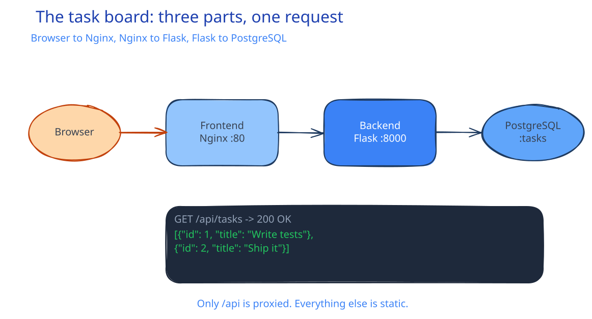

# ALL-00: Four careers, one project

**Introduction** · Focus: overview · About 15 minutes

You have a degree and no job yet. This course shows you what four tech jobs feel like by letting you do the work of each one on a single app.

| | |
|---|---|
| You need | Nothing. This episode is an overview. |
| You build | Nothing yet. You see the app and the plan. |
| Done when | You can name the four roles, the three parts of the app, and the four acts |

## What you will be able to do

- Name the four roles and what each one owns.
- Describe the task board and its three parts.
- Explain how the same app moves through four jobs.
- Decide which act matches the job you want.
- Explain how the CV skills ledger turns practice into evidence.

## Before you start

Nothing. This episode has no prerequisites. Episode 1 installs the tools.

## The four roles

Every software system needs four kinds of engineers. They work on the same product with different responsibilities.

| Act | Role | What they do | Main tools |
|---|---|---|---|
| 1 | Software Engineer | Write code, test it, package it | Git, Python, Flask, Docker, GitHub Actions |
| 2 | Cloud Engineer | Plan infrastructure, build and configure servers | Multipass, cloud-init, Ansible, Terraform, GCP |
| 3 | DevOps Engineer | Run systems on Kubernetes, scale and monitor them | Kubernetes, Minikube, ArgoCD, Prometheus, Grafana |
| 4 | Cybersecurity Engineer | Attack the app, then fix and harden it | Burp Suite, sqlmap, NetworkPolicies, Semgrep, Trivy, ZAP |

Each act is a new job. A different engineer joins the team in each act, and each one inherits the work of the previous team.

That structure answers a question a degree often leaves open: what does each job actually do all day? You do not read about the role. You do one task from it.

## The app

The app is a task board. It has three parts:

| Part | Technology | Job |
|---|---|---|
| Frontend | HTML, CSS, JavaScript, served by Nginx | Show the list and send API requests |
| Backend | Python Flask [[rest|REST API]] | Validate requests, run SQL, return JSON |
| Database | PostgreSQL | Store tasks in one table |

The app is deliberately small. A small app lets you see the whole system, and it leaves room for the infrastructure and security work in later acts.

### The API

The backend has a small surface:

| Method | Endpoint | Purpose |
|---|---|---|
| GET | `/healthz` | The process is alive |
| GET | `/readyz` | The database is reachable |
| GET | `/metrics` | Prometheus metrics |
| GET | `/api/tasks` | List all tasks |
| POST | `/api/tasks` | Create a task |
| PATCH | `/api/tasks/<id>` | Mark a task done or not done |
| DELETE | `/api/tasks/<id>` | Delete a task (you add this in Act 1) |
| GET | `/api/tasks/search?q=` | Search by title (later hacked, then fixed) |
| GET | `/api/demo/work` | CPU work for autoscaling demos |

The search endpoint is where Act 4 finds a SQL injection. The DELETE endpoint is where Act 1 starts. The API is the thread that connects the acts.

## The four acts

### Act 1: Software Engineer

You add `DELETE /api/tasks/<id>` and a delete button. You write unit tests with mocks, so the test needs no database. You write three Dockerfiles and a Compose file, so one command starts the stack. You add a GitHub Actions workflow, so every pull request runs the tests and builds the images.

What you practice: Git, Python, Flask, SQL, unit testing, Docker, CI.

### Act 2: Cloud Engineer

You plan the machine: CPU, memory, storage, firewall, [[cloud/cidr|CIDR]], DNS, and cost. Then you build the same machine twice. First on Multipass with cloud-init, then on Google Cloud with Terraform. Ansible configures it, and the playbook is idempotent, so a second run changes nothing.

What you practice: Multipass, cloud-init, Ansible, Terraform, GCP, Linux administration.

### Act 3: DevOps Engineer

You stop the VMs and move the app to Kubernetes on Minikube. You write Deployments, Services, ConfigMaps, Secrets, a StatefulSet, and a PersistentVolumeClaim. ArgoCD syncs the cluster from Git. A HorizontalPodAutoscaler adds Pods under load. Prometheus collects metrics, Grafana shows them, and Alertmanager sends an alert to Discord.

What you practice: Kubernetes, YAML, kubectl, ArgoCD, Prometheus, Grafana, autoscaling.

### Act 4: Cybersecurity Engineer

You attack the app, then defend it. You map the API, find the SQL injection in the search endpoint, and exploit it by hand and with sqlmap. Then you fix it with a parameterized query and default-deny NetworkPolicies. Semgrep checks the code, Trivy checks images and manifests, and ZAP checks the live app. A second bug, broken access control, adds authentication and ownership checks. Sealed Secrets keeps the fix out of Git history.

What you practice: penetration testing, SQL injection, sqlmap, NetworkPolicies, SAST, SCA, DAST, secret management.

## How the course works

Each act is a separate job. You can start at any act.

- Each act opens with a briefing: what happened before, the task, the goal, and what "done" means.
- Each act ends with a review and a resume checkpoint you can use on its own.
- The solved repository has one folder per act. If you skip ahead, copy the contents of the previous act folder to the root of your fork, not the folder itself.
- Your own repository is a fork of the starter repository.

The acts are independent enough to start anywhere, and connected enough that the same app carries through.

## What you need

The core path is free. Everything runs on your laptop.

| Tool | Used for | Cost |
|---|---|---|
| Docker Desktop and Minikube | Containers and a local Kubernetes cluster | Free |
| Multipass | Local Ubuntu VMs for Act 2 | Free |
| GitHub, Actions, GHCR | Fork, CI, and images | Free for public repositories |
| Google Cloud | Episode 10 only, the same work in the cloud | Free trial, card required |
| Laptop | macOS or Windows 10/11, 8 GB RAM, 30 GB disk | Free path for the core course |

If you have no Google Cloud account, watch Episode 10 and skip its hands-on part. Every Google Cloud step sets a budget alert first and ends with `terraform destroy`.

## The CV skills ledger

After each episode, you add a row to the skills ledger in your repository. The row has four columns: skill, episode, CV section, and an example bullet.

The ledger is not a certificate. It is evidence. Each row points to work you did, and each act ends with a resume checkpoint you can use on its own.

By the end, the ledger holds more than thirty skills, each with proof. Episode 26 turns the ledger into a finished CV.

## Common mistakes

- **Treating the course as a video series.** Watching builds recognition. Doing builds skill. Open the episode page and run the steps.
- **Skipping setup.** One missing tool stops every later act. Episode 1 exists to remove that risk.
- **Starting Act 3 with a short laptop.** Kubernetes needs memory. If Docker Desktop has less than 8 GB, Act 3 runs slowly or fails.
- **Skipping the Google Cloud cost guard.** A free trial still needs a budget alert and a `terraform destroy`.
- **Copying a later act folder without the previous one.** Each act folder is the app at that point. Start from the folder the act guide names.
- **Ignoring the ledger until the end.** You will not remember what each episode taught. Add the row while the work is fresh.

## Check your work

- [ ] You can name the four roles and one task each one does.
- [ ] You can name the three parts of the app and the language of each.
- [ ] You know which act matches the job you want to try first.
- [ ] You know the core path is free and which episode uses Google Cloud.
- [ ] You found the skills ledger in your repository.

## What this unlocks on your CV

No ledger rows yet. This episode is the map. The first row arrives in Episode 2, when you use Git and GitHub on a real change.

## Career note

The four roles are not four separate industries. They are four sets of responsibilities that meet on one product. A software engineer who understands the deployment, and a DevOps engineer who understands the code, are more useful than either alone. This course gives you one lap through all four.

## Next

Episode 1 installs five programs on your laptop. After that, every episode runs on your machine.
