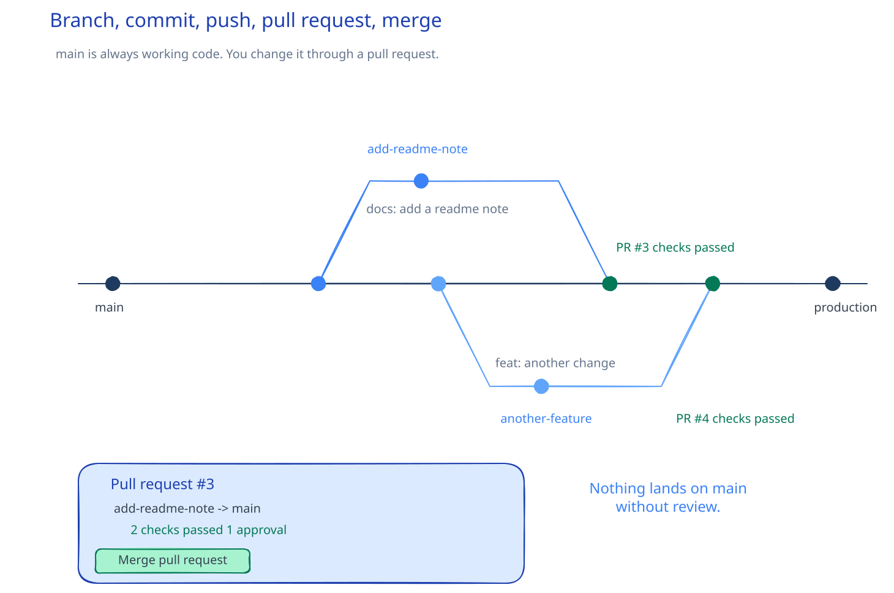

# SWE-02: Git and GitHub

**Act 1, Software Engineer** · Focus: full stack · About 13 minutes

You make one small change and take it through the same cycle a team uses: branch, commit, push, pull request, review, merge.

| | |
|---|---|
| You need | Episode 1 complete. Git is installed. You forked and cloned your repository. |
| You build | A branch with one commit, pushed to GitHub, merged through a pull request |
| Done when | The note is on `main`, the pull request is merged, and the branch is gone |

## What you will be able to do

- Fork and clone a repository.
- Create a branch that isolates one change.
- Commit with a message a stranger can understand.
- Push a branch to GitHub.
- Open a pull request and review the diff.
- Merge the pull request and update your local `main`.
- Explain why teams never commit to `main`.

## Before you start

- You finished Episode 1. Git and VS Code are installed.
- You forked the course repository and cloned your fork.
- You can open a terminal in the repository folder.

## Why branches protect main

`main` is the code that works. Every person on the team can build from it at any time. If everyone changed it directly, a broken change would block the whole team.

A branch is a copy of `main` where you work. The team reviews the branch before it joins `main`. Three things follow:

1. `main` stays releasable.
2. Review catches bugs early. A second reader sees what the author missed.
3. History becomes an audit trail. Small commits explain how the code changed and why.

The cycle has one direction:

## The seven terms

| Term | Meaning |
|---|---|
| Repository | A folder that Git tracks, with its full history. |
| Commit | A snapshot of your changes, with a unique ID and a message. |
| Branch | A separate line of work. `main` is one branch. |
| Remote | The copy on GitHub. `origin` is the usual name. |
| Fork | Your own copy of another person's repository. |
| Pull request | A request to review and merge one branch into another. |
| Merge | Combine the changes from one branch into another. |

## The cycle, step by step

### 1. Start from a clean `main`

Before you branch, make sure `main` is current. You want your change to start from the latest code, not from an old copy.

### 2. Create a branch

A branch name states the change: `add-readme-note`, `delete-task`, `fix-login-redirect`. A good name answers "what is this branch for" before anyone opens it.

Creating a branch does not copy the files. Git records a new pointer to the same commit. That is why a branch is cheap.

### 3. Make one change

Keep the change small. A branch should do one thing. A reviewer can hold one idea in mind, and a failure is easy to find.

### 4. Stage and commit

Staging selects the changes that go into the next snapshot. A commit records that snapshot locally. It does not reach GitHub yet.

The commit message describes the result, not the activity:

| Weak | Strong |
|---|---|
| `fix stuff` | `Fix race condition in startup` |
| `update` | `Add delete endpoint for tasks` |
| `asdf` | `Validate task title before insert` |

Write the message in the present tense, as if the commit completes a sentence: "Add a note to the README." A reader in two years understands the change without opening the diff.

### 5. Push the branch

The first push sends your branch to GitHub and links the local branch to the remote one. After that link exists, a plain push is enough.

The remote is a backup and a meeting point. Nothing on your laptop is visible to a reviewer until you push.

### 6. Open a pull request

A pull request compares two branches: the source branch and the target, usually `main`. It shows the diff, the commits, and the checks.

The title and description are for the reviewer. State what changed and why. Link the related issue if one exists.

### 7. Review

Review is reading the diff with intent. A reviewer asks:

- Does the change do what the description says?
- Is there a case the author missed?
- Is there a simpler way?
- Do the checks pass?

On your own fork, you are the reviewer. Read the diff before you merge. You are practicing the habit, and the habit is the point.

### 8. Merge

A merge brings the branch commits into `main`. GitHub then offers to delete the branch. Delete it. The commit remains in history, so nothing is lost.

### 9. Return to `main`

Switch back to `main` and pull. Your local copy now has the change. The next branch starts from here.

## Why the commit history matters

Git stores every commit. A future reader can see when a line changed, who changed it, and the message that explained it. That is the audit trail.

A history of small commits with clear messages answers questions that code alone cannot:

- When did this behavior change?
- Was this deliberate?
- Which change introduced the bug?

A history of "wip" and "fix" messages answers none of them. The cost of a good message is ten seconds. The cost of a bad history is an afternoon.

## Common mistakes

- **Committing to `main`.** Create the branch before the first change. If you already committed, move the commit to a branch before you push.
- **Forgetting the upstream link on the first push.** The first push needs the remote and branch name. After that, Git remembers.
- **A vague commit message.** "Fix stuff" tells a reviewer nothing. Name the result.
- **Merging without reading the diff.** Review is not a click. Read the change you are about to keep.
- **One giant branch.** A branch with five unrelated changes is hard to review and hard to revert.
- **Working on an old `main`.** Switch to `main` and pull before you branch.
- **Windows: the wrong `curl`.** PowerShell 5.1 maps `curl` to an alias. Use `curl.exe` when a command expects the real program.

## Check your work

- [ ] The branch name describes the change.
- [ ] The commit message states the result in the present tense.
- [ ] The branch exists on GitHub.
- [ ] The pull request shows one focused diff.
- [ ] You read the diff before you merged.
- [ ] `main` on your laptop contains the change after the pull.
- [ ] The merged branch is deleted.

## What this unlocks on your CV

| Skill | Episode | CV section | Example bullet |
|---|---|---|---|
| Git, GitHub | 2 | Programming and tools | Managed changes with feature branches, pull requests, and review on GitHub |

## Career note

Software engineers run this cycle many times a day. Every change goes through review. No one commits directly to `main`. Teams stay organized because the workflow is boring and repeatable, not because everyone is careful.

## Next

Episode 3 runs the app. You start the database, the backend, and the frontend in three containers on one private network.

## Apply

The verified steps for this episode are in [Act 1, Episode 2](../act1-software-engineer.md#episode-2-git-and-github). Follow the tasks in order.

<!-- APPLY -->

### What you should see

| After | You should see |
|---|---|
| You create the branch | The prompt shows the branch name. |
| You commit | `1 file changed, 1 insertion(+)` |
| You push | The terminal reports the new branch on `origin`. |
| You open the pull request | GitHub shows the diff and the merge button. |
| You merge | The pull request is closed and `main` contains the change. |
| You pull on `main` | The README note is on your laptop under `main`. |

An end-to-end run of this episode on the starter code passed with a local remote: branch, commit, push, and merge all worked. The GitHub web flow was not exercised in that run.
