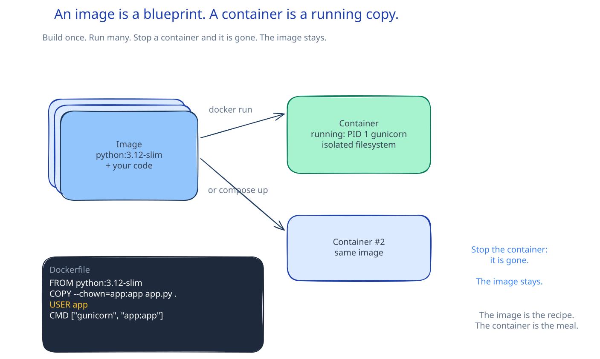

# SWE-03: Run the app

**Act 1, Software Engineer** · Focus: full stack · About 15 minutes

You run the task board: a database, a Python API, and a web server, each in its own container, all on one private network.

| | |
|---|---|
| You need | Episode 1 complete. Docker Desktop is running. Episode 2 complete, so the repository is on your laptop. |
| You build | Three containers on one Docker network, with the app reachable at `http://localhost:8080` |
| Done when | `/readyz` returns `{"status":"ready"}`, the task board loads, and you can add a task |

## What you will be able to do

- Tell an image apart from a container.
- Create a Docker network and explain why names work on it.
- Start PostgreSQL, Flask, and Nginx with the right ports, volumes, and variables.
- Explain the difference between alive and ready.
- Call the API with `curl` and read the JSON.
- Clean up containers and the network.

## Before you start

- Docker Desktop is installed and shows "Engine running".
- You cloned your fork in Episode 2.
- You can open a terminal in the repository folder.

## Image and container

An image is a template. It holds the filesystem and the start command. A container is a running instance of that image, with its own process, network, and writable layer.

| Image | Container |
|---|---|
| A template, stored on disk or in a registry | A running process |
| Stays after the container stops | Disappears when removed |
| Built once, reused many times | Started, stopped, and replaced |

A class and an object is a close analogy. The image is the definition. The container is one live instance.

The three images in this episode come from Docker Hub: `postgres:16-alpine`, `python:3.12-slim`, and `nginx:1.27-alpine`.



## One network, three names

By default, containers cannot reach each other by name. Each one sits in its own network namespace with its own address.

A user-defined Docker network changes that. Docker runs a small DNS server on the network. A container joins the network with a name, and every other container on that network can resolve the name.

That is why the backend connects to host `database`, not to an IP address:

| Approach | Problem |
|---|---|
| Hard-code an IP address | The address changes when the container restarts. |
| Use a container name on a shared network | Docker resolves the name to the current address. |

Name discovery is the reason the three commands share one `--network` value. A typo in one name breaks the chain.

## Ports: laptop to container

A container has its own network. A published port forwards one port on your laptop to one port in the container.

`-p 8000:8000` means: listen on port 8000 on the laptop, and send that traffic to port 8000 inside the container. The two numbers do not have to match. `-p 8888:80` would put Nginx on port 8888 on the laptop and still use port 80 inside.

Only the frontend and the backend need published ports. The database talks to the backend inside the network, so it stays private. Fewer open ports means fewer ways in.

## Volumes: files that survive

A container's writable layer disappears with the container. A volume mount shares a file or folder from your laptop.

This episode mounts three things:

| Mount | Why |
|---|---|
| `database/init.sql` read-only | PostgreSQL runs the file once, on first start, to create the table. |
| `backend/` into `/app` | Flask reads your code. A change on the laptop appears in the container. |
| Frontend files and `nginx.conf` read-only | Nginx serves the static files and the proxy rules. |

`init.sql` runs only when the database volume is empty. On a later start, PostgreSQL sees existing data and skips it. That behavior matters when you change the schema.

## Environment variables

An environment variable passes configuration into the container at start. The same backend image can point at a test database or a production database without a rebuild.

The backend needs two values here:

- `DB_HOST=database` tells Flask where to find PostgreSQL. It is the container name on the shared network.
- `DB_PASSWORD` must match the password given to PostgreSQL.

A mismatch does not stop the containers. The backend starts, then fails when it tries to connect. That is why the readiness check matters.

## Alive is not ready

The backend has two health endpoints, and they answer different questions:

| Endpoint | Question | Use |
|---|---|---|
| `/healthz` | Is the process alive? | Restart the process if it fails. |
| `/readyz` | Can it reach the database? | Send traffic only when it succeeds. |

The backend installs Python packages and starts Flask after the container starts. That takes time. During that window the process may be alive but not ready. A client that sends traffic too early gets an error.

Poll `/readyz` until it returns `{"status":"ready"}`. A load balancer or Kubernetes probe does the same thing automatically in later acts.

## The three services

| Service | Image | Port on laptop | Talks to |
|---|---|---|---|
| Database | `postgres:16-alpine` | none | Backend, by container name |
| Backend | `python:3.12-slim` | 8000 | Database |
| Frontend | `nginx:1.27-alpine` | 8080 | Backend, by service name |

Start them in dependency order: network, database, backend, frontend. The backend can start before the database is ready, but it cannot serve until the database answers.

## Why `curl` the API directly

The browser shows the result of the frontend code. `curl` shows the API response without the frontend. When something looks wrong, the two views separate the layers:

- `curl /api/tasks` fails: the problem is the backend or the database.
- `curl` works but the browser does not: the problem is the frontend or the proxy.

That habit becomes a debugging loop in later acts.

The API returns JSON in a fixed shape. A task looks like this:

```json
[
  {
    "id": 1,
    "title": "Learn Docker",
    "done": false
  }
]
```

The frontend parses the array and renders one row per object. The same response from `curl` proves the backend and the database agree.

## Common mistakes

- **Starting the containers on different networks.** They cannot resolve each other's names. Create the network first, then use the same `--network` value everywhere.
- **A name mismatch.** `--name database` but `DB_HOST=db` fails. The name is the address.
- **Port 8080 or 8000 already in use.** The container fails to start. Publish a different laptop port, such as `-p 8888:80`.
- **Calling the backend before it is ready.** The package install takes time. Poll `/readyz`.
- **Expecting `init.sql` to run again.** It runs only on an empty database volume.
- **Deleting containers but not the network.** Leftover networks and volumes consume space. Clean both.
- **Windows: the wrong `curl`.** Use `curl.exe` in PowerShell 5.1.

## Check your work

- [ ] The Docker network exists.
- [ ] Three containers run on that network.
- [ ] `curl http://localhost:8000/readyz` returns `{"status":"ready"}`.
- [ ] `curl http://localhost:8000/healthz` returns `{"status":"ok"}`.
- [ ] `http://localhost:8080` shows the task board.
- [ ] A new task appears in the list.
- [ ] `curl http://localhost:8000/api/tasks` returns a JSON array.
- [ ] The containers and the network are removed at the end.

## What this unlocks on your CV

| Skill | Episode | CV section | Example bullet |
|---|---|---|---|
| Docker | 3 | Containers and orchestration | Ran a three-tier app (Nginx, Flask, PostgreSQL) on a private container network with named service discovery |
| SQL, PostgreSQL | 3 | Programming and scripting | Ran PostgreSQL with an initialisation script and read data through a parameterised API |

## Career note

Every engineer on a team runs the full stack locally. You change code, see the result, and push when it works. CI then runs the same tests and containers on a clean machine. This episode is the foundation for every later act.

## Next

Episode 4 adds a feature to this stack: a delete endpoint, two tests, and a button.

## Apply

The verified steps for this episode are in [Act 1, Episode 3](../act1-software-engineer.md#episode-3-run-the-app). Follow the tasks in order.

<!-- APPLY -->

### What you should see

| After | You should see |
|---|---|
| You create the network | Docker prints a network ID. |
| You start each container | Docker prints a container ID. |
| You poll `/readyz` | `{"status":"ready"}` |
| You open port 8080 | The task board with an input field and an empty list. |
| You add a task | The task appears in the list. |
| You call `/api/tasks` | A JSON array with the task |
| You call `/healthz` | `{"status":"ok"}` |
| You remove the containers and network | `docker ps` shows no course containers. |

An end-to-end run of this episode on the starter code passed with the laptop ports remapped: three containers started, `/readyz` returned `{"status":"ready"}`, the frontend returned 200, and a task could be created and listed.
