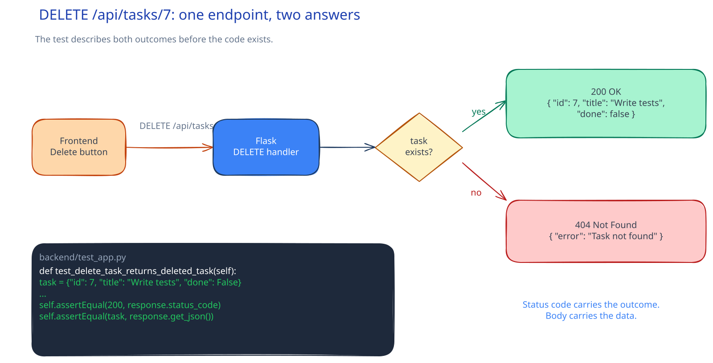

# SWE-04: Add a feature with a test

**Act 1, Software Engineer** · Focus: backend, then frontend · About 12 minutes

You add a delete feature to the task board. You write the test before the code, watch the test fail, then make it pass. This is the workflow a software team uses every day.

| | |
|---|---|
| You need | Episodes 2 and 3 complete. The app from Episode 3 starts with the commands in that episode. |
| You build | `DELETE /api/tasks/<id>`, two unit tests, and a Delete button in the browser |
| Done when | The endpoint returns 200 for a task and 404 for a missing task, all tests pass, and the button removes a task |

## What you will be able to do

- Describe a feature as a contract before you write code.
- Write a REST endpoint that deletes one row and returns the deleted row.
- Write unit tests that mock the database layer.
- Explain why a missing resource returns 404, not 200.
- Explain HTTP [[status-code|status codes]] and REST semantics: methods name the action, resources name the thing.
- Explain test-first thinking: red, green, refactor.
- Review and merge one small pull request.

## Before you start

- You finished Episode 2. You can create a branch, commit, and push.
- You finished Episode 3. The task board runs locally.
- You can read a Python function and a short SQL statement.

## Why write the test first

A feature is not done until it is tested. Three problems come from code without tests:

1. You cannot change the code later without the risk of breaking old behavior.
2. Nobody can read the code and know what the API promises.
3. A bug reaches a user before anyone sees it.

A test states the promise in code. `DELETE /api/tasks/7` returns the deleted task with status 200. `DELETE /api/tasks/999` returns status 404. When you write the test first, you decide the promise before you write the implementation. The test becomes the first review of the design.

Test-first has one more benefit. You see the test fail for the reason you expect. A test that has never failed may be testing nothing.

The cycle has three steps:

| Step | Name | What you do |
|---|---|---|
| 1 | Red | Write a test that fails because the feature is missing. |
| 2 | Green | Write the smallest code that makes the test pass. |
| 3 | Refactor | Clean the code without changing behavior. The test proves you did not break it. |

## The feature

The task board can create and update tasks. It cannot delete them. You add one endpoint:

| Request | Result |
|---|---|
| `DELETE /api/tasks/7` when task 7 exists | Status 200 and the deleted task as JSON |
| `DELETE /api/tasks/999` when task 999 does not exist | Status 404 and an error message |
| `DELETE /api/tasks/7` when task 7 was already deleted | Status 404 |

### Why the status code matters

The status code is part of the API contract. A client does not read your code. It reads the status code.

| Code | Meaning | Use here |
|---|---|---|
| 200 | OK | The task was found and deleted. |
| 404 | Not found | The task does not exist. |
| 500 | Server error | The database failed. The client should retry later. |

If the endpoint returned 200 for a missing task, the frontend would show success and remove a row that was never there. The bug would look like a display problem. The contract would be wrong.

## The test, explained

The test replaces the database with a fake object. The endpoint then runs its real logic: it calls `execute`, reads one row, and decides the status code. Only the database is fake.

### The fake connection

The endpoint uses `with connect_to_database() as connection`. That line calls `__enter__` on the connection object. Inside the block it calls `.execute(...)`, then `.fetchone()`. The fake object must follow the same chain, or the endpoint fails for the wrong reason.

`MagicMock` builds that chain automatically. The helper sets the last link, `fetchone`, to return a chosen row. The helper is small on purpose: it models only the calls this endpoint makes.

### The patch path

`patch("app.connect_to_database")` replaces the name `connect_to_database` inside the module `app`. Use the module where the function is looked up, not where it is defined.

| Patch target | Result |
|---|---|
| `app.connect_to_database` | The endpoint uses the fake. Correct. |
| `backend.app.connect_to_database` | The endpoint keeps the real function. The test tries a real database. |
| `connect_to_database` in the test file | The endpoint keeps the real function. |

### The two assertions

Each test asserts two facts: the status code and the body.

- The success test returns a task object from `fetchone` and expects status 200 with the same JSON.
- The missing-task test returns `None` from `fetchone` and expects status 404.

The second test is the one people skip. It is also the one clients hit most often. A delete request often refers to a row that another user already removed.

### Why mock the database

A unit test should test one unit: the endpoint logic. A real database adds three problems:

- It must be running, so the test is slower and less reliable.
- Its contents change, so the result depends on state.
- A failure may come from the database, not from your code.

The mock removes the database and keeps the decision you want to test: what to return when a row exists, and what to return when it does not.

## The endpoint, explained

Two details carry the design.

`DELETE ... RETURNING` deletes the row and returns it in one query. Without `RETURNING`, you would `SELECT` the row first, then delete it. Another client could change the row between the two statements. One statement removes that gap.

`fetchone()` returns `None` when no row matched. That is the only signal the endpoint needs. A missing row means the task did not exist, so the answer is 404. A returned row means the delete happened, so the answer is 200 with the row.

The route parameter is an `int`. A request such as `/api/tasks/abc` never reaches the function. Flask returns 404 for it. A bad type is not a server error.

## The frontend, explained

The Delete button does three things:

1. It sends `DELETE /api/tasks/<id>` with `fetch`.
2. It waits for the response.
3. It reloads the list only when the response is OK.

Reloading after success shows the server state. The UI does not guess. If the request fails, the error appears in the status line and the row stays.

The button also has an `aria-label` with the task title. A screen reader then says "Delete Write tests", not just "Delete". The label is part of the feature, not decoration.

`type="button"` stops the browser from treating the button as a form submit. Without it, a click can reload the page and hide the result.

## Apply

The verified steps for this episode are in [Act 1, Episode 4](../act1-software-engineer.md#episode-4-add-a-feature-with-a-test). Follow the tasks in order. Each task has a solution you can open when you are stuck.

<!-- APPLY -->

### What you should see

| After | You should see |
|---|---|
| You run the tests before writing the endpoint | Two failures. The route does not exist yet. |
| You write the endpoint and run the tests again | `Ran 5 tests ... OK` |
| You delete an existing task | Status 200 and the deleted task as JSON |
| You delete a task that does not exist | Status 404 and an error message |
| You select Delete in the browser | The task disappears and the list refreshes |

An end-to-end run of this episode on the starter code passed: the test run reported `Ran 5 tests ... OK`, and delete worked through Nginx.

## Common mistakes

- **Writing the endpoint before the test.** The test then describes code you already wrote, and it may pass for the wrong reason.
- **Patching the wrong name.** Use `app.connect_to_database`. The endpoint looks up the name inside `app.py`.
- **Asserting only the response body.** Assert the status code too. The status is part of the contract.
- **Testing only success.** A success-only test misses the 404 path, which is the path most clients hit.
- **Forgetting to append the button.** The element exists in memory but never reaches the page. Replace the existing `item.append(...)` line.
- **Returning 200 for a missing task.** The client learns the wrong fact and hides a bug.
- **Changing the test to match the code.** Fix the code unless the test states the wrong contract. If the contract changed, change the test first, then the code.

## Check your work

- [ ] The two new tests fail before you add the endpoint.
- [ ] The test run ends with `OK` and a test count five higher than the Episode 3 count.
- [ ] A delete of an existing task returns 200 and the deleted task.
- [ ] A delete of a missing task returns 404.
- [ ] The Delete button removes a task and the list refreshes.
- [ ] The branch has one commit with the endpoint, the tests, and the button.
- [ ] The pull request is merged.

## What this unlocks on your CV

Add these rows to your skills ledger:

| Skill | Episode | CV section | Example bullet |
|---|---|---|---|
| Python, Flask | 4 | Programming and scripting | Built a REST endpoint in Flask with correct status codes and a single-query delete |
| Unit testing (unittest, mocks) | 4 | Programming and scripting | Covered API success and error behavior with unit tests that mock the database layer |

## Career note

Software engineers write tests alongside the code. Tests are not a separate task for a later sprint. When a change breaks a test, CI tells the team before the change merges. You practiced that discipline here.

## Next

Episode 5 packages the app. You write one Dockerfile per service, write `compose.yaml`, and start the whole stack with one command.
