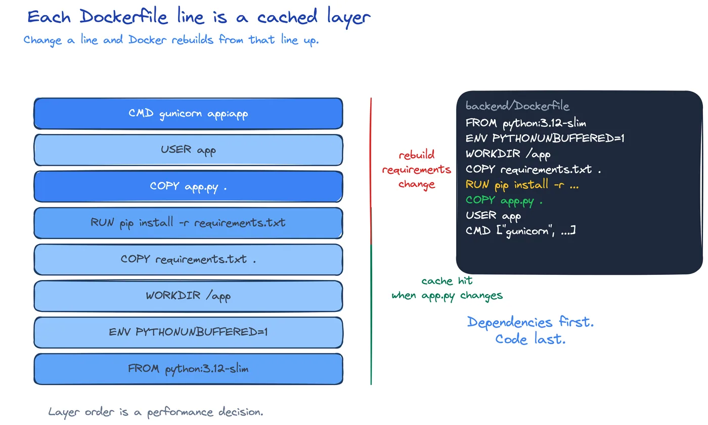

# SWE-05: Containers

**Act 1, Software Engineer** · Focus: full stack · About 15 minutes

In Episode 3 you started three containers with three long commands. One typo broke the stack. This episode replaces those commands with three Dockerfiles and one Compose file, so the whole stack starts with one command.

| | |
|---|---|
| You need | Episode 3 complete. You ran the containers by hand. Episode 4 complete. The delete feature works. |
| You build | One Dockerfile per service, a `compose.yaml` with health-gated startup, and a `.env` file |
| Done when | `docker compose up --build` starts the stack and the task board works at `http://localhost:8080` |

## What you will be able to do

- Explain how image layers and the build cache work.
- Write a Dockerfile that installs dependencies before it copies code.
- Run a container as a non-root user.
- Pin a base image tag and explain why `latest` is a risk.
- Define three services in `compose.yaml` with ports, volumes, and variables.
- Gate startup on a health check, not on a fixed sleep.
- Build, start, inspect, and clean a multi-service stack.

## Before you start

- Episode 3 complete. You can run the three containers manually.
- Episode 4 complete. The endpoint and the tests work.
- You can read a short YAML file.

## Why recipes beat long commands

A long `docker run` command is a program you type once and forget. It has no version history, no review, and no reuse. The next person copies it from a chat message and makes a typo.

Two files replace it:

| File | Purpose |
|---|---|
| Dockerfile | A recipe for one image. |
| `compose.yaml` | A declaration of the whole stack: services, ports, volumes, order. |

The Dockerfile is versioned with the code. The Compose file states the wiring. A new team member clones the repository, sets one password, and runs one command.

## Layers and the build cache

A Dockerfile is a list of steps. Each step creates a layer. Docker stores each layer and reuses it when the inputs have not changed.



The order of the steps controls the cache. This order is fast:

```dockerfile
COPY requirements.txt .
RUN pip install --no-cache-dir -r requirements.txt
COPY --chown=app:app app.py .
```

A change to `app.py` reuses the dependency layer. Only the last copy runs again.

This order is slow:

```dockerfile
COPY . .
RUN pip install -r requirements.txt
```

A change to any file invalidates the copy layer, and the install runs again. On a small app the difference is seconds. On a real app it is minutes on every push.

The rule: put the things that change least at the top.

## Base images and tags

The first line names the image you build on:

| Service | Base image | Why |
|---|---|---|
| Backend | `python:3.12-slim` | Python and pip, without the full Debian toolchain. |
| Frontend | `nginx:1.27-alpine` | A small Nginx with a shell. |
| Database | `postgres:16-alpine` | PostgreSQL 16 with a small base. |

A tag pins a version. `python:latest` moves to a new release without a change in your repository. A build that worked last month can break today. Pin the version you tested.

`-slim` and `-alpine` variants remove tools you do not need. A smaller image pulls faster and has fewer packages to patch.

## Run as a non-root user

By default, a container process runs as root inside its namespace. A bug or a compromised dependency then has root rights inside the container. That is more room to move than the task needs.

The backend Dockerfile creates a user and switches to it:

```dockerfile
RUN groupadd --system app \
    && useradd --system --gid app --home-dir /app app
COPY --chown=app:app app.py .
USER app
```

`--chown=app:app` makes the files owned by the user that will read them. `USER app` changes the process user for every later instruction and for the container start.

This is least privilege at the process level. It does not replace a network policy or a read-only filesystem, which arrive in Act 4.

## The Compose file

Compose turns three containers into one declared stack. Each entry under `services` becomes one container.

### Services and build context

`build: ./backend` tells Compose to build the image from the Dockerfile in that folder. The service name becomes the DNS name on the stack network. The backend reaches PostgreSQL at host `database` because that is the service name.

### Health-gated startup

`depends_on` has two forms, and they are not equal:

| Form | Meaning |
|---|---|
| `depends_on: [database]` | Start the backend after the database container starts. |
| `condition: service_healthy` | Start the backend after the database health check passes. |

The database takes a few seconds to accept connections. The first form starts the backend too early, and the backend fails to connect. The second form waits for this check:

```yaml
healthcheck:
  test: ["CMD-SHELL", "pg_isready -U tasks -d tasks"]
  interval: 5s
  timeout: 3s
  retries: 10
```

A health check is a command that answers "ready?". Compose runs it on an interval and marks the service healthy when it passes.

### Volumes

A named volume keeps data across container restarts:

```yaml
volumes:
  - database-data:/var/lib/postgresql/data
```

The name is declared at the bottom of the file. `docker compose down` removes the containers but keeps the volume. `docker compose down -v` removes the volume too.

Persistence is a choice. Keep the volume in development so your data survives a restart. Remove it in a test so every run starts clean.

### Environment and secrets

The Compose file reads `DB_PASSWORD` from `.env`:

```yaml
POSTGRES_PASSWORD: ${DB_PASSWORD:?Set DB_PASSWORD in .env}
```

The `:?` makes the variable required. Compose stops with a message if it is missing. That is better than starting with an empty password.

`.env` is in `.gitignore`. `.env.example` is the template in Git. A secret in a Git file is in history forever, even after you delete the line.

### Ports

Only the frontend publishes a port in this stack. The backend and the database talk on the Compose network. A published port is a door from the laptop into the container. Open the doors you need and no more.

## The lifecycle

| Action | Command shape | Effect |
|---|---|---|
| Build and start | `docker compose up --build` | Rebuilds changed images, starts services in order, shows logs. |
| Follow one service | `docker compose logs backend -f` | Streams the backend log. |
| Stop | `Ctrl+C` in the Compose terminal | Stops the containers. |
| Remove | `docker compose down` | Removes containers and the network, keeps the volume. |
| Remove with data | `docker compose down -v` | Also removes the volume. |

`--build` matters after a Dockerfile change. Without it, Compose reuses the old image and your change does not appear.

## Common mistakes

- **Copying code before installing dependencies.** The dependency layer is invalidated on every code change, and every build is slow.
- **Running as root.** Create the user and switch to it. A root process inside the container is a larger blast radius.
- **Using `latest`.** Pin the version. An unpinned tag changes without a commit.
- **Forgetting `--build`.** The change is in the file, not in the running image.
- **A plain `depends_on` list.** It waits for the container, not for readiness. Use the health condition.
- **Committing `.env`.** It holds the password. Commit `.env.example` only.
- **`down` without `-v` when you wanted a clean database.** The old volume keeps the old data and the old schema.
- **Windows: shell variable syntax.** Compose uses `${VAR}`. PowerShell uses `$env:VAR`. Do not mix them.

## Check your work

- [ ] Three Dockerfiles exist, one per service.
- [ ] Each base image has a pinned tag.
- [ ] The backend runs as a non-root user.
- [ ] `compose.yaml` defines three services and one named volume.
- [ ] The database has a health check.
- [ ] The backend waits for `service_healthy`.
- [ ] `.env` exists and `.env.example` is the only one in Git.
- [ ] `docker compose up --build` starts the stack.
- [ ] The task board loads and add and delete work.
- [ ] `docker compose down -v` removes the containers and the volume.

## What this unlocks on your CV

| Skill | Episode | CV section | Example bullet |
|---|---|---|---|
| Docker | 5 | Containers and orchestration | Containerized a three-tier app with non-root images and cache-friendly layer order |
| Docker Compose | 5 | Containers and orchestration | Defined a multi-service stack with health checks and startup order in Docker Compose |

## Career note

Software engineers write the Dockerfiles and the Compose file so the whole team can run the app locally. A new member clones the repository, copies one file, and starts the stack in one command. That removes a day of setup and a class of "works on my machine" bugs.

## Next

Episode 6 adds continuous integration. Every pull request runs the tests and builds the images automatically.

## Apply

The verified steps for this episode are in [Act 1, Episode 5](../act1-software-engineer.md#episode-5-containers). Follow the tasks in order.

<!-- APPLY -->

### What you should see

| After | You should see |
|---|---|
| You copy `.env.example` to `.env` | The file exists and is ignored by Git. |
| You run `docker compose up --build` | Three images build, then three services start. |
| The database becomes healthy | The backend starts after it. |
| You open port 8080 | The task board loads. |
| You add and delete a task | Both work through Nginx. |
| You run `docker compose down -v` | Containers and the volume are gone. |

An end-to-end run of this episode on the starter code passed: three Dockerfiles built, the stack started, and add and delete worked through Nginx.
