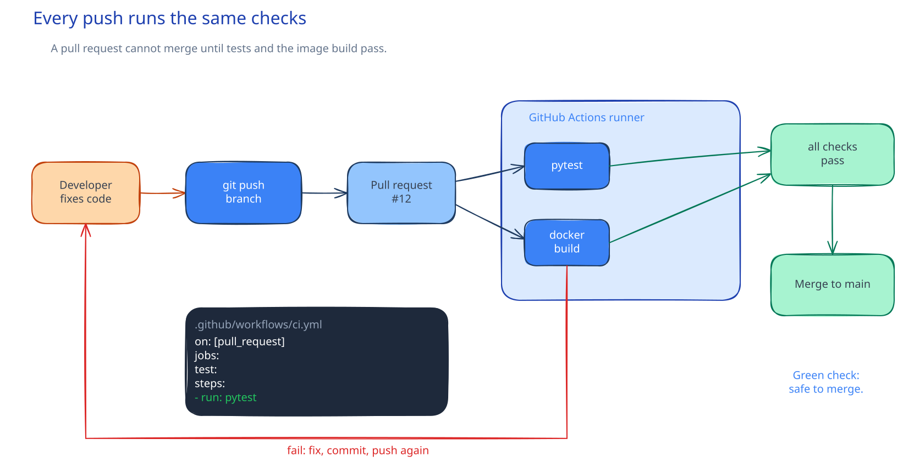

# SWE-06: Continuous Integration

**Act 1, Software Engineer** · Focus: full stack · About 18 minutes

You add a gate between a developer and `main`. Every pull request runs the tests and builds the images automatically. A red check blocks the merge; a green check permits it.

| | |
|---|---|
| You need | Episode 4 complete. The tests pass. Episode 5 complete. The Compose stack builds. Episode 2 complete. You can open a pull request. |
| You build | `.github/workflows/ci.yml` with a test job and a build job |
| Done when | A pull request shows two green checks, and a deliberately broken test turns one red |

## What you will be able to do

- Explain what a workflow, a job, a step, and a runner are.
- Write a workflow that runs on pull requests and on push to `main`.
- Run tests and build images on a clean machine.
- Apply [[cloud/principle-of-least-privilege|least privilege]] with `contents: read`.
- Read a status check and the job log.
- Break a test on purpose, watch CI fail, and fix it.
- Explain why professional teams do not run tests by hand.

## Before you start

- Episode 4 complete. `python-test` passes locally.
- Episode 5 complete. `docker compose build` works.
- Episode 2 complete. You know the branch and pull request flow.
- You can push a branch to your fork.

## CI is the gate

A developer pushes a branch. GitHub detects the push and starts the workflow. A runner, a clean machine owned by GitHub, checks out the code. It runs the tests and builds the images.

The result appears on the pull request as a status check.



Three facts follow from the clean machine:

1. The result does not depend on what is installed on your laptop.
2. Every change gets the same checks, including changes from people you have never met.
3. A failure is visible before the merge, not after a release.

Local tests are still faster for the inner loop. CI is the gate that everyone passes.

## The vocabulary

| Term | Meaning |
|---|---|
| Workflow | A YAML file in `.github/workflows/` that GitHub Actions runs. |
| Job | A unit of work that runs on one runner. Jobs can run in parallel. |
| Step | One command or one action inside a job. |
| Runner | The machine that runs a job, here a GitHub-hosted Ubuntu machine. |
| Trigger | The event that starts the workflow, such as a pull request. |
| Permission | What the workflow may do in the repository. |
| Action | A reusable step, such as `actions/checkout`. |
| Status check | The pass or fail shown on the pull request. |

## The flow

1. The workflow triggers on `pull_request` and on `push` to `main`.
2. The `test` job checks out the code, installs Python 3.12, installs the requirements, and runs the unit tests.
3. The `build` job checks out the code and runs `docker compose build`.
4. GitHub reports both jobs as status checks.
5. A red check blocks the merge. A green check permits it.
6. After the merge, the push to `main` runs the workflow again.

Steps 2 and 3 are separate jobs on purpose. They can run in parallel, and a failure names the phase: tests failed, or the image build failed.

## Why two jobs

| Job | Question it answers | Fails when |
|---|---|---|
| `test` | Does the code behave? | A unit test fails or the code does not import. |
| `build` | Can the image be produced? | A Dockerfile is wrong, a dependency is missing, or the build context is broken. |

A single job would still run both, but the report would be one status. Two jobs tell the reviewer which kind of problem exists before they open the log.

## Least privilege

A workflow has a token with permissions in your repository. The default may be broader than the workflow needs.

The test and build jobs only read the code. They do not push, comment, or release. So the workflow asks for one permission:

```yaml
permissions:
  contents: read
```

This is least privilege. If a third-party action is compromised, it holds a token that can read, not write. It cannot push a commit to `main`.

The rule is simple: start with no write permission. Add one only when a step proves it needs one.

## The build job needs a password

Compose refuses to start without `DB_PASSWORD`, even for a build. The workflow provides a dummy value for the build step:

```yaml
- run: docker compose build
  env:
    DB_PASSWORD: ci-only
```

`ci-only` is not a secret and is not used by a running service. It exists to satisfy the Compose variable check during the build.

Do not put a real credential in the workflow file. A workflow file is code in Git. A secret in Git stays in history. Real secrets belong in GitHub Secrets or, later in this course, in Sealed Secrets.

## Reading a failed check

When a job fails, the status check turns red and the pull request cannot merge. Do not guess. Open the job log and find the first failing step.

A useful order:

1. Which job failed, `test` or `build`?
2. Which step failed: checkout, setup, install, test, build?
3. What is the first error line, not the last?
4. Can you reproduce it locally with the same command?

The log is the evidence. A reviewer reads the log before reading the code change.

## Break it on purpose

A green check proves the pipeline runs. It does not prove the gate works. To prove the gate, make a test fail on purpose.

The workflow should turn red, and the merge button should refuse. Then fix the assertion and push again. The workflow runs on the new commit and turns green.

This exercise teaches two things:

- The check is connected to the pull request, not a separate page.
- The fix is a new commit, not an edit to the old one. Git keeps the history of both.

## What CI does not do

CI verifies what you wrote. It does not invent the fix. A test that asserts the wrong behavior passes forever. A flaky test blocks the team and teaches people to ignore red checks.

CI is a gate, not a substitute for local discipline or review.

## Act 1 review

You started with an app that could not delete a task and had no tests, no images, and no automated checks. You finish with:

| Task | What you did | What you achieved |
|---|---|---|
| Ship a delete feature | A DELETE endpoint, two mocked tests, a button | A tested feature through a pull request |
| Package the app | Three Dockerfiles and a Compose file | One command starts the stack |
| Add checks | A GitHub Actions workflow | Every pull request is tested and built |

If you stop here, you have a complete CV for a junior software engineer role.

## Common mistakes

- **Forgetting `DB_PASSWORD` in the build job.** Compose stops with the required-variable error.
- **Requesting write permission you do not use.** Start from `contents: read` and add only what a step needs.
- **Hard-coding a real secret in the workflow.** The file is in Git. Use a dummy value for a build, or GitHub Secrets for a real one.
- **Triggering only on push.** Add `pull_request`, or the gate never runs before the merge.
- **Omitting `actions/checkout`.** The runner starts with an empty folder.
- **Using `python:latest` in `setup-python`.** Pin `3.12` so the runner matches your laptop.
- **Reading only the last log line.** The first error explains the failure. The rest is noise.
- **Assuming the runner is your laptop.** It is Linux. A Windows-only command fails there.
- **Ignoring a flaky test.** The team learns to ignore red. Fix or remove the test.

## Check your work

- [ ] `.github/workflows/ci.yml` exists on a branch.
- [ ] The workflow triggers on `pull_request` and on push to `main`.
- [ ] The workflow sets `contents: read`.
- [ ] The `test` job installs Python 3.12 and runs the unit tests.
- [ ] The `build` job runs `docker compose build` with a dummy password.
- [ ] The pull request shows two checks.
- [ ] A deliberately broken test turns the test check red and blocks the merge.
- [ ] The fix turns the check green.
- [ ] The test branch is closed without merging into `main`.

## What this unlocks on your CV

| Skill | Episode | CV section | Example bullet |
|---|---|---|---|
| GitHub Actions, CI | 6 | CI/CD and automation | Built a CI pipeline in GitHub Actions that tests and builds every pull request |

## Career note

Professional teams do not run tests by hand before a merge. CI runs them on every commit, on a clean machine, and reports the result on the pull request. When a check fails, the author fixes it before anyone else sees the code. That is the habit this episode installs.

## Next

Act 1 is complete. In Act 2 you become a Cloud Engineer. Episode 7 plans the move from your laptop to a server: size, ports, network, DNS, cost, and a diagram.

## Apply

The verified steps for this episode are in [Act 1, Episode 6](../act1-software-engineer.md#episode-6-continuous-integration). Follow the tasks in order.

<!-- APPLY -->

### What you should see

| After | You should see |
|---|---|
| You push the workflow branch | GitHub shows `CI / test` and `CI / build` on the pull request. |
| Both jobs finish | Two green checks and an enabled merge button. |
| You break a test and push | `CI / test` turns red and the merge is blocked. |
| You fix the test and push | The check runs again and turns green. |
| You close the pull request | The branch is deleted and `main` is unchanged. |

An end-to-end run checked both workflow files for syntax and ran their commands locally. GitHub Actions itself did not run because the test token lacked the `workflow` scope.
