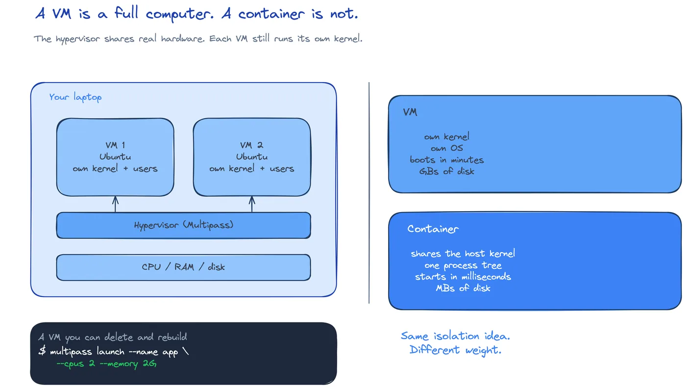

# CLD-08: Your first VM

**Act 2, Cloud Engineer** · Focus: systems and Linux engineer · About 25 minutes

A cloud server is a VM that someone else hosts. You build one on your laptop with Multipass, configure its first boot with cloud-init, and log in with a key. The steps are the same in the cloud.

| | |
|---|---|
| You need | Episode 7 complete. Multipass installed from Episode 1. |
| You build | An Ubuntu VM named `taskboard`, configured by cloud-init, with key-only SSH |
| Done when | `multipass list` shows `Running`, SSH logs in as `student`, and `report.sh` prints host, disk, and memory |

## What you will be able to do

- Explain what a VM is and how a hypervisor shares hardware.
- Create an SSH key pair and install the public key on the server.
- Write a cloud-init file that creates a user and installs packages.
- Launch, list, and enter a VM.
- Inspect a Linux server with `df`, `free`, `systemctl`, and `apt`.
- Read and set file permissions with `chmod`.
- Combine commands with pipes and redirects.
- Read an environment variable.
- Write and run a short Bash script.

## Before you start

- Episode 7 complete. You have a plan and a size.
- Multipass is installed. Episode 1 installed it.
- You can open a terminal in the repository.

## A VM is a computer made of software

A VM is a full computer: its own kernel, users, filesystem, and network interface. A hypervisor shares the real CPU, memory, and disk between the VMs.



| VM | Container |
|---|---|
| Own kernel | Shares the host kernel |
| Boots an operating system | Starts a process |
| Stronger isolation | Faster and smaller |
| Minutes to start | Seconds to start |

Both are useful. This act uses a VM because the course needs a real server with its own SSH service, users, and firewall. Act 3 moves to containers on Kubernetes.

## Keys beat passwords

A password can be guessed, reused, or leaked. A key pair cannot be guessed. The private key stays on your laptop. The public key goes on the server.

The pair has two halves:

| File | Where it lives | Share it? |
|---|---|---|
| `id_ed25519` | Your laptop, `~/.ssh` | Never |
| `id_ed25519.pub` | Your laptop, then the server | Yes |

The server stores the public key in the user's `authorized_keys`. At login, the server sends a challenge. The client signs it with the private key. The server verifies the signature with the public key. The private key never crosses the network.

For this lab, create the key with an empty passphrase. The Ansible container in Episode 9 cannot type a passphrase. State the reason before the command. On a real server, use a passphrase and an agent.

## cloud-init configures the first boot

cloud-init runs once, on the first boot. It creates users, installs packages, sets the host name, and writes files. It does not run on later boots.

The first line must be exactly `#cloud-config`. Without it, cloud-init ignores the file.

A minimal file:

```yaml
#cloud-config
hostname: taskboard
users:
  - name: student
    groups: [sudo]
    shell: /bin/bash
    sudo: ALL=(ALL) NOPASSWD:ALL
    ssh_authorized_keys:
      - ssh-ed25519 AAAA... you@laptop
package_update: true
packages:
  - curl
  - git
  - htop
timezone: UTC
```

The `ssh_authorized_keys` value is the contents of your `.pub` file. Paste the public key, never the private key.

`NOPASSWD` fits a lab. A production server should require a password or a tighter sudo rule.

YAML is indentation-sensitive. One wrong space changes the structure, and cloud-init may ignore the file without a clear error.

## Launch and log in

Launch Ubuntu 24.04 with the resources from Episode 7:

```shell
multipass launch 24.04 --name taskboard --cpus 2 --memory 2G --disk 10G --cloud-init infra/cloud-init/vm.yaml
multipass list
```

The first launch downloads the image, so it takes a few minutes. `multipass list` shows the state and the IPv4 address.

Log in with the user cloud-init created:

```shell
ssh student@<vm-ip>
```

No password prompt. The key did the work. The host name is `taskboard`, because cloud-init set it.

If cloud-init changes, a restart does not apply it. Delete the VM and launch again from the new file.

## Inspect the server

A cloud engineer reads these outputs every day:

| Command | Question it answers |
|---|---|
| `whoami` | Which user am I? |
| `pwd` | Which folder am I in? |
| `ls /` | What is at the root of the filesystem? |
| `df -h` | How much disk is free? |
| `free -m` | How much memory is free? |
| `systemctl status ssh` | Is the SSH service running? |
| `sudo apt update` | Are the package lists current? |
| `htop` | What is using CPU and memory? |

File commands work the same way:

| Command | Action |
|---|---|
| `cd /var/log`, `cd ..`, `cd ~` | Enter a folder, go up, go home |
| `mkdir app` | Make a folder |
| `touch notes.txt` | Make an empty file |
| `cat notes.txt` | Print the file |
| `cp a.txt b.txt`, `mv old new` | Copy, move, rename |
| `rm notes.txt`, `rm -r app` | Remove a file, remove a folder |

`rm` does not ask. There is no trash can. Check `pwd` before a recursive remove.

## File permissions

Every file has an owner, a group, and permissions for three sets: owner, group, and others. `ls -l` shows them as three groups of three letters: `r` read, `w` write, `x` execute.

The numeric form adds the bits: read 4, write 2, execute 1.

| Mode | Owner | Group | Others | Use |
|---|---|---|---|---|
| `400` | read | none | none | A private key |
| `600` | read, write | none | none | A private key that needs editing |
| `644` | read, write | read | read | A normal file |
| `755` | all | read, execute | read, execute | A script or a directory |

SSH refuses a private key that other users can read. A key with mode `644` is not private. Use `600` or `400`.

A script needs the execute bit. `./report.sh` fails with `Permission denied` until `chmod +x report.sh` runs.

## Pipes, redirects, and variables

A pipe sends the output of one command into the next:

```shell
cat /etc/passwd | grep student
history | grep ssh
```

A redirect writes output to a file. `>` replaces the file. `>>` appends.

| Operator | Effect | Risk |
|---|---|---|
| `>` | Write, replace the file | Loses the old content |
| `>>` | Append | Keeps the old content |
| `|` | Pipe to the next command | None |

An environment variable is a named value that programs can read:

```shell
export NAME="Task Board"
echo "Hello, $NAME"
echo $HOME
env
```

The task board reads `DB_PASSWORD` this way. Episode 9 writes it into `.env` with Ansible.

No spaces around `=` in a shell assignment. `NAME = "x"` runs a command named `NAME`, not an assignment.

## Your first script

A script is a file of commands. The first line names the interpreter.

```bash
#!/bin/bash
echo "Report for ${1:-world} on $(hostname)"
echo "Date: $(date)"
df -h / | tail -n 1
free -m | grep Mem
```

`$1` is the first argument. `${1:-world}` uses `world` when no argument is given.

Run it:

```shell
chmod +x report.sh
./report.sh student
./report.sh student > report.txt
cat report.txt
```

The script uses four ideas from this episode: permissions, a pipe, a redirect, and a variable. That is the first step to automation. Ansible in Episode 9 is the same idea at a larger scale.

## Common mistakes

- **Pasting the private key into cloud-init.** Paste the `.pub` file.
- **Wrong YAML indentation.** cloud-init ignores a broken file. Check the first line and the spaces.
- **Missing `#cloud-config`.** Without it, nothing runs.
- **Editing `vm.yaml` and restarting.** cloud-init runs once. Delete the VM and launch again.
- **Windows paths.** Use `$env:USERPROFILE\.ssh` in PowerShell.
- **Using `>` when you mean `>>`.** The old content disappears.
- **Running `./report.sh` without `chmod +x`.** Permission denied.
- **Spaces around `=`.** The shell reads it as a command.
- **`rm -r` in the wrong folder.** Check `pwd` first.

## Check your work

- [ ] The key pair exists and the `.pub` file starts with `ssh-ed25519`.
- [ ] `vm.yaml` starts with `#cloud-config` and contains your public key.
- [ ] `multipass list` shows `taskboard` as `Running` with an IPv4 address.
- [ ] `ssh student@<vm-ip>` logs in without a password.
- [ ] `whoami` prints `student` and the host name is `taskboard`.
- [ ] `df -h`, `free -m`, and `systemctl status ssh` print useful output.
- [ ] `chmod 400` makes a file read-only for the owner.
- [ ] `echo "hello" > hello.txt` and `>>` produce the expected file.
- [ ] `export NAME="Task Board"` and `echo $NAME` print the value.
- [ ] `./report.sh student` prints host, date, disk, and memory.
- [ ] `report.txt` contains the same report.

## What this unlocks on your CV

| Skill | Episode | CV section | Example bullet |
|---|---|---|---|
| Linux administration, SSH | 8 | Cloud and infrastructure | Provisioned Ubuntu VMs with cloud-init and key-only SSH access |
| File permissions | 8 | Operating systems | Set `chmod` modes and explained why SSH rejects an open private key |
| Shell, pipes, variables | 8 | Operating systems | Combined commands with pipes, redirection, and environment variables |
| Bash scripting | 8 | Programming and scripting | Wrote a Bash script that reports host, disk, and memory use |

## Career note

You will not log in to fix servers by hand for long. Each hand fix is a change nobody wrote down and nobody can repeat. Episode 9 replaces the hand work with a playbook that runs the same setup every time.

## Next

Episode 9 configures the VM with Ansible. One command installs Docker, writes the environment, and starts the stack.

## Apply

The verified steps for this episode are in [Act 2, Episode 8](../act2-cloud-engineer.md#episode-8-your-first-vm). Follow the tasks in order.

<!-- APPLY -->

### What you should see

| After | You should see |
|---|---|
| You create the key | One line starting with `ssh-ed25519`. |
| You launch the VM | State `Running` and an IPv4 address. |
| You log in | A prompt as `student@taskboard`, with no password. |
| You inspect the server | Disk, memory, service status, and package output. |
| You set permissions | `ls -l` shows the mode you set. |
| You run the script | Host, date, one disk line, and one memory line. |
| You redirect the output | `report.txt` holds the same report. |

An end-to-end run of this episode passed on a Lima Ubuntu 24.04 VM: the cloud-init file passed `cloud-init schema`, SSH as `student` worked, and permissions, pipes, variables, and `report.sh` behaved as written. The Multipass binary itself was not exercised in that run.
