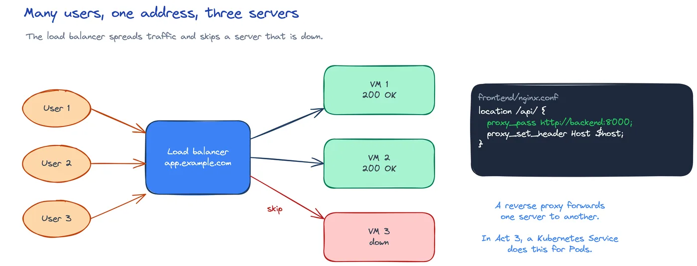

# CLD-10: Now in the cloud

**Act 2, Cloud Engineer** · Focus: cloud engineer · About 26 to 31 minutes

A cloud VM is the same as your Multipass VM. Someone else owns the hardware. Today you create one with code. Cost comes first. You set an alert before any resource, and you destroy everything at the end.

| | |
|---|---|
| You need | Episode 9 complete. A Google Cloud free trial account. Read `docs/costs-and-free-options.md`. |
| You build | A network, firewall rules, and a Compute Engine VM on Google Cloud with Terraform, then the task board with the same Ansible playbook |
| Done when | The plan lists 4 resources, the app runs at the output URL, and destroy removes 4 resources with nothing left running |

## What you will be able to do

- Create a budget alert before any resource.
- Describe a VM and a firewall in Terraform.
- Run `plan`, `apply`, and `destroy`.
- Reuse the Ansible playbook on a cloud VM.
- Explain the limits of one VM.
- Recognize a load balancer, a reverse proxy, and a CDN.

## Before you start

- Episode 9 complete. The playbook runs on your local VM.
- A Google Cloud free trial account. Viewers without one watch only.
- Read `docs/costs-and-free-options.md`.

## Cost comes first

Cloud resources cost money while they run. Even an idle VM bills every hour. So cost control comes before any resource.

A budget alert sends an email when spending passes a limit. It does not stop the spending. You still destroy resources at the end.

Create a Google Cloud project and note the project ID. Open Billing, then Budgets and alerts. Create a budget with a low amount, for example 5 USD. Add an email alert at 50 percent, 90 percent, and 100 percent.

Do not create resources before the budget alert. The alert is the guardrail. `destroy` is the stop button.

## Sign in and enable the API

Terraform and the `gcloud` command run in containers. Sign in and enable the Compute Engine API:

```shell
docker compose -f tools/compose.yaml run --rm gcloud gcloud auth application-default login
docker compose -f tools/compose.yaml run --rm gcloud gcloud services enable compute.googleapis.com --project <project-id>
```

A browser window opens. Then a success message appears. Replace `<project-id>` with your project ID.

On Windows PowerShell, run `$env:HOME = $env:USERPROFILE` first. The container cannot find your gcloud login without it.

## Terraform describes the state

Infrastructure as code means desired state in files. Tools reconcile reality with what you wrote.

You write the state you want in `.tf` files. `plan` shows what will change. `apply` makes the change. `destroy` removes it. Terraform keeps a state file. It lists what Terraform created. Do not commit the state file.

| Term | Meaning |
|---|---|
| Infrastructure as code | Desired state in files. Tools reconcile reality. |
| Plan | Shows what would change before it changes. |
| Apply and destroy | Make the change, then remove it. |
| State file | The record of what the tool created. |
| Budget alert | Mail when spend passes a limit. It does not stop spend. |
| Load balancer | Spreads traffic across many servers. |
| Reverse proxy and CDN | Proxy forwards requests. CDN serves nearby copies. |

Reviewable infrastructure. `terraform plan` shows the change before it happens. A Cloud Engineer reviews that plan the way a Software Engineer reviews a pull request.

## Write the resources

`infra/terraform/gcp/versions.tf` sets the Google provider. You do not change it. It sets the provider version and the `project`, `region`, and `zone` inputs.

Three files describe the rest:

- `variables.tf`: project ID, region, zone, machine type, SSH public key, and your IP in CIDR form.
- `main.tf`: a network, a firewall rule for port 22 from your IP only, a firewall rule for port 8080, and a Compute Engine VM with Ubuntu 24.04, 20 GB disk, and a public IP.
- `outputs.tf`: the VM IP and the app URL.

Tags connect the firewall rules to the VM. The ports are the same ones UFW opens on the VM. SSH opens from your IP only, as `/32`. The web port opens from `0.0.0.0/0`.

The reference network uses auto mode. It does not create the Episode 7 subnet. Add a `google_compute_subnetwork` resource if you want the exact plan.

`terraform.tfvars` holds your project ID and your IP. It is in `.gitignore`. Never commit it.



## Plan and apply

Check the plan, then create the resources:

```shell
docker compose -f tools/compose.yaml run --rm terraform init
docker compose -f tools/compose.yaml run --rm terraform validate
docker compose -f tools/compose.yaml run --rm terraform plan
docker compose -f tools/compose.yaml run --rm terraform apply
```

The plan lists four resources to add. Apply asks for `yes`. The output shows the IP and the URL.

## Reuse the playbook

Only the IP address changes. Put the VM IP in `inventory.ini`. Set `ansible_user=student`. Run the playbook from Episode 9. Open the app URL.

```shell
export DB_PASSWORD=choose-a-password
docker compose -f tools/compose.yaml run --rm -e DB_PASSWORD ansible ansible-playbook playbook.yml
```

The task board runs on Google Cloud. If SSH fails, wait one minute. The VM needs time to boot.

The same playbook already proved idempotence on the local VM. That is the point. Cloud-init created the user. Terraform created the VM, network, and firewall. Ansible configured the VM exactly as before.

## Destroy and prove cleanup

We are done. Remove everything:

```shell
docker compose -f tools/compose.yaml run --rm terraform destroy
```

Four resources destroyed. Open the Billing page and the Compute Engine page. Both must show nothing running. Open Billing Reports and check that no Compute Engine VM, disk, or network remains. Open Compute Engine VM instances and Disks. Both lists must be empty.

Destroy proves cleanup. An empty billing page closes the act. Unused resources are waste. Cost control is part of the job.

## The limits of one VM

One VM works, but it exposes four limits:

- If the VM fails, the app is down. One point of failure.
- If traffic grows, you resize by hand. Manual scale.
- Each update needs a playbook run.
- Rollbacks are manual.

Act 3 uses Kubernetes to solve these problems. A Kubernetes Service does the load-balancing job for Pods.

## Three words to recognize

Three ideas appear when an app grows past one VM. You do not build them in this course. You must recognize them.

| Idea | What it does | On Google Cloud |
|---|---|---|
| Load balancer | Sits in front of many servers. It spreads traffic across them, so no server is overwhelmed. It also skips a server that is down. | Cloud Load Balancing |
| Reverse proxy | Forwards requests to another server. Our frontend Nginx already does this. It forwards `/api` to the backend. | The Nginx `proxy_pass` line in `frontend/nginx.conf` |
| CDN | Keeps copies of your files in cities around the world. Users load them from a nearby city. | Cloud CDN |

## Common mistakes

- **Creating resources before the budget alert.**
- **Forgetting `destroy`.** The VM keeps billing.
- **Committing `terraform.tfvars` or the state file.**
- **Using `0.0.0.0/0` for SSH.** Use your IP.
- **Wrong IP in the CIDR.** Use the form `203.0.113.7/32`.
- **Skipping the Compute Engine API step.**
- **Windows: not setting `$env:HOME`.** The container cannot find your gcloud login.

## Check your work

- [ ] The budget alert exists before any resource is created.
- [ ] `terraform validate` passes without errors.
- [ ] `terraform plan` lists four resources to add.
- [ ] `terraform apply` prints the VM IP and the app URL.
- [ ] The task board loads at the app URL and an added task appears.
- [ ] `terraform destroy` destroys four resources.
- [ ] The Billing page and the Compute Engine page show nothing running.
- [ ] `terraform.tfvars` and the state file are not committed.
- [ ] The SSH firewall rule allows your IP only, as `/32`.
- [ ] You can name the four limits of one VM and explain a load balancer, a reverse proxy, and a CDN.

## What this unlocks on your CV

| Skill | Episode | CV section | Example bullet |
|---|---|---|---|
| Terraform, Google Cloud | 10 | Cloud and Infrastructure | Created a Compute Engine VM and firewall rules with Terraform and destroyed them after use |
| Cloud cost control | 10 | Cloud and Infrastructure | Set budget alerts and removed resources with `terraform destroy` to stay within the free trial |
| Load balancers, reverse proxies, CDNs (concepts) | 10 | Cloud Platforms | Explained how a load balancer, a reverse proxy, and a CDN remove the single point of failure and speed up delivery |

## Career note

A cloud engineer plans, builds, configures, and destroys infrastructure from code. The plan is reviewed before it runs. Cost control is part of the job. An empty billing page is the proof that cleanup happened. If you stop here, this act is a complete CV for a junior software engineer with cloud and infrastructure as code skills.

## Next

Episode 11 starts Kubernetes. Delete the Multipass VM before Act 3, because Minikube needs the memory. A second playbook run changes nothing, only the needed ports are open, and no resources are left running.

## Apply

The verified steps for this episode are in [Act 2, Episode 10](../act2-cloud-engineer.md#episode-10-now-in-the-cloud). Follow the tasks in order.

<!-- APPLY -->

### What you should see

| After | You should see |
|---|---|
| You sign in | A browser window opens, then a success message. |
| You run `terraform plan` and `apply` | The plan lists four resources to add. Apply asks for `yes`. The output shows the IP and the URL. |
| You run the playbook on the cloud VM | The task board runs at the app URL, and the app returns 200 on port 8080. |
| You run `terraform destroy` | Four resources destroyed. The Billing and Compute Engine pages show nothing running. |

An end-to-end run of this episode passed: `terraform init`, `validate`, `plan`, and `apply` created 4 resources, the playbook ran on the GCP VM, the app returned 200 on port 8080, and `terraform destroy` removed 4 resources.
