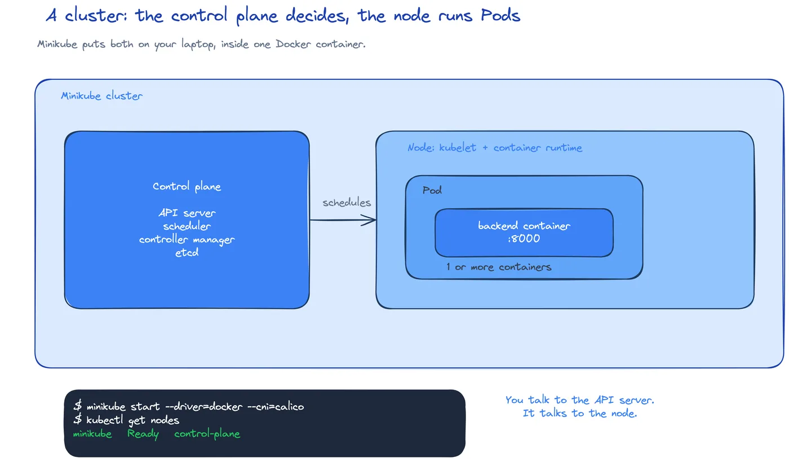

# DEV-11: Hello, Kubernetes

**Act 3, DevOps Engineer** · Focus: Platform Engineer · About 22 to 26 minutes

One VM has a single point of failure, scales by hand, updates by playbook run, and rolls back by hand. Kubernetes restarts failed apps, scales them, and updates them without downtime. This episode starts the cluster and runs the first workloads.

| | |
|---|---|
| You need | Episode 10 complete. Multipass VMs stopped so Minikube has memory. Docker Desktop running in Linux container mode. |
| You build | A Minikube cluster with Calico, an `app` Namespace, a bare Pod, and a frontend Deployment with three replicas |
| Done when | The node is `Ready`, the Namespace is `Active`, and the Deployment replaces a deleted Pod and runs three Pods |

## What you will be able to do

- Explain what Kubernetes does and why one VM is not enough.
- Explain desired state and the control loop.
- Start Minikube with Calico.
- Create a Namespace, a Pod, and a Deployment.
- Explain why a Deployment replaces a bare Pod.

## Before you start

- Episode 10 complete.
- Multipass VMs stopped: `multipass stop --all`. Minikube needs the memory.
- Docker Desktop running in Linux container mode.

## Desired state and the control loop

You do not tell Kubernetes the steps. You declare the desired state, such as running three copies of an image. Kubernetes then keeps the cluster at that state.

The control loop compares what runs with what you declared. It fixes any difference. In plain terms, it asks, what is running now, what did I ask for, and what is missing. If reality does not match desired state, the loop acts. It starts missing Pods, removes extra Pods, or replaces failed Pods.

This behaves like a thermostat. You set the temperature once. The thermostat keeps correcting. Self-healing is the same idea at work. A crashed container is replaced by the loop, not by a script you wrote. A Pod you delete by accident is replaced for the same reason, provided a Deployment owns it.

Declarative YAML stores this intent in Git. A reviewer can read the file, test it, and apply it again. ArgoCD applies the same files later in Episode 17, so the intent stays visible from commit to cluster.

A cluster is a set of machines that run containers. The control plane decides, and the nodes run the Pods. A Pod is one or more containers that run together on a node. Minikube makes a one-node cluster on your laptop, so the control plane and the node share one machine for this lab.

A Namespace groups resources. A Deployment keeps a set number of Pod copies running. That is the core idea, declare the count, and the control loop keeps the count.

Calico is the network plugin in this act. It enforces NetworkPolicies in Act 4, which the default network plugin does not. On Windows, Minikube runs from PowerShell, not WSL.

## Namespace, Pod, and Deployment

A Namespace is a grouping boundary inside the cluster. This act uses `app`, `monitoring`, and `argocd`. Resources such as Pods, Deployments, and Services live in a Namespace. A command without `-n app` looks at the `default` Namespace, so the wrong results can come from the wrong group.

A Pod is the smallest unit Kubernetes schedules. It runs one or more containers that share networking and storage. In the lab, a Pod runs one frontend container on one port.

A bare Pod has no owner. If a Pod is deleted, nothing brings it back. That is useful for a quick test, but it is fragile as a service. A Deployment solves the problem by owning a set of Pods. It uses a label selector to find its Pods. It handles rolling updates, so new Pods replace old Pods in order.

A Pod can also be created in one line with `kubectl run`, with no file. That is the imperative way. It is fast for a quick test. A YAML file is better for real work, because Git stores it and ArgoCD applies it in Episode 17. Use imperative commands to explore, and declarative files to run real workloads.

A Deployment keeps the set number of Pod copies running. If you delete one Pod, the Deployment creates a replacement. If you change the replica count in the file, the Deployment scales to the new count. This episode changes the frontend Deployment to three replicas, so three Pods run.

## Local images

Minikube cannot see local Docker images. A local image must be loaded before the cluster can run it. Without a load step, a Pod using a local tag can stay in `ErrImagePull` or `ImagePullBackOff`. Loading the frontend image removes the pull error and lets the Pod reach `Running`.

Image tags also matter. The tag `latest` moves, so Kubernetes pulls every time. A fixed tag such as `:local`, or a commit SHA later in the act, names the exact build. Pinned tags make runs repeatable and debugging faster.

Rolling updates explain why Deployments beat bare Pods. A Deployment replaces Pods in order, so the service stays available. A bare Pod has no sign. A Deployment also keeps the count you declared, which is the desired state made durable.

## Common mistakes

- **Leaving Multipass VMs running.** Minikube then has too little memory.
- **Using the `latest` tag.** Kubernetes pulls every time. Use `:local` or a SHA.
- **Forgetting `-n app`.** The command then looks in the `default` Namespace.
- **Treating a bare Pod as safe.** Nothing restarts it.
- **Starting Minikube without enough memory.** Use the Docker Desktop settings.
- **Expecting a local image to be visible.** Load it into Minikube first.

## Check your work

- [ ] The node reports status `Ready`.
- [ ] The `app` Namespace is `Active`.
- [ ] A bare Pod reaches `Running` with the loaded frontend image.
- [ ] Deleting the bare Pod leaves no Pods behind.
- [ ] The Deployment creates a new Pod after a delete.
- [ ] After the change to three replicas, three Pods run.

## What this unlocks on your CV

| Skill | Episode | CV section | Example bullet |
|---|---|---|---|
| Kubernetes (Pods, Deployments, Services) | 11, 12 | Containers & Orchestration | Deployed a three-tier app to Kubernetes with Deployments and Services |
| Desired state and self-healing | 11 | Containers & Orchestration | Explained the Kubernetes control loop and showed a Deployment replacing a deleted Pod |
| Imperative and declarative `kubectl` | 11, 12 | Containers & Orchestration | Used `kubectl run` for quick tests and YAML manifests for real work |

## Career note

A DevOps Engineer rarely creates a bare Pod. The team owns Deployments. The first debugging question is always what the cluster says. The next episode covers the tools for that.

## Next

Episode 12 adds Services and teaches troubleshooting. Pods change IP addresses on restart, so the app needs a stable name.

## Apply

The verified steps for this episode are in [Act 3, DevOps Engineer](../act3-devops-engineer.md#task-1-start-the-cluster). Follow the tasks in order.

<!-- APPLY -->

### What you should see

| After | You should see |
|---|---|
| You start Minikube with Calico | One node with status `Ready`. |
| You create the `app` Namespace | Namespace `app` is `Active`. |
| You build and load the frontend image, then create the Pod | The Pod reaches `Running`. |
| You delete the bare Pod | No Pods. |
| You apply the Deployment | Three Pods run. |

An end-to-end run of this episode passed: Minikube started with Calico, and the bare Pod reached `Running` after the image was built and loaded.
