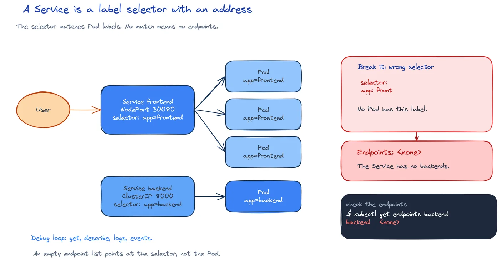

# DEV-12: Services and Troubleshooting

**Act 3, DevOps Engineer** · Focus: Platform Engineer · About 25 to 30 minutes

Pods get new IP addresses every time they restart. A Service gives them one stable name, so clients keep working across restarts. This episode adds Services, then breaks the app on purpose and fixes it.

| | |
|---|---|
| You need | Episode 11 complete. Minikube running with the `app` Namespace. |
| You build | A Service file with a NodePort `frontend` Service, a ClusterIP `backend` Service, and a headless `postgres` Service |
| Done when | Services and endpoints appear, the frontend returns 200 through the Service, and the debug loop names the cause of a broken deployment |

## What you will be able to do

- Use labels and selectors.
- Create ClusterIP, headless, and NodePort Services.
- Name the LoadBalancer Service type and say when to use it.
- Create a Deployment and a Service from the command line.
- Reach the app with `minikube service`.
- Debug with `describe`, `logs`, and events.

## Before you start

- Episode 11 complete.

## Labels, selectors, and annotations

Labels identify resources. Selectors use labels to pick resources. The act uses `app.kubernetes.io/name` and `app.kubernetes.io/part-of`. A Pod template carries these labels. A Service selector then finds matching Pods by those values.

Annotations store extra information. Selectors do not use them. Other tools read annotations. For example, `external-dns` reads an annotation on a Service and creates a DNS record for it.

Labels and annotations look alike in YAML, but they serve different uses. A matching label is how a Service finds its Pods. A wrong selector means the Service has nobody to route to. When routing fails, matching labels is the first check.

## Service types

A Service is a stable front door in front of Pods. Pods change IP addresses on restart. The Service name does not change, and traffic survives Pod replacement. That is the reason Pods alone are not enough for clients to rely on.

The Service types are covered in the table below.

| Type | Reach | Use in this act |
|---|---|---|
| ClusterIP | Inside the cluster only. The default. | The `backend` Service. Other Pods reach it by name. |
| Headless (`clusterIP: None`) | Gives a DNS name for each Pod. | The `postgres` Service. The database uses it in Episode 14. |
| NodePort | Opens a port on the node. | The `frontend` Service, on port 30080. `minikube service` opens a tunnel to it. |
| LoadBalancer | Asks the cloud for a real load balancer in front of the Pods. | Not used on Minikube. On Google Cloud it creates one for you. |

Endpoints are the Pod addresses behind a Service. When endpoints list Pod IPs, routing has a target. An empty list means the selector does not match. On the Docker driver, the node port is not reachable from the host. `minikube service` opens a tunnel, and it must keep running. Closing that terminal stops the URL.

The command line can create the same objects without YAML. `kubectl run` makes one bare Pod with no self-healing. `kubectl create deployment` makes a Deployment whose Pods are replaced if they die. `kubectl expose` makes a Service with one stable address in front of the Pods. `kubectl get`, `describe`, and `logs` look, look closer, and read the output. Use these for a quick test. Keep the YAML for real work. Edit the file and apply it, instead of editing the live resource with `kubectl edit`.

## Break it, then fix it

The debug loop uses four commands in order, `get`, `describe`, `logs`, and events. Start with `get` to see the state. Use `describe` to read the Events at the bottom. Use `logs` only after the Pod has started. Use events to see recent changes in order. Read the Events first. They name the cause in most cases.

A wrong image tag shows `ImagePullBackOff`. The Events show `Failed to pull image`. Fix the tag and apply. A wrong selector shows `<none>` in ENDPOINTS. Fix the selector and apply. Those two cases cover the common faults. The scratch Deployment and Service from the command line exercise are a quick way to practice both the create and delete forms, and they must be deleted when the test ends.

A Service of type LoadBalancer needs a cloud. Minikube uses NodePort plus `minikube service` for local access. NodePort fits a laptop. Ingress plus cloud load balancing fit production. Editing the live resource drifts from Git, so the file stays the source of truth.

## Common mistakes

- **Selector and Pod labels do not match.** Check the endpoints.
- **Reading `logs` of a Pod that never started.** Use `describe`.
- **Closing the `minikube service` terminal.** The URL stops working.
- **Editing the live resource with `kubectl edit`.** Edit the file and apply.
- **Forgetting to delete the scratch Deployment and Service.**
- **Expecting `LoadBalancer` to work on Minikube.** Use NodePort and `minikube service`.

## Check your work

- [ ] Services for `frontend`, `backend`, and `postgres` exist in the `app` Namespace.
- [ ] Endpoints list Pod IPs for the frontend and backend Services.
- [ ] The frontend returns 200 through the Service.
- [ ] A Deployment and Service created from the command line can be listed and then deleted.
- [ ] A wrong image shows `ImagePullBackOff` and `Failed to pull image` in Events.
- [ ] A wrong selector shows `<none>` in ENDPOINTS.

## What this unlocks on your CV

| Skill | Episode | CV section | Example bullet |
|---|---|---|---|
| Kubernetes (Pods, Deployments, Services) | 11, 12 | Containers & Orchestration | Deployed a three-tier app to Kubernetes with Deployments and Services, and debugged it with `describe`, logs, and events |
| Service types (ClusterIP, NodePort, LoadBalancer) and annotations | 12 | Containers & Orchestration | Exposed workloads with ClusterIP and NodePort Services, and explained when a LoadBalancer Service replaces them |

## Career note

Most on-call work starts with these four commands, `get`, `describe`, `logs`, and events. Match the selector to the Pod labels, use `describe` when logs are empty, and edit files and apply. Never edit live.

## Next

Episode 13 adds configuration. The backend will read settings from a ConfigMap and credentials from a Secret.

## Apply

The verified steps for this episode are in [Act 3, DevOps Engineer](../act3-devops-engineer.md#task-4-write-the-services). Follow the tasks in order.

<!-- APPLY -->

### What you should see

| After | You should see |
|---|---|
| You apply the Services | Services and endpoints appear. |
| You list endpoints | Pod IPs behind each Service. |
| You open the app through the Service | The frontend returns 200. |
| You use a wrong image tag | `ImagePullBackOff`, and `Failed to pull image` in Events. |
| You use a wrong selector | `<none>` in ENDPOINTS. |

An end-to-end run of this episode passed: Services and endpoints appeared, and the frontend returned 200 through the Service.
