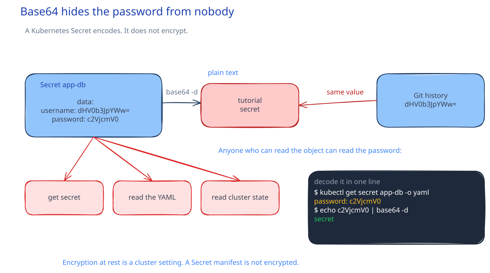

# DEV-13: Configuration

**Act 3, DevOps Engineer** · Focus: Platform Engineer · About 15 to 20 minutes

The same image must run in every environment. Only the configuration changes. This episode separates plain settings from credentials, so the image stays portable and secrets stay out of Git.

| | |
|---|---|
| You need | Episode 12 complete. Minikube running with the `app` Namespace. |
| You build | A ConfigMap with the database settings, and a Secret named `app-db` created from the command line |
| Done when | The ConfigMap and Secret are read by the backend |

## What you will be able to do

- Move settings out of the image into a ConfigMap.
- Create a Secret from the command line.
- Explain why base64 is not encryption.
- Explain why Secrets stay out of Git.

## Before you start

- Episode 12 complete.

## ConfigMaps hold plain settings

A ConfigMap holds plain settings, such as host, port, and database name. This episode writes `DB_HOST`, `DB_PORT`, `DB_NAME`, and `POSTGRES_DB` into one ConfigMap. Environments differ by this file, not by a rebuild. The same image runs in development, test, and production, and the ConfigMap points it at the right database.

Wiring decides how a setting reaches a container. `envFrom` loads every key from a ConfigMap as an environment variable. `configMapKeyRef` loads one key. That one-key form suits a case where the container needs a single named value and the ConfigMap holds more values for other containers.

Configuration and credentials are different kinds of values. A host name is plain and safe to store in Git. A password is a credential and is not safe. That distinction is why the act uses a ConfigMap for settings and a Secret for credentials. Mixing them into the image makes every environment need a new build.

## Secrets hold credentials

A Secret holds the database username and password. Never write a password in a manifest that goes to Git. A Secret is created from the command line, outside Git, so the value never reaches a commit.

The Secret for this act holds `username` and `password` for the database. The backend loads each value with `secretKeyRef`, which loads one key from a Secret. The same one-key pattern applies here as for a ConfigMap. Each environment variable names the exact key it needs.

The Secret must live in the same Namespace as the Pod that reads it. This act keeps the Secret in `app`. A Secret in the wrong Namespace breaks the Pod. The Pod can then show `CreateContainerConfigError`, because it cannot read its configuration.

## Base64 is not encryption

A Secret value shows as base64 text. Base64 is an encoding. It is not encryption. Anyone can decode it in the open. The password appears in plain text after a decode, which is the proof that encoding does not protect a value.

Anyone with read access to the Secret reads the password. Kubernetes stores Secrets unencrypted by default. Real clusters add encryption at rest and access rules on top. For this lab, the rule is simple, treat every Secret as readable by anyone with access, and rotate any Secret that leaks.

## Secrets stay out of Git

Git keeps history. A pushed password stays in the history after you delete it from the newest commit. ArgoCD syncs from Git, so a Secret committed to Git would be synced to the cluster as well. That path makes a leak permanent and automatic.

Creating Secrets on the command line avoids that path. The value moves from shell to cluster, with no file in the repository. A ConfigMap change also does not update a running Pod on its own. Restart the Deployment so the new values load. Teams use tools such as Sealed Secrets or an external secrets manager for larger fleets. This act keeps it simple with command line Secrets, which sit outside GitOps by design.

## Common mistakes

- **Committing a Secret manifest with real values.** Git history keeps the leak.
- **Creating the Secret in the wrong namespace.** The Pod then shows `CreateContainerConfigError`.
- **Changing a ConfigMap and expecting a running Pod to update.** Restart the Deployment.
- **Thinking base64 protects the value.** Base64 decodes in the open.

## Check your work

- [ ] The ConfigMap holds `DB_HOST`, `DB_PORT`, `DB_NAME`, and `POSTGRES_DB`.
- [ ] The Secret named `app-db` exists in the `app` Namespace with `username` and `password`.
- [ ] A Secret value shows as base64 text, and decodes to plain text.
- [ ] The backend reads the ConfigMap and the Secret.
- [ ] No password appears in a committed manifest.

## What this unlocks on your CV

| Skill | Episode | CV section | Example bullet |
|---|---|---|---|
| Kubernetes configuration (ConfigMaps, Secrets) | 13 | Containers & Orchestration | Separated configuration and credentials from images with ConfigMaps and Secrets created outside Git |

## Career note

Rotating a leaked secret is expensive. Prevention is cheap. Teams scan repositories for committed secrets. You will practice that scan in Act 4.

## Next

Episode 14 runs PostgreSQL with a StatefulSet. The backend can read its settings, but the database does not exist yet.

## Apply

The verified steps for this episode are in [Act 3, DevOps Engineer](../act3-devops-engineer.md#task-3-write-the-configmap). Follow the tasks in order.

<!-- APPLY -->

### What you should see

| After | You should see |
|---|---|
| You read the Secret | Values show as base64 text. |
| You decode a Secret value | The password appears in plain text. |
| You run the backend | The ConfigMap and Secret are read by the backend. |

An end-to-end run of this episode passed: the ConfigMap and Secret were read by the backend.
