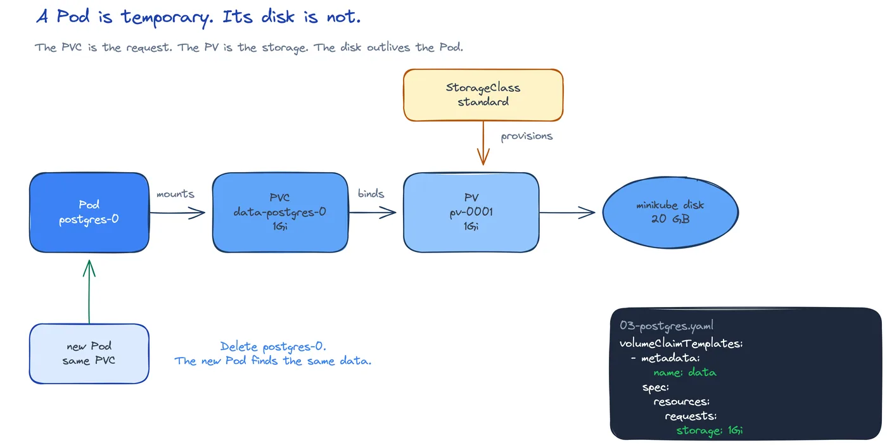

# DEV-14: State

**Act 3, DevOps Engineer** · Focus: Platform Engineer · About 22 minutes

A Deployment Pod can be replaced at any time. Its files vanish with it. This episode gives PostgreSQL a disk that survives that replacement, with a stable name and a per-Pod claim.

| | |
|---|---|
| You need | Episode 13 complete. The `app-db` Secret exists. Minikube is running and your built database image is loaded. |
| You build | A `postgres` StatefulSet with a per-Pod PVC, backed by your built database image |
| Done when | `postgres-0` is 2/2 ready, the PVC is `Bound`, and two tasks you added still appear after you delete the Pod |

## What you will be able to do

- Explain why a database needs a StatefulSet.
- Explain PVC, PV, and StorageClass.
- Run PostgreSQL with a volume claim template.
- Prove that data survives a Pod restart.

## Before you start

- Episode 13 complete. The ConfigMap and the `app-db` Secret work.
- Minikube is running with the metrics server and the Calico CNI.
- The local database image `tutorial-database:local` is built from the `database` folder and loaded into Minikube.

## A Deployment Pod disappears

A Deployment treats Pods as replaceable. Kubernetes may stop a Pod, start a new one, or move it to another node. The new Pod gets a new name. It starts with an empty writable layer. Files you wrote in the old Pod are gone.

That model fits a web frontend. Each replica starts from the same image. You can kill one and another copy takes over. The database does not fit that model. PostgreSQL stores the `tasks` table in files. If the Pod dies and the files die with it, the data is gone. The app has no history.

A database needs two things a Deployment does not give: a stable name and a disk that outlives the Pod. The name matters for backup and discovery. The disk matters so data survives restarts. Together they are called state.

## PVC, PV, and StorageClass

Three objects separate the request for storage from the storage itself:

| Object | Meaning |
|---|---|
| PVC | A request for storage. You ask for a size and an access mode. |
| PV | The storage itself. It is a piece of concrete disk. |
| StorageClass | How Kubernetes creates a PV. |

You write a PVC. Kubernetes binds it to a PV. The Pod mounts the PVC. When the Pod dies, the PVC and the PV stay. A new Pod mounts the same PVC and reads the same files. This is the core idea.

Minikube ships with a default StorageClass. It creates a PV on demand when a PVC asks for storage. That is why this lab needs no cloud disk. The cluster grows the storage for you. In production a StorageClass might point at a cloud disk or a network volume. The pattern is the same. You still write a PVC. The StorageClass decides where the bytes live.

## A StatefulSet keeps names and disks

A StatefulSet is the workload type for apps that need identity. It gives each Pod a stable name: `postgres-0`, `postgres-1`, and so on. The first Pod is always `postgres-0`. It never becomes `postgres-7`. That fixed name lets tools find the same database every time.

A StatefulSet works with a headless Service. A normal Service chooses one address. A headless Service gives each Pod a stable DNS name. In this act the headless Service is named `postgres`. The rest of the app can reach the database at that name.

The disk comes from a `volumeClaimTemplates` entry. A template is a pattern. The StatefulSet copies it once per Pod. Each Pod gets its own PVC from the same 1Gi template. With one replica you get one PVC. If you scale to three Pods, you get three PVCs. Each template makes its own claim, so replicas do not share a disk by accident.

Read the chain from left to right:

| Step | What happens |
|---|---|
| Pod `postgres-0` | The database process runs here. |
| PVC 1Gi | A per-Pod storage request from the template. |
| PV and disk | The bytes persist across restarts. |

The Pod is disposable. The PVC is not. Delete the Pod and Kubernetes creates `postgres-0` again. The new process mounts the same PVC. PostgreSQL starts, reads its data directory, and finds the tasks it stored before. That is the proof this episode wants.

## PGDATA and the built image

PostgreSQL needs an empty data directory. A fresh volume is not empty. It contains a `lost+found` folder from the filesystem. If PostgreSQL starts in that root, it fails. It cannot initialize because the directory is not empty. The error mentions `initdb` and the data directory. Do not ignore it.

Set `PGDATA` to a subfolder. In this act the value is `/var/lib/postgresql/data/pgdata`. The container creates that empty subfolder inside the volume. PostgreSQL uses it and leaves `lost+found` alone. The StatefulSet also mounts the volume at `/var/lib/postgresql/data`. The two paths work together. The mount is the volume root. `PGDATA` is the private folder inside it.

Use the image you built, `tutorial-database:local`. Do not use the stock `postgres:16-alpine` image. Only your built image has `init.sql` baked in. Only it creates the `tasks` table on first initialization. The stock image would start an empty database with no table. The app would start and find no tasks. This is not a version issue. It is a content issue inside the image.

The StatefulSet in this act runs two containers in one Pod: `postgres` and `postgres-exporter`. That is why the ready count is 2/2, not 1/1. The exporter sidecar publishes Postgres metrics on port 9187. The Pod also carries probes. A startup probe waits with `pg_isready` for up to 150 seconds. Readiness and liveness probes keep checking the same command. Without the startup probe, a slow first boot could fail the readiness check before PostgreSQL is ready.

## Limits of Minikube storage

Minikube storage is for learning. `minikube delete` removes the cluster and all PostgreSQL data. Do not treat it as a backup. Production needs real backups and usually a managed database or an operator that handles upgrades and failover. That is outside this course.

Claims outlive the workload. If you delete the StatefulSet, the PVCs stay. Check PVCs before cleanup, or you will leave disk behind. This one rule changes how you delete things. Remove the StatefulSet, then check the PVC list. Remove claims only when you mean to delete the data.

Teams often avoid running databases in Kubernetes because a managed database is simpler to operate. That choice is real. You still need StatefulSets. Many tools, such as queues and databases, run as StatefulSets even on managed clusters.

## Common mistakes

- **Missing `PGDATA`.** PostgreSQL fails with an `initdb` error because the folder is not empty.
- **Fixing an image error but leaving the old Pod.** Delete `postgres-0` so the StatefulSet recreates it.
- **Expecting the PVC to be deleted with the StatefulSet.** It stays. Check PVCs before cleanup.
- **Treating Minikube storage as a backup.** `minikube delete` deletes the data.
- **Using the stock `postgres:16-alpine` image.** Only `tutorial-database:local` has `init.sql` and the `tasks` table.
- **Creating data against a missing Secret.** The Pod restarts when `app-db` is missing. Create the Secret, then delete the Pod.

## Check your work

- [ ] `postgres-0` shows 2/2 ready in the Pod list.
- [ ] The PVC for `postgres-data` is `Bound`.
- [ ] A PV exists for the claim.
- [ ] `PGDATA` points at `/var/lib/postgresql/data/pgdata`.
- [ ] You added two tasks through the app.
- [ ] After you deleted `postgres-0`, the new Pod started and both tasks remain.

## What this unlocks on your CV

| Skill | Episode | CV section | Example bullet |
|---|---|---|---|
| Stateful workloads (StatefulSet, PVC) | 14 | Containers and Orchestration | Ran PostgreSQL as a StatefulSet with a dynamically provisioned persistent volume |

## Career note

A platform engineer chooses between running state in Kubernetes and using a managed database. The managed option is simpler to operate. Knowing how StatefulSets bind stable names to persistent disks still matters. Tools you will use later, such as databases and queues, rely on the same pattern.

## Next

Episode 15 adds requests, limits, probes, and autoscaling. The database keeps its disk. The app learns to grow under load.

## Apply

The verified steps for this episode are in [Act 3, Task 5](../act3-devops-engineer.md#task-5-write-the-postgresql-statefulset). Follow the tasks in order.

<!-- APPLY -->

### What you should see

| After | You should see |
|---|---|
| You apply `03-postgres.yaml` | `postgres-0` runs with 2 of 2 containers ready. |
| You check the PVC and the PV | The PVC is `Bound`. A PV exists. |
| You add two tasks, then delete `postgres-0` | A new `postgres-0` starts. Refresh the app. The tasks remain. |

An end-to-end run of this episode passed: `postgres-0` reached 2/2, the PVC was `Bound`, and data survived a Pod delete.
