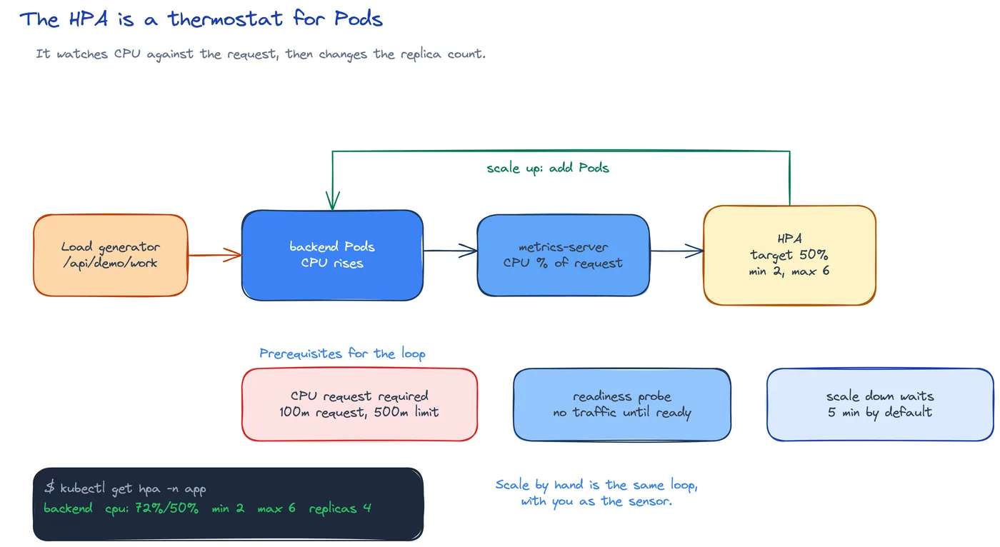

# DEV-15: Scale

**Act 3, DevOps Engineer** · Focus: Site Reliability Engineer (SRE) · About 27 minutes

One VM could not scale. Kubernetes can, but only if you give it numbers. This episode sets requests and limits, adds probes, scales by hand, then lets an HPA scale for you.

| | |
|---|---|
| You need | Episode 14 complete. `metrics-server` enabled on Minikube. |
| You build | Requests, limits, and probes for the app, a CPU HPA from 2 to 6 replicas with a tuned behavior, proved with a load generator |
| Done when | The backend scales from 2 to 6 replicas under load and returns to 2 when the load stops, with no leftover load replicas |

## What you will be able to do

- Set resource requests and limits.
- Add readiness and liveness probes.
- Scale a Deployment by hand.
- Create an HPA.
- Tune how fast the HPA scales up and down.
- Trigger scaling with a load generator.

## Before you start

- Episode 14 complete. PostgreSQL runs as a StatefulSet and the app opens.
- `metrics-server` is enabled. The HPA and `top pods` need it.
- The `app` and `monitoring` namespaces exist, or you can create them.

## Requests and limits

Each container declares how much it needs and how much it may take:

| Field | Meaning |
|---|---|
| Request | What the scheduler reserves. It sizes the Pod for placement. |
| Limit | The most the container may use. |

The scheduler uses requests to place Pods. It spreads them so each one gets its reserved share. That is why a request matters for autoscaling too. The HPA measures CPU as a percentage of the request. Without a request, there is nothing to divide by.

CPU and memory fail in different ways. CPU over the limit is throttled. The container slows down but keeps running. Memory over the limit kills the container. Kubernetes reports `OOMKilled`. A low memory limit therefore looks like a crash. A low CPU limit looks like slowness.

The backend in this act requests `100m` CPU and `96Mi` memory. Its limits are `500m` CPU and `256Mi` memory. The frontend requests `50m` and `32Mi` and limits at `250m` and `128Mi`. PostgreSQL requests more because it holds data: `100m` and `256Mi` requested, `1000m` and `1Gi` as limits. The exporters get small shares. These numbers are examples from measured use. Keep them as a starting point. Episode 18 shows dashboards that refine them.

## Probes separate waiting from failing

A probe is a check Kubernetes runs inside the Pod. Three kinds answer different questions:

| Probe | Question | Effect when it fails |
|---|---|---|
| Readiness | Is the Pod ready for traffic? | The Pod gets no traffic. It stays in place. |
| Liveness | Should Kubernetes restart it? | Kubernetes restarts the container. |
| Startup | Has a slow process finished starting? | Kubernetes waits before the other probes run. |

The backend uses HTTP probes. Readiness checks `/readyz`. Liveness checks `/healthz`. The frontend checks `/` on port 80. PostgreSQL uses an exec probe with `pg_isready` and an HTTP probe on the exporter metrics path. The startup probe matters for PostgreSQL because the first boot takes longer than the default check window. Without it, Kubernetes could judge a healthy but still-starting database as not ready.

Break a probe and you can see the split. Point the backend readiness path at `/nope` and apply. The Pod shows `0/1` ready. The Service still lists it, but the Service sends no traffic to it. An event explains the probe failure. Fix the path and the Pod returns to `1/1`. The app did not restart. No Pod was killed. Readiness only gates traffic.

A liveness probe runs a different risk. If it is too strict, Kubernetes restarts healthy Pods. A slow endpoint or a short period can turn a normal spike into a restart loop. Set liveness to match the cost of the app, not to an ideal you wish for. Readiness can be eager. Liveness should be patient.

## Scale by hand, then stop doing it

Scale by hand means you type the new replica count:

```shell
minikube kubectl -- scale deployment/backend -n app --replicas=4
```

Four backend Pods start. Set the count back to 2 and two stop. You are the thermostat in this step. You watch the load, you decide, you type. It works. It does not scale as a habit, because you must notice the load and type the command each time. A person cannot watch at 3 AM. The HPA does this for you.

One warning: if an HPA owns the Deployment, it sets the count back to its own value. Manual writes fight the controller. You can scale by hand before the HPA exists. After the HPA exists, your manual number is a suggestion for a few seconds until the next check rewrites it. Apply the HPA next and let it own the Deployment.

## An HPA holds the app to a CPU target

An HPA changes the replica count from a metric. In this act it watches CPU and targets 50 percent. The range is 2 to 6 replicas. At low load it holds 2. Under load it grows to 6. When load fades, it returns to 2.

The percentage is of the request. If a Pod requests `100m` and uses `50m`, that is 50 percent. The HPA reads that number across the backend Pods. At 50 percent it holds. Above 50 percent it adds Pods. That is why the requests come first. No CPU request leaves the HPA blind. It shows `<unknown>` until metrics arrive or the request exists.

A one-line form exists:

```shell
minikube kubectl -- autoscale deployment backend --cpu-percent=50 --min=2 --max=6
```

This act uses YAML instead. Git can store YAML, review it, and restore it. The one-line form cannot set the behavior block described next. For a lab you can type either form. For a team you want the file.

The metrics server collects CPU use. `top pods` shows it. The HPA checks every 15 seconds. CPU metrics can lag. Give it about a minute before you judge. A `<unknown>` target after that minute means `metrics-server` is not ready or the Pod has no CPU request. Check the Pod `resources.requests` before you tune anything else.



## Tune how fast the HPA reacts

By default the HPA scales up fast and scales down slowly. It waits 5 minutes before it removes Pods. The wait stops replicas going up and down on every small change. Flapping: up five Pods, down five Pods, in a loop. Slow windows save churn and cost. In production they are the right default.

For a video, 5 minutes is slow to watch. The `behavior` block changes this for one HPA. It is YAML only. `kubectl autoscale` cannot write it. The block in this act sets `stabilizationWindowSeconds` to 0 for both directions. It also limits speed with `policies`. One policy may double the Pods every 15 seconds. Another may add up to 4 Pods every 15 seconds. The scale-down side uses the same fast rule so you can watch the count fall in the lab.

Read the two words literally. `stabilizationWindowSeconds` is how long the HPA waits before it acts on a lower number. At 0 it acts at once. At 300 it waits 5 minutes. `policies` bound the rate. Percent means a share of current replicas. Pods means an absolute count. The act uses both so growth is quick but capped. Do not copy a 0 second scale-down window into production. The count would move on every spike. Use a longer window there.

## A load generator proves it

The backend exposes `/api/demo/work`. It does bounded CPU work. Bounded means it finishes. It does not loop forever. The load generator calls it in a loop. Tools such as `hey` do the same from the command line. The point is steady, honest pressure, not an attack.

The generator is a Deployment in the `monitoring` namespace. It starts at zero replicas. Scale it to 6. CPU rises above 50 percent. The HPA adds backend replicas. Watch `get hpa backend -n app --watch`. The count grows from 2 toward 6. When you finish, scale the generator back to 0. CPU falls. Replicas return to 2. That return takes a few minutes. Do not leave the generator running. It ships cost with no value after the test.

The HPA protects the app from load. It does not fix slow code. It adds copies. Six slow Pods answer faster than two slow Pods, but slow code stays slow. Right-sizing sets the price. Dashboards in Episode 18 show whether the numbers fit.

## Common mistakes

- **No CPU request.** The HPA shows `<unknown>` because the percentage has no base.
- **Limits set too low.** The container restarts with `OOMKilled` when memory is tight.
- **A liveness probe that is too strict.** Kubernetes restarts healthy Pods.
- **Leaving the load generator running.** Scale it to 0 when you finish.
- **Scaling a Deployment by hand while an HPA owns it.** The HPA overrides your number.
- **Expecting `kubectl autoscale` to set the `behavior` block.** Write the HPA in YAML.
- **Copying a zero second scale-down window into production.** The count then changes on every spike.

## Check your work

- [ ] The backend Deployment lists CPU and memory requests and limits.
- [ ] The backend readiness path is `/readyz` and the liveness path is `/healthz`.
- [ ] You scaled the backend by hand to 4, then back to 2.
- [ ] `get hpa -n app` shows a CPU percentage target, not `<unknown>`.
- [ ] `05-hpa.yaml` holds 2 to 6 replicas, 50 percent CPU, and a `behavior` block with `stabilizationWindowSeconds: 0`.
- [ ] The load generator drove the backend from 2 to 6 replicas.
- [ ] After the load stopped, the backend returned to 2 replicas.
- [ ] The load generator is at 0 replicas.

## What this unlocks on your CV

| Skill | Episode | CV section | Example bullet |
|---|---|---|---|
| Autoscaling (HPA), resource management | 15 | Containers and Orchestration | Set requests, limits, and probes, and configured a CPU-based HPA that scaled the API from 2 to 6 replicas under load |
| HPA tuning (scale behavior, stabilization window) | 15 | Containers and Orchestration | Tuned HPA scale-up and scale-down policies to control how fast the API reacts to load |

## Career note

An SRE right-sizes every day. Too high wastes money. Too low causes outages. The numbers in this episode are a first fit from small measurements. Dashboards in Episode 18 refine them with real traffic. The thermostat habit stays. You tune it with data, not with hope.

## Next

Episode 16 publishes the images to a registry. The app still loads by hand until then. After the publish workflow, any cluster can pull the same bytes.

## Apply

The verified steps for this episode are in [Act 3, Task 7](../act3-devops-engineer.md#task-7-write-the-hpa). Follow the tasks in order.

<!-- APPLY -->

### What you should see

| After | You should see |
|---|---|
| You apply `05-hpa.yaml` and wait about a minute | `get hpa -n app` shows a CPU percentage target. |
| You run the load generator | CPU rises above 50 percent. The backend grows from 2 to 6 replicas. |
| You stop the load | CPU falls. The backend returns to 2 replicas. |

An end-to-end run of this episode passed: the HPA scaled the backend from 2 to 6 under load, then back to 2 after the load stopped.
