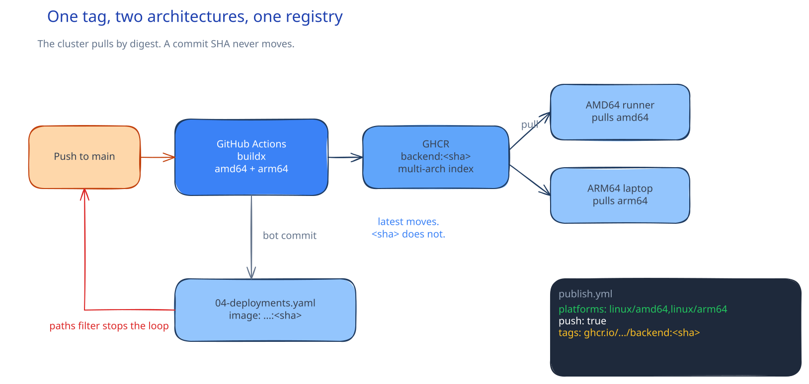

# DEV-16: Publish Images

**Act 3, DevOps Engineer** · Focus: Release Engineer · About 20 minutes

Until now you loaded the three images into Minikube by hand. A real cluster pulls from a registry. This episode makes a push to `main` build and publish the images, then update the manifests without a loop.

| | |
|---|---|
| You need | Episode 15 complete. Your fork is on GitHub and you can push to `main`. |
| You build | A publish workflow at `.github/workflows/publish.yml` that builds multi-arch images, tags them by commit SHA, and pushes them to GHCR |
| Done when | The workflow runs the tests, publishes `linux/amd64` and `linux/arm64` images tagged by SHA, and updates the manifests to the new tags without retriggering itself |

## What you will be able to do

- Explain a container registry.
- Build multi-arch images in GitHub Actions.
- Tag images with the commit SHA.
- Update manifests without a workflow loop.
- Pull private images with a classic PAT.

## Before you start

- Episode 15 complete. The app runs, scales, and the manifests use local image names.
- Your fork is on GitHub. You can push to `main` and open the Actions tab.
- You have Docker and Git locally, so you can run the build and update commands by hand.

## Clusters pull. Laptops load.

Hand loading does not scale. `minikube image load` copies one image from your laptop to one cluster. It works for a lab with one node. It fails for a team, a fleet, or a weekend. A real cluster has no laptop beside it. It fetches bytes from a registry. The registry is the source of truth.

Pull beats loading for one more reason: the bytes match. Every cluster pulls the same file, with the same layers, from the same tag. Hand loading can drift. One laptop has a stale image. Another has a rebuild. The registry ends the argument. The tag names the bytes.

## A registry stores tagged bytes

GHCR is the GitHub registry. It is free for public repositories. The image name states where an image lives:

```text
ghcr.io/<owner>/<repo>/backend:<sha>
```

`ghcr.io` is the registry host. `<owner>` and `<repo>` say whose fork holds it. `backend` names the app part. `<sha>` is the commit SHA, the unique ID of the code. Frontend and database have the same shape with their own suffix. A tag names an image version.

Two tag styles matter. `latest` moves. It always points at the newest build. It is handy for a quick test. It hides what runs. You cannot tell which commit produced it. A commit SHA never changes. The same SHA always means the same code. Rollback becomes simple: point the manifest at an older SHA. The old bytes return. That is why this act tags by SHA and avoids `latest`.

## One tag holds two architectures

Macs with Apple chips use ARM64. Most servers use AMD64 (x86_64). One tag can hold both builds. Docker picks the right one at pull time. The user does not name the architecture. The platform list in the workflow says which builds to create:

```text
linux/amd64,linux/arm64
```

QEMU and Buildx in GitHub Actions build the other architecture on the runner. The first build is slower because it emulates the foreign chip. The result is still a normal image. Later pulls are fast because the right bytes are already stored. Multi-arch costs time once and saves motion every week after.



## The workflow in outline

GitHub Actions runs a file under `.github/workflows/`. This act adds `publish.yml`. It triggers on push to `main`, but only when listed paths change: `backend/`, `database/`, `frontend/`, or the workflow file itself. That filter is a gate. A README edit does not build images. A manifest edit does not build images.

Its permissions are exact. It needs `contents: write` to commit the manifest update back to the repo, and `packages: write` to push images to GHCR. A missing `packages: write` denies the push. The error is clear and easy to miss. Check the block before the first run.

The steps run in order:

| Step | Job |
|---|---|
| Checkout | Fetch the pushed commit. |
| Tests | Run the test suite. Stop here if they fail. |
| QEMU, Buildx | Set up multi-arch build. |
| Login to GHCR | Authenticate the push. |
| Build and push | Three `build-push-action` steps, one per app part. |
| Update manifests | Rewrite image tags and commit the change. |

Tests run first. A broken suite never publishes. That order matters. You want a failing test to block a release, not to arrive with one.

Copying the workflow needs care. The solved file uses an `ACT` variable and an `act-3-devops-engineer/` path prefix. Your fork has the app at the repository root. Remove the variable and the prefix. Use `context: ./backend`, `context: ./frontend`, and `context: ./database`. The paths must match your folders, or the build finds nothing.

## Update the manifests without a loop

After the push, the workflow writes the new SHA into the manifests. It does this with `sed` commands that match on the image name, such as `tutorial-frontend:`. Your manifests already use the local names, so the first run rewrites them to the `ghcr.io` form with the new SHA. If you renamed the local images, update the `sed` patterns to match. The pattern and the manifest must agree.

The workflow then commits the change as `github-actions[bot]` and pushes it. That bot commit must not start the workflow again. It does not, because it changes only manifests. The `paths` filter does not list manifests. A manifest-only commit is invisible to the trigger. The loop is avoided by exclusion, not by a special flag. Check the filter before you debug a loop.

One more line deserves care. The workflow also rewrites `repoURL` in `kubernetes/argocd/applications/*.yaml`. Episode 17 creates those files. If you run the workflow before Episode 17, that step has nothing to rewrite. Remove the `repoURL` line before the first run. Add it back after Episode 17. Otherwise the first run fails on a missing file.

## Private images need a classic PAT

Packages from a private repository are private. Minikube cannot pull them without credentials. Public images need no token. The docs give a short section for this case. Create a classic personal access token with only `read:packages`. A fine-grained token cannot read GHCR packages. Use the classic form. Never commit the token. The workflow never connects to your cluster. The token and its pull Secret live on the command line, not in Git.

Making the repository and the packages public removes the need for this token. That is the simpler choice for a lab. If you keep the fork private, create the pull Secret in the `app` namespace and attach it to the default ServiceAccount. Every Pod then uses it. Scope stays at `read:packages`. A classic token reaches every repository you can read. Keep the scope small and revoke the token after the course.

## Traceability is the point

A tag tied to a commit traces a running Pod to exact code. You can read the SHA from the Pod spec and open that commit. You can rebuild it. You can read its tests. A `latest` tag gives you none of that. The workflow here is a release tool first and a build tool second. The build is routine. The trace is the value.

## Common mistakes

- **Using `latest`.** You cannot tell what code runs. Tag by commit SHA.
- **A workflow that triggers itself.** The bot commit changes only manifests. The `paths` filter must exclude manifests.
- **Missing `packages: write`.** The image push fails with `denied`.
- **A PAT with too many scopes.** Use only `read:packages`.
- **Committing the PAT.** Keep it in an environment variable and revoke it after the course.
- **Paths that do not match the fork.** Remove the `ACT` prefix or the build finds nothing.
- **Renamed local images with old `sed` patterns.** The update step silently writes the wrong tag.

## Check your work

- [ ] `.github/workflows/publish.yml` exists and its YAML is valid.
- [ ] The `on: push` filter lists `backend/`, `database/`, `frontend/`, and the workflow file.
- [ ] The `permissions` block lists `contents: write` and `packages: write`.
- [ ] The build lists both `linux/amd64` and `linux/arm64`.
- [ ] The image names in the workflow match the `sed` patterns and the manifest names.
- [ ] The repoURL step is removed until Episode 17, or the ArgoCD folder exists.
- [ ] You ran the image build and manifest update commands locally without errors.

## What this unlocks on your CV

| Skill | Episode | CV section | Example bullet |
|---|---|---|---|
| Container registries, multi-arch builds | 16 | CI/CD and Automation | Built and published multi-architecture images to GHCR, tagged by commit SHA, with GitHub Actions |

## Career note

A release engineer keeps every Pod traceable to a commit. The SHA tag in this episode gives that trace. Rollback means pointing the manifest at an older SHA. The workflow without the loop gives you that safety every push. Images sit in the registry. Nothing deploys them yet. Episode 17 hands the registry to ArgoCD.

## Next

Episode 17 installs ArgoCD and syncs the app from Git. The workflow never connects to your cluster. ArgoCD pulls from Git and the cluster pulls images from GHCR.

## Apply

The verified steps for this episode are in [Act 3, Task 13](../act3-devops-engineer.md#task-13-write-the-publish-workflow). Follow the tasks in order.

<!-- APPLY -->

### What you should see

| After | You should see |
|---|---|
| You write `publish.yml` | The workflow YAML is valid and the paths match your folders. |
| You run the image build and manifest update commands locally | The multi-arch builds and the tag update pass locally. |

An end-to-end run of this episode was partial: the workflow was written and checked and its commands ran locally. GHCR publish did not run because the token lacked the `workflow` scope.
