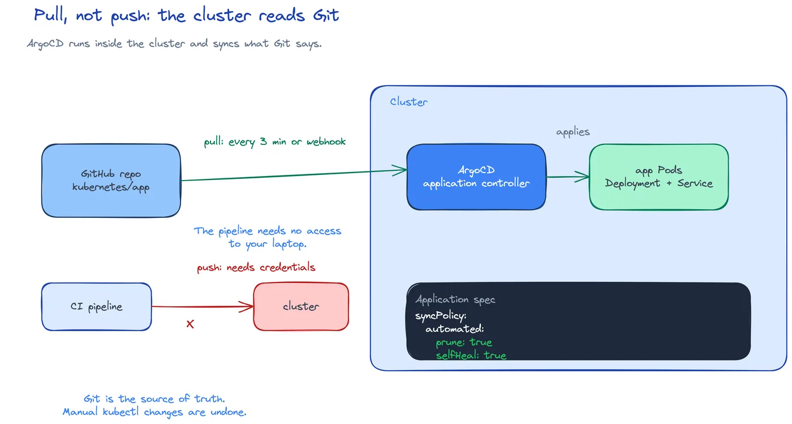

# DEV-17: GitOps

**Act 3, DevOps Engineer** · Focus: DevOps Engineer · About 20 to 25 minutes

You stop running `kubectl apply` by hand. Git holds the desired state. A tool inside the cluster reads Git and makes the cluster match it. That pull model is GitOps.

| | |
|---|---|
| You need | Episode 16 complete. The fork is public, or ArgoCD has repository credentials. The `monitoring` namespace exists. |
| You build | ArgoCD installed in the `argocd` namespace, with `app` and `monitoring` Applications that sync from Git |
| Done when | Both Applications are `Synced` and `Healthy`, and pushing a commit changes the cluster without a manual apply |

## What you will be able to do

- Explain GitOps and tell push delivery from pull delivery.
- Install ArgoCD into a cluster.
- Write an ArgoCD Application with a source, a destination, and a sync policy.
- Follow a change from commit to cluster.
- Explain self-heal and prune.

## Before you start

- Episode 16 complete. You publish images from CI.
- Your fork is public, or you can give ArgoCD read access to it.
- The `monitoring` namespace exists for the Grafana and database Secrets.
- You can commit and push to your fork.

## Push versus pull

Two delivery models exist.

| Term | Meaning |
|---|---|
| Push delivery | A pipeline connects to the cluster and applies manifests. |
| Pull delivery | A tool in the cluster reads Git and applies manifests. |
| ArgoCD Application | A Kubernetes resource that declares source, destination, and sync policy. |
| Automated sync | Sync runs on every Git change. |
| Prune | Delete cluster resources that Git no longer lists. |
| Self-heal | Undo manual drift and restore Git state. |
| Rollback | Revert the commit to undo the change. |

Push delivery needs network access from the pipeline to the cluster. That fails for a laptop cluster. No public network reaches your laptop, so no pipeline can connect and apply.

Pull delivery reverses the direction. ArgoCD runs inside the cluster. It polls the Git repository, compares Git with the cluster, and syncs the difference. The pipeline needs no access to your laptop. The cluster reaches out to Git over HTTPS.

This episode uses pull delivery with ArgoCD. After this point, no command in this act runs `kubectl apply` against the app manifests from your laptop. You commit, you push, ArgoCD syncs.



## Git holds the desired state

Keep the Kubernetes manifests and the ArgoCD Application files in Git. That folder is the declared state. ArgoCD compares the declared state with the live state in the cluster and makes them equal.

Git gives you three things for free:

1. Review. A change to a manifest is a commit. People can review it before it lands.
2. History. Every change has an author, a time, and a message.
3. Rollback. To undo a bad change, revert the commit. ArgoCD syncs the revert and the cluster returns to the old state.

This is why Teams call Git the source of truth. The history is the audit trail. When you verify a change, you read the commit, not a chat message.

The diagram has three parts. Git holds manifests plus ArgoCD Applications. ArgoCD reads Git and syncs the apps. The cluster holds `app` and `monitoring` namespaces that converge to Git. Nothing in the pipeline connects to the cluster.

## What an ArgoCD Application declares

An Application has three parts.

| Part | Question it answers |
|---|---|
| `source` | Which repository, which revision, which path? |
| `destination` | Which cluster, which namespace? |
| `syncPolicy` | Sync automatically, and clean up drift? |

A minimal shape:

```yaml
apiVersion: argoproj.io/v1alpha1
kind: Application
metadata:
  name: app
  namespace: argocd
spec:
  source:
    repoURL: https://github.com/YOUR_USERNAME/four-hats.git
    targetRevision: main
    path: kubernetes/app
  destination:
    namespace: app
  syncPolicy:
    automated:
      prune: true
      selfHeal: true
```

Read it as one sentence: watch `main` at path `kubernetes/app` and keep namespace `app` equal to it, with automatic sync, prune, and self-heal.

The second Application points at `observability` and namespace `monitoring`. Together they cover the app and the monitoring stack, so the whole Act 3 system deploys from Git.

`syncPolicy.automated` with `prune: true` and `selfHeal: true` is the mode this act uses. Manual sync stays as an option in the ArgoCD UI, but automated sync is the default path.

## Prune and self-heal

Prune and self-heal handle two different kinds of drift.

Prune removes resources that Git no longer lists. If you delete a Service from Git, prune deletes it from the cluster. Without prune, deleted manifests would linger forever.

Self-heal undoes manual edits. If someone runs `kubectl scale` against the cluster, self-heal restores the replica count from Git within seconds. If someone deletes a ConfigMap by hand, self-heal recreates it.

That behavior surprises people who edit the cluster directly. The rule is strict: if you want a change to stick, commit it to Git. Anything else is temporary drift that ArgoCD will revert.

Self-heal only works when Git declares the value. If a Deployment in Git has no `replicas` field, Git wants one Pod. There is nothing to restore, so the cluster keeps its current count. Always declare `replicas` in Git when you care about the count.

### Open the UI

Forward the ArgoCD server and read the initial admin password. The secret command prints a base64 value. Decode it with `base64 -d` to get the password. The user is `admin`.

```shell
minikube kubectl -- port-forward svc/argocd-server -n argocd 8443:443
minikube kubectl -- -n argocd get secret argocd-initial-admin-secret -o jsonpath="{.data.password}"
```

Open `https://localhost:8443`. The browser warns about the self-signed certificate. Accept it for this lab.

## Why pull fits a laptop cluster

Three reasons make pull the right choice here.

1. Reachability. A laptop has no inbound path from CI. Outbound HTTPS to GitHub always works. Pull needs only that path.
2. Auth. ArgoCD runs with cluster credentials already. The pipeline never holds a kubeconfig.
3. Convergence. The Application keeps syncing. A missed push still converges on the next poll. A failed push apply needs a retry.

The tradeoff is indirection. When something breaks, you debug through ArgoCD as well as the cluster. You check the Application health, the sync history, and the diff between Git and live state. That extra step is the price of automation.

## Limits and tradeoffs

Git holds manifests and ArgoCD Applications. It holds no Secrets. Secrets stay outside Git and outside history. Create them on the cluster by hand, with the same names the manifests expect. Missing Secrets fail Pod start with `CreateContainerConfigError` or a stuck Pending state.

A private repository needs credentials. ArgoCD must read the repo. Make the fork public or store read access in ArgoCD.

The `path` must hold manifests. A wrong path syncs empty and the Application looks quiet while nothing runs. Point at a folder that has the manifests you want.

Automation trusts Git. That trades against debugging indirection. You move faster on the happy path and add one layer to inspect on the failure path.

## What to check before you continue

These are theory checks. The Apply section below holds the verified tasks.

- Can you state the difference between push and pull in one sentence?
- Can you point to the three parts of an Application?
- Can you explain why a manual `kubectl scale` reverts?

## Common mistakes

- **Private repository with no credentials.** ArgoCD cannot read it. Make the fork public or add repository credentials in ArgoCD.
- **Missing Secrets.** Pods fail with `CreateContainerConfigError`. Create `app-db` and `grafana-admin` on the cluster before you sync. Never commit a Secret to Git.
- **Editing the cluster by hand and wondering why it reverts.** Self-heal restores Git state. Change Git instead.
- **Pointing `path` at a folder with no manifests.** The sync looks empty. Check the path holds the files you mean.
- **Expecting self-heal to restore an undeclared field.** If Git does not declare `replicas`, Git wants one Pod and there is nothing to restore.
- **Treating sync as instant.** ArgoCD polls and reconciles. A new Pod takes a minute.

## Check your work

- [ ] You can explain GitOps and tell push from pull apart.
- [ ] You know what ArgoCD installs into the `argocd` namespace.
- [ ] You can name the three parts of an Application.
- [ ] You know what `prune: true` and `selfHeal: true` do.
- [ ] You know why Secrets stay outside Git.
- [ ] You know why pull fits a local cluster.

## What this unlocks on your CV

| Skill | Episode | CV section | Example bullet |
|---|---|---|---|
| GitOps (ArgoCD) | 17 | CI/CD and Automation | Implemented GitOps with ArgoCD so every change reaches the cluster through a Git commit, with automated sync and self-heal |

Keep the two Application files. They back the GitOps row.

## Next

Episode 18 adds Prometheus scrape targets and a Grafana dashboard. The cluster now deploys from Git, so the monitoring configuration ships the same way.

## Apply

The verified steps for this episode are in [Act 3, Episode 17](../act3-devops-engineer.md#gitops-with-argocd-episode-17). Follow the tasks in order.

<!-- APPLY -->

### What you should see

| After | You should see |
|---|---|
| You install ArgoCD | ArgoCD Pods `Running` in namespace `argocd`. Version `v3.5.1`. |
| The `app` Application syncs | Status `Synced` and `Healthy`. |
| The `monitoring` Application syncs | Status `Synced` and `Healthy`. |
| You push a manifest change | ArgoCD applies it with no manual apply. |

An end-to-end run of this episode passed: ArgoCD `v3.5.1` installed, and the `app` and `monitoring` Applications reached `Synced` and `Healthy`.
