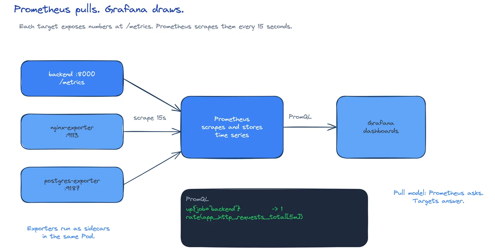

# DEV-18: Observability

**Act 3, DevOps Engineer** · Focus: Site Reliability Engineer (SRE) · About 20 to 25 minutes

You cannot fix what you cannot see. This episode makes the app visible from the inside. Prometheus pulls numbers from the app. Grafana draws charts from Prometheus.

| | |
|---|---|
| You need | Episode 17 complete. The `grafana-admin` Secret exists in `monitoring`. |
| You build | Prometheus scrape targets for the backend, frontend, and postgres, plus a Grafana dashboard |
| Done when | Every target shows `UP` at `http://localhost:9090/targets`, and the Grafana dashboard shows five panels |

## What you will be able to do

- Explain metrics, and the roles of Prometheus and Grafana.
- Add scrape targets.
- Read exporters.
- Use a dashboard to watch the HPA load test.

## Before you start

- Episode 17 complete. ArgoCD syncs the app and monitoring stacks from Git.
- The `grafana-admin` Secret exists in `monitoring`.
- You can open `http://localhost:9090` and `http://localhost:3000` through port-forward.
- The backend exposes `/metrics`. The frontend and postgres run exporters as sidecars.

## How metrics work

An app exposes numbers at `/metrics`. Prometheus pulls those numbers on a schedule and stores them as time series. Grafana draws charts from Prometheus queries. Storage and charts divide the work.

| Term | Meaning |
|---|---|
| Metrics endpoint | The path where the app exposes numbers, here `/metrics`. |
| Prometheus | Pulls metrics on a schedule and stores them. |
| Exporter | A helper that exposes numbers for a service. |
| Scrape target | One job pointing at one address. |
| PromQL | The query language for metrics. |
| Grafana | Draws charts from Prometheus queries. |

Read the chain from left to right:

The pipeline has four properties:

1. The app exposes. The app owns the numbers. Prometheus owns the collection.
2. Prometheus pulls. It contacts each target on a schedule. A target that does not answer shows as `DOWN`.
3. Targets prove wiring. `UP` on the targets page means the DNS name, the port, and the path all work.
4. Grafana charts. A dashboard only shows what Prometheus stored. No stored series, no chart.

Dashboards show what is wrong. Logs and traces show why. Keep that split in mind. A dashboard tells you to look. Logs tell you where.

## Exporters

The backend exposes `/metrics` itself. Nginx and PostgreSQL do not. They need a helper container, called an exporter.

Each exporter runs as a sidecar in the same Pod as the app:

| Pod | App container | Exporter sidecar |
|---|---|---|
| `frontend` | Nginx | `nginx-exporter` on port `9113` |
| `postgres` | PostgreSQL | `postgres-exporter` on port `9187` |

A sidecar shares the Pod network. It can reach the app on `localhost` and expose its own metrics port to the cluster. The Service must list that exporter port, not only the app port. When a scrape target will not connect, check `02-services.yaml` first.

The backend has no sidecar. Its `/metrics` path serves the same data format, so one job points at the backend Service on port `8000` with path `/metrics`.

## Scrape targets

`scrape_configs` holds one job per address. The starter ships with only a self-scrape job for Prometheus itself. This episode adds three jobs.

| Job | Target | Path |
|---|---|---|
| `backend` | `backend.app.svc.cluster.local:8000` | `/metrics` |
| `frontend` | `frontend.app.svc.cluster.local:9113` | default `/metrics` |
| `postgres` | `postgres.app.svc.cluster.local:9187` | default `/metrics` |

DNS names carry the namespace. The form is `<service>.<namespace>.svc.cluster.local`. A wrong namespace in the DNS name breaks resolution and the target stays `DOWN`.

The exporter ports are the trap. Two Services need two ports each:

- `frontend` needs the web port and `9113`.
- `postgres` needs the `5432` port and `9187`.

If the Service lists only the app port, Prometheus has no address to pull from. The job exists and the target fails. Add the exporter port to the Service when it is missing.

## Restart loads the config

Prometheus reads `prometheus.yml` once, at startup. A ConfigMap change does not restart the Pods that read it. Restart Prometheus every time you edit `scrape_configs` or `rules.yml`.

The same rule covers Alertmanager in Episode 19. Both read their config once at startup. A synced ConfigMap alone never restarts the Pod. You restart by hand after each edit.

Open the targets page after the restart. Every target must show `UP`. `UP` proves DNS, Service, port, and path in one glance. A `DOWN` target names the job, so you know which Service to inspect.

## PromQL and Grafana

Two queries cover most of the debugging in this act.

| Query | Question it answers |
|---|---|
| `up` | Is the target reachable? |
| `rate(app_http_requests_total[5m])` | What is the request rate over the last five minutes? |

Run `up` first. If a target is `DOWN`, no later query matters for that job. Run `rate` next. You get a graph of request rate over time.

Grafana is the chart layer. It connects to Prometheus as a data source. The provisioned dashboard in `observability/` shows five panels:

- request rate
- latency
- frontend connections
- database connections
- requests by endpoint

Those five panels track traffic, errors, and latency. Traffic shows load. Errors show failure. Latency shows queueing before it becomes failure.

Config as code versions the view. The dashboard JSON lives in Git. If you change a panel, you commit the file. Review and history apply to charts as well as manifests.

## Watch the HPA load test

The starter ships a load generator at zero replicas. Scale it up, watch the request rate rise on the dashboard, and watch the backend HPA scale from 2 to 6 replicas. Stop the load when you finish.

The load test proves the charts move. A dashboard that never moves during load is a wiring fault, not a quiet system.

Two rules close the loop:

1. Give the HPA a minute. It checks every 15 seconds. CPU metrics lag. Instant judgments misread the system.
2. Stop the load. A generator left running skews every later measurement.

## Limits and tradeoffs

Prometheus reads config once. Restart after each scrape or rules edit.

Exporter ports must be listed on the Service. The scrape target alone is not enough.

Missing Secrets stop dashboards. Grafana needs `grafana-admin` to start. Without it, the Grafana Pod never becomes ready.

Dashboard visibility trades against alert fatigue. Dashboards show what is wrong. Alerts, in Episode 19, decide what needs a person now.

## Common mistakes

- **A target `DOWN`.** Check the Service name and port. The job name must match a real Service.
- **Wrong namespace in the DNS name.** The form is `<service>.<namespace>.svc.cluster.local`. A wrong namespace breaks resolution.
- **Missing exporter port on the Service.** The frontend and postgres Services need the exporter port too, not only the app port.
- **Forgetting the `grafana-admin` Secret.** Grafana does not start without it.
- **Editing `scrape_configs` and not restarting Prometheus.** The change never loads. Run `rollout restart`.
- **Leaving the load generator on.** Scale it back to zero when you finish.
- **Treating a flat dashboard as a quiet system.** If load does not move the charts, the wiring is wrong.

## Check your work

- [ ] You can explain the roles of Prometheus and Grafana.
- [ ] You know what an exporter is and where it runs.
- [ ] You know why Prometheus needs a restart after a config edit.
- [ ] You can name the three scrape jobs and their ports.
- [ ] You know what `UP` on the targets page proves.
- [ ] You ran the load test and stopped the generator.

## What this unlocks on your CV

| Skill | Episode | CV section | Example bullet |
|---|---|---|---|
| Monitoring (Prometheus, Grafana) | 18 | Monitoring and Observability | Instrumented a Flask API, Nginx, and PostgreSQL with Prometheus exporters and built a Grafana dashboard |

Keep `prometheus.yaml` with the three targets and the dashboard JSON. They back the monitoring row.

## Next

Episode 19 adds an alert rule and a Discord receiver. Dashboards need someone to look at them. Alerts come to you.

## Apply

The verified steps for this episode are in [Act 3, Episode 18](../act3-devops-engineer.md#observability-episode-18). Follow the tasks in order.

<!-- APPLY -->

### What you should see

| After | You should see |
|---|---|
| You open the targets page | `backend`, `frontend`, `postgres`, and `prometheus` targets all `UP`. |
| You open Grafana | The provisioned dashboard with 5 panels. |

An end-to-end run of this episode passed: Prometheus showed `backend`, `frontend`, `postgres`, and `prometheus` targets `UP`, and Grafana showed the dashboard with 5 panels.
