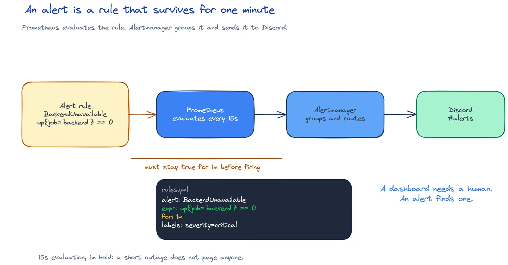

# DEV-19: Alerting

**Act 3, DevOps Engineer** · Focus: Site Reliability Engineer (SRE) · About 22 to 27 minutes

Dashboards need someone to look at them. Alerts come to you. This episode makes the app send a message to Discord when it fails. It closes with a demo-only segment on managed Kubernetes with GKE.

| | |
|---|---|
| You need | Episode 18 complete. A Discord server where you can add a webhook. |
| You build | A `BackendUnavailable` alert rule, a Discord receiver in Alertmanager, and a firing and resolved message in Discord |
| Done when | Scaling the backend to zero produces a `BackendUnavailable` alert in Discord, and restoring replicas produces a resolved message |

## What you will be able to do

- Write a Prometheus alert rule.
- Create a Discord webhook.
- Route alerts with Alertmanager.
- Trigger and resolve an alert.
- See the same manifests run on managed Kubernetes (GKE), demo only.

## Before you start

- Episode 18 complete. Prometheus scrapes `backend`, `frontend`, and `postgres` targets `UP`.
- A Discord server where you can add a webhook.
- You can create Secrets in `monitoring`.
- The GKE segment is a demo. You can watch it without a Google Cloud account.

## How alerts work

Prometheus checks a rule on a schedule. If the rule holds for its `for` window, the alert fires. Alertmanager groups alerts and sends them to a receiver.

| Term | Meaning |
|---|---|
| Alert rule | A PromQL expression checked on a schedule. |
| For window | The condition must hold for this long before firing. |
| Alertmanager | Groups alerts and sends them to a receiver. |
| Receiver | One destination, for example Discord. |
| Route | Picks which receiver gets which alert. |
| Send resolved | Also sends a message when the alert clears. |



Read the chain from left to right:

1. The rule checks `up{job="backend"} == 0`. When Prometheus cannot scrape the backend, the value is `0`.
2. The `for: 1m` window starts. The condition must hold for one minute before the alert fires.
3. Prometheus sends the firing alert to Alertmanager.
4. Alertmanager groups alerts, applies the route, and delivers to the Discord receiver.
5. When the backend returns, Alertmanager sends a resolved message because `send_resolved: true`.

Two phases matter. Firing tells you something failed. Resolved tells you it recovered. You see both, not only noise.

## The Discord webhook

Discord webhooks are a receiver interface. Create a webhook in Discord, copy its URL, and store it in a Secret in `monitoring`. Alertmanager reads the URL from a file and posts to it.

The webhook URL is a secret. Never commit it. Never show it on a screen recording. A leaked webhook URL lets anyone post into the channel.

The Secret holds one key, `webhook_url`. Alertmanager mounts the Secret as a volume and reads the file at `/etc/alertmanager/secrets/discord/webhook_url`. A Secret in the wrong namespace blocks Alertmanager. Alertmanager stays in `ContainerCreating` until the Secret appears.

## The alert rule

In `prometheus.yaml`, replace `groups: []` with a `BackendUnavailable` group.

```yaml
groups:
  - name: task-board
    rules:
      - alert: BackendUnavailable
        expr: up{job="backend"} == 0
        for: 1m
        labels:
          severity: warning
        annotations:
          summary: Backend is unavailable
          description: Prometheus cannot scrape the backend.
```

Each field has one job:

| Field | Job |
|---|---|
| `expr` | The failure condition. Here, `up` equals zero for the backend job. |
| `for` | The hold window. One minute smooths brief restarts. |
| `labels.severity` | Severity. `warning` here. The receiver can route on it. |
| `annotations.summary` | Short message in Discord. |
| `annotations.description` | Why the condition fired. |

A `for` window that is too short makes alerts flap. The alert fires, clears, fires again, and teaches people to ignore it. One minute is a starting point for this lab. Production values depend on restart behavior and on-call thresholds.

## The receiver and the route

In `alertmanager.yaml`, change `route.receiver` to `discord`. Replace the starter `blackhole` receiver with a `discord_configs` receiver that reads the webhook URL from a file. Mount the Secret as a volume, read-only, at `/etc/alertmanager/secrets/discord`.

```yaml
receivers:
  - name: discord
    discord_configs:
      - webhook_url_file: /etc/alertmanager/secrets/discord/webhook_url
        send_resolved: true
```

```yaml
volumes:
  - name: discord
    secret:
      secretName: alertmanager-discord
```

```yaml
volumeMounts:
  - name: discord
    mountPath: /etc/alertmanager/secrets/discord
    readOnly: true
```

The route picks the receiver. Alertmanager groups alerts and rate limits them, so one outage produces one message, not a stream. `send_resolved: true` adds the recovery message. Without it, you see the failure and never learn when it cleared.

Good alerts are rare and actionable. Too many alerts teach people to ignore them. The on-call engineer decides what pages a person. This lab uses `warning` severity and a one-minute window to keep the signal clean.

## Restart loads the config

Prometheus and Alertmanager both read their config once, at startup. A synced ConfigMap does not restart the Pod. Restart both by hand after this change.

The same rule covered Prometheus in Episode 18. It covers Alertmanager here. A config edit without a restart never loads. The targets page can still show `UP` while the new rule sits unloaded. Restart both, then trigger.

## Trigger and resolve

Test the alert by breaking the backend. Pause ArgoCD automated sync first, or the alert never fires.

ArgoCD self-heal restores the replica count within seconds. That is long before the alert `for: 1m` window elapses. If automated sync stays on, the Deployment returns to two replicas and `up` returns to `1` before Prometheus ever fires. Pause automated sync, scale the backend to zero, wait about one minute, and watch Discord show `BackendUnavailable`.

Restore automated sync when you finish. The HPA cannot scale the backend up from zero replicas. Scale the Deployment back to two replicas by hand. Re-enabling sync alone leaves the backend at zero. Discord shows the resolved message once Prometheus scrapes the backend again.

If you did not install ArgoCD, run the same scale commands. The alert path is identical. Only the drift control differs.

## Demo only: the same app on GKE

Everything so far ran on Minikube, a single-node cluster on your laptop. Production Kubernetes is usually managed. GKE, EKS, and AKS run the control plane for you. The manifests from Episodes 11 to 15 do not change.

This segment is a demo, presenter-only. There is nothing to submit. You can watch it without a Google Cloud account. The presenter needs `gcloud` and `kubectl` on the host machine.

Warning: this needs a Google Cloud free trial and creates real billable resources. Set a budget alert before creating anything.

```shell
gcloud container clusters create-auto gke-demo --region us-central1
gcloud container clusters get-credentials gke-demo --region us-central1
gcloud components install kubectl
```

The end-to-end run also needed `gke-gcloud-auth-plugin`. Install it if `kubectl` reports the plugin missing. Delete the cluster and any `pvc-*` disks after the demo.

Apply the same `kubernetes/app/` manifests: the Namespace, the Deployments, the Services, the Postgres StatefulSet, the ConfigMaps, and the Secrets. Change the frontend Service from `type: NodePort` to `type: LoadBalancer` for this demo. Change each `image:` value to the published image from Episode 16.

Same Deployments, StatefulSet, ConfigMaps, and Secrets, running on a different cluster. What changes: a managed control plane, automatic node upgrades, and a `LoadBalancer` Service that gets a real external IP, which Minikube cannot do without MetalLB. A `NodePort` Service never gets an external IP on GKE. What does not change: everything else this act taught you.

Delete the cluster right after the demo, not at the end of the session. The cluster can leave Persistent Disk volumes behind. List disks with `gcloud compute disks list --filter='name~pvc-'` and delete each disk the demo created. Check the Billing page. It must show no running resources.

## Limits and tradeoffs

Config loads once. Prometheus and Alertmanager need a restart after changes.

Self-heal beats the timer. ArgoCD restores replicas in seconds, before the one-minute window ends. Pause automated sync to test, then restore it.

The webhook URL is a secret. Never show it on screen and never commit it.

False positives trade against missed outages. A short `for` window catches brief failures and causes flapping. A long window stays quiet and delays pages.

## Common mistakes

- **Committing the webhook URL.** The URL is a secret. It stays in a Kubernetes Secret, never in Git.
- **Rule `for` too short.** Alerts flap. Start with `1m` and tune from evidence.
- **Secret in the wrong namespace.** Alertmanager stays in `ContainerCreating`. Create it in `monitoring`.
- **Testing with Prometheus targets still `UP`.** If the backend still scrapes, the rule never holds. Scale the backend to zero first.
- **Leaving automated sync on during the test.** Self-heal restores replicas before the one-minute window elapses. Pause sync first.
- **Forgetting the restart after the config edit.** The new rule and receiver never load. Restart Prometheus and Alertmanager.
- **Leaving the GKE demo cluster running.** Delete it right after the demo. Check `pvc-*` disks and the Billing page.

## Check your work

- [ ] You have a Discord webhook and its URL lives only in a Secret.
- [ ] You can state the `BackendUnavailable` expression and its `for` window.
- [ ] You can explain the route and the receiver in Alertmanager.
- [ ] You know why Prometheus and Alertmanager need a restart.
- [ ] You triggered the alert and saw the firing message.
- [ ] You restored replicas and saw the resolved message.
- [ ] You understand what changes on GKE and what does not.

## What this unlocks on your CV

| Skill | Episode | CV section | Example bullet |
|---|---|---|---|
| Alerting (Alertmanager) | 19 | Monitoring and Observability | Wrote Prometheus alert rules and routed alerts to Discord with Alertmanager |

Keep the alert rule and receiver in Git and the Discord message as proof.

## Next

Act 3 is done. You deployed, scaled, published, delivered, and monitored the app. In Act 4 you pentest it. Episode 20 starts with thinking like an attacker.

## Apply

The verified steps for this episode are in [Act 3, Episode 19](../act3-devops-engineer.md#alerting-episode-19). Follow the tasks in order.

<!-- APPLY -->

### What you should see

| After | You should see |
|---|---|
| You trigger the alert | The `BackendUnavailable` alert fired after about 105 seconds and reached the receiver. |
| The GKE Autopilot demo runs | The app returned 200 through the LoadBalancer. |

An end-to-end run of this episode passed with a mock receiver: the `BackendUnavailable` alert fired after about 105 seconds and the payload reached a local HTTP receiver at `host.minikube.internal:18082`. No Discord server was available for that run. The GKE Autopilot demo also ran, and the app returned 200 through the LoadBalancer.
