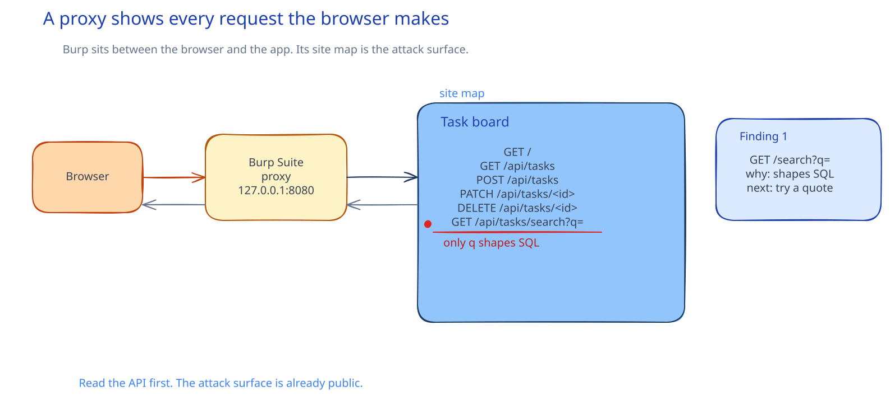

# CSC-20: Think like an attacker

**Act 4, Cybersecurity Engineer** · Focus: Penetration Tester · About 20 to 24 minutes

Every app you have built so far assumed its users are honest. This episode stops that assumption. You write a scope, read the API by hand, map every browser request, and name the one endpoint to test next. You do not exploit anything in this episode.

| | |
|---|---|
| You need | Episode 19 complete, with the app running on Minikube in the `app` namespace. Burp Suite Community Edition installed on your laptop. |
| You build | A one-page scope, an API map from `curl`, a Burp Suite site map, and the first pentest notes row for the search endpoint |
| Done when | The scope names target, in scope, out of scope, and stop condition, the four endpoints respond, and the site map lists every browser request |

## What you will be able to do

- Write a scope and rules of engagement before testing anything.
- Map the OWASP Top 10 onto a real three-tier app.
- Read an API by hand with `curl` and name each endpoint, parameter, and [[status-code|status code]].
- Map an attack surface with Burp Suite and list every request in the site map.
- Explain why reading the code and the traffic beats running a scanner on autopilot.

## Before you start

- Episode 19 complete, with the app running on Minikube.
- Burp Suite Community Edition installed on the host. It is a GUI proxy and the one Act 4 tool that runs outside the cluster.
- You can open a second terminal for the port-forward that Episode 20 needs.

## Scope before tools

Warning: never point a security tool at a system you do not own or do not have written permission to test. State this warning before any test. Every step in this act targets `127.0.0.1`, `localhost`, or your own Minikube cluster internal network. Nothing else.

Rules of engagement record four things before you touch the app. Target names the system you test. In scope names what you may test inside it. Out of scope names what you must not test. Stop condition names when you stop.

| Term | Meaning |
|---|---|
| Rules of engagement | Written target, scope, and stop condition before testing |
| OWASP Top 10 | Most common web weaknesses, injection included |
| API recon with `curl` | Read endpoints, parameters, and status codes |
| Burp Suite proxy | Records, replays, and edits browser requests |
| Site map | Every request the app makes, in one view |

A real engagement starts with a signed scope, not a tool. Testing without written scope is the line between work and a crime. Write the scope first, even as a student. A one-page scope is enough for this act. The scope in this episode covers `http://localhost:8000`, your own Minikube cluster, the API and the frontend, and a stop rule based on time or on confirming the flaw.

## The OWASP Top 10 and this app

The OWASP Top 10 is a list of the most common web application weaknesses. Injection is on it. Security misconfiguration is on it too.

This act gives you one of each. The backend ships a search endpoint that builds SQL from user input. That is injection. The Kubernetes cluster has no NetworkPolicies. That is misconfiguration.

Neither flaw needs a famous name to find. Both need reading first. The OWASP Top 10 gives you names for the classes. The app gives you one live example of each class. Keep those two facts apart. The list is the map of common weaknesses. The app is the ground you walk on.

## Read the API before you attack

Before you attack anything, read it. Most of what an attacker needs is already public: the endpoints, the parameters, the status codes.

Keep a port-forward running in its own terminal for the rest of this act. The forward exposes the backend Service in the `app` namespace on your laptop at port 8000. With it up, you can call the API from your laptop while the app stays inside the cluster. If port 8000 is in use, forward to 18000 and use 18000 in the URLs. If a request hangs, check that the forward is still running first. A dead forward is the usual cause.

Four endpoints respond in this episode. The two health endpoints are `healthz` and `readyz`. They prove the backend is alive and ready. The task list endpoint returns the saved tasks. The search endpoint takes a `q` parameter.

The search endpoint is the first one that takes raw user input and uses it to filter data. Every other endpoint takes an ID or a fixed field. Search takes free text and shapes a database query. That difference draws the eye. An attacker will try search first for the same reason. You are only following the reading to its clear conclusion.

## Map the attack surface with Burp Suite

`curl` shows you one request at a time. A proxy shows you every request your browser makes. Burp Suite sits between your browser and the app. It records, replays, and lets you edit requests.

Burp Suite listens on `127.0.0.1` port 8080. Your browser sends each request to that listener. Burp sends the request on to the app and records the response. You then see the whole conversation in the site map. Turn the browser proxy off after this episode. Do not leave it pointed at Burp for normal browsing, or every request will fail or be logged.

Drive the app through its normal jobs. Open the frontend. Create a task. Search for it. Mark it done. Delete it. The site map grows with each job. Five requests tell the story of this app.

| Request | Job |
|---|---|
| `GET /` | Load the frontend |
| `GET /api/tasks` | List tasks |
| `POST /api/tasks` | Create a task |
| `PATCH /api/tasks/<id>` | Mark a task done |
| `GET /api/tasks/search` | Search tasks |

The last row stands out. It is the only endpoint whose parameter directly shapes a database query `WHERE` clause. It also appears in the `curl` reading as the endpoint with a `q` parameter. Two independent reads point at the same place. That is recon working as it should. The next episode tests that endpoint.

## Write what you found

A pentest is worthless if nobody reads it later. Write down what you found, even before you exploit it.

One line per finding is enough. Record the endpoint, why it looks interesting, and your next step. The notes file starts with one row for `/api/tasks/search`. It states the observation from the site map and the next test. Later episodes add the proof and the fix to the same row. A written artifact beats a memory of what you clicked. A reviewer, or a future employer, reads the artifact after the tools are closed.

## Common mistakes

- **Testing without a written scope.** Write it first, even as a student.
- **Forgetting the port-forward.** If `curl` hangs, check the forward is still running in its own terminal.
- **Leaving the browser proxy pointed at Burp.** Turn it off before normal browsing.
- **Skipping the read-only recon.** Jumping straight to exploitation misses endpoints.
- **Testing anything outside your own laptop.** Stop. Only `127.0.0.1`, `localhost`, and your Minikube cluster are in scope.
- **Guessing the port.** Port 8000 may be in use. Forward to 18000 and use 18000 in the URLs.

## Check your work

- [ ] The scope names target, in scope, out of scope, and stop condition.
- [ ] `healthz`, `readyz`, the task list, and search all respond through the port-forward.
- [ ] You can name the `q` parameter on the search endpoint.
- [ ] Burp Suite listens on `127.0.0.1:8080` and the browser points at it.
- [ ] The site map shows `GET /`, `GET /api/tasks`, `POST /api/tasks`, `PATCH /api/tasks/<id>`, and `GET /api/tasks/search`.
- [ ] The pentest notes hold one row for `/api/tasks/search` with endpoint, observation, and next step.
- [ ] The browser proxy is off again after the mapping.

## What this unlocks on your CV

| Skill | Episode | CV section | Example bullet |
|---|---|---|---|
| Rules of engagement, authorized testing | 20 | Networking & Security | Defined scope and rules of engagement before testing an application |
| OWASP Top 10 | 20 | Networking & Security | Mapped the OWASP Top 10 to a three-tier application |
| API reconnaissance (curl) | 20 | Networking & Security | Enumerated API endpoints and parameters with curl |
| Attack surface mapping (Burp Suite) | 20 | Networking & Security | Mapped an application's attack surface with Burp Suite |

## Career note

A real engagement starts with a signed scope, not a tool. The slowest and most valuable step is reading, not attacking. Most real flaws are found by someone who read code or traffic carefully, not by running a scanner on autopilot.

## Next

Episode 21 confirms the SQL injection by hand, then automates the attack with `sqlmap`.

## Apply

The verified steps for this episode are in [Act 4, Episode 20](../act4-cybersecurity-engineer.md#think-like-an-attacker-episode-20). Follow the tasks in order.

<!-- APPLY -->

### What you should see

| After | You should see |
|---|---|
| You write the scope | One page with target, in scope, out of scope, and stop condition, limited to your own laptop and cluster. |
| You read the API | `healthz`, `readyz`, the task list, and search respond through the port-forward. Search takes `q`. |
| You map with Burp | A site map with `GET /`, `GET /api/tasks`, `POST /api/tasks`, `PATCH /api/tasks/<id>`, and `GET /api/tasks/search`. |
| You write the notes | One row for `/api/tasks/search` with endpoint, observation, and next step. |

An end-to-end run of this episode passed: `healthz`, `readyz`, the task list, and search all responded through the port-forward.
