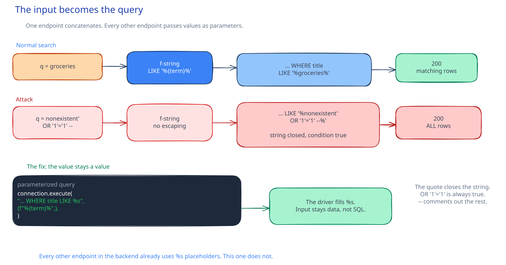

# CSC-21: Exploit the SQL injection

**Act 4, Cybersecurity Engineer** · Focus: Penetration Tester · About 20 to 24 minutes

One endpoint stood out in Episode 20: `/api/tasks/search`. This episode proves it is broken, by hand first, then with a tool that automates the attack. Manual proof comes first. A scanner report is a lead, not proof.

| | |
|---|---|
| You need | Episode 20 complete. The port-forward from Episode 20 still running. |
| You build | Hand-made proof of the injection, a full dump of the `tasks` table with `sqlmap`, and a written finding in the pentest notes |
| Done when | The boolean payload returns every row, the UNION payload returns data you never created, and `sqlmap` reports the parameter as injectable |

## What you will be able to do

- Confirm a SQL injection by hand with an error-based and a boolean-based payload.
- Extract data with a UNION-based payload that matches three columns.
- Automate discovery and extraction with `sqlmap` as a Pod in the cluster.
- Write up a finding with endpoint, payload, data extracted, and planned fix.

## Before you start

- Episode 20 complete, with the scope, the site map, and the pentest notes row for search.
- The port-forward from Episode 20 still running in its own terminal.

## The vulnerable endpoint

Warning: every command in this episode targets your own Minikube cluster, on your own laptop. Never run these commands against a system you do not own. State this warning before the payloads. Keep the boundary from Episode 20 scope. It applies to every command that follows.

Here is the code. The search handler reads the `q` parameter into a variable called `term`. It opens a database connection. It builds a SQL query with an f-string. It drops the `q` parameter straight into the query text.

The query selects `id`, `title`, and `done` from `tasks`. The `WHERE` clause filters with `LIKE` on the title. The `ORDER BY id DESC` sorts newest first. The handler fetches all rows and returns them as JSON. Every part of that script matters, but only one part is unsafe.

Every other endpoint in the backend passes values as parameters that the database driver fills in safely. This one does not. Whatever you put in `q` becomes part of the SQL text itself. The database cannot tell your text from the app text. That is the whole bug.

| Term | Meaning |
|---|---|
| Vulnerable code | An f-string drops `q` straight into SQL text |
| Error based | One quote changes `200` to `503` |
| Boolean based | An always-true condition returns every task |
| UNION based | A second SELECT adds rows you never created |
| `sqlmap` | Tries hundreds of payloads and extracts for you |

## A normal search

A normal search always returns `200`. It returns an empty list when no title matches. It returns your own tasks when a title matches. Search for an ordinary word first, so you have a clean baseline. The next three tests each compare against that baseline. Without a baseline, a new [[status-code|status code]] or a new row means nothing.

Use `--data-urlencode` with `curl` for every payload from now on. A raw quote or space in the URL breaks the request before it reaches the app. Encoding keeps the search value as one parameter. The app still receives your text, but the transport stays valid.

## Error-based confirmation

Send one character the query does not expect: a single quote.

The backend has a global error handler. It turns any database error into a `503` with a short JSON body. The original error never reaches you. A stack trace would help an attacker, so the app hides it. The status code still tells the story. A broken query is invisible as a stack trace, but it is not invisible as a status code.

One character changes a `200` into a `503`. That is the signal. A normal word returns `200`. A quote returns `503`. The only difference is one character of input. Your input broke the SQL. You have shown that input reaches the query. You have not yet shown that you control it. The next payload shows that.

## Boolean-based confirmation

A `503` only shows something broke. The next payload proves you control the query logic.

This payload closes the quoted string early, then adds a condition that is always true. Walk through what the app builds. The closing quote ends the `LIKE` string right after your word. The added condition is always true, so the database filter passes for every row. A trailing comment removes the rest of the original query text, including the stray quote the template adds.

The result returns every task in the table, not just ones matching your word. The search term never matched. The injected condition did. That is the difference between breaking a query and controlling it. Error breaks it. Boolean controls it.

## UNION-based extraction

A boolean payload proves control. A UNION payload steals data.

The real query selects three columns: `id`, `title`, `done`. The injected `SELECT` must return three values of matching types: a number, a string, and a boolean. Get the count or the types wrong and the database rejects the query. The app returns its usual error shape and you learn nothing. Match all three and the database adds your rows to the result.

The injected query returns one task whose `title` is the PostgreSQL version string. You never created that task. The `UNION` added a row from a query you wrote, not the app. Control became extraction. The same three-column shape that the real query uses now serves your query instead.

## Automate with sqlmap

You just did what `sqlmap` does, one payload at a time, by hand. `sqlmap` tries hundreds of payloads and does the extraction for you.

`sqlmap` has no official Docker image, so this course builds a small one from source. Run it as a Pod inside the cluster, not from your laptop. That way it reaches the backend by Service name at `backend.app.svc.cluster.local:8000`. The vulnerable endpoint never leaves the cluster. A laptop container reaching a port-forward would need the forward bound to every network interface. That would expose the endpoint to your local network. A Pod avoids that risk entirely.

The scan reports the `q` parameter as injectable. It names boolean-based blind, stacked queries, time-based blind, and UNION query. Those techniques match what you just used by hand, each in a more general form. The tool found what you proved. That order matters. You can now explain the report, because you know which payload produced which idea.

PostgreSQL has no separate databases to list from one connection the way MySQL does. The list operation names schemas instead. This app stores its tables in the default `public` schema. Use `-D public` for the schema. Then list the tables in it. That list finds `tasks`, the table the search handler reads. Dump that one table with `-T tasks`. The dump returns every row with `id`, `title`, `done`, and `created_at`. You now have the full table, not a sample.

## Write up the finding

Add the finding to the pentest notes. Record the endpoint. Record the payload that confirmed it. Record the data extracted. Record the fix you will apply next episode. A finding without a clear fix is not finished.

One row now holds the full story. The endpoint is the search route. The boolean payload confirmed control. The UNION payload and `sqlmap` dumped the table. The fix is a parameterized query. Keep the row in the repo. A reviewer can read it later and understand both the bug and the plan.

## Common mistakes

- **Skipping the manual payloads.** Going straight to `sqlmap` leaves you unable to explain the result.
- **Forgetting `--data-urlencode`.** A raw quote or space breaks the request before it reaches the app.
- **Forgetting to load the `sqlmap` image.** The Pod stays in `ImagePullBackOff` until the image is loaded into this cluster.
- **Using `-D tasks` instead of `-D public`.** PostgreSQL lists schemas. The table lives in `public`, not a database named `tasks`.
- **Running these commands anywhere else.** Only your own Minikube cluster is in scope.
- **Getting the UNION shape wrong.** The injected `SELECT` must match three columns: an integer, a string, and a boolean.

## Check your work

- [ ] A normal search returns `200`.
- [ ] A single quote in `q` returns `503` with `Database is unavailable`.
- [ ] The boolean payload returns every row in the table.
- [ ] The UNION payload returns the PostgreSQL version string as a title.
- [ ] The `sqlmap` scan reports the `q` parameter as injectable.
- [ ] The dump returns every `tasks` row with `id`, `title`, `done`, and `created_at`.
- [ ] The pentest notes row for search names endpoint, payload, data extracted, and planned fix.

## What this unlocks on your CV

| Skill | Episode | CV section | Example bullet |
|---|---|---|---|
| SQL injection (manual exploitation) | 21 | Networking & Security | Confirmed and exploited a SQL injection by hand |
| Automated exploitation (sqlmap) | 21 | Networking & Security | Automated SQL injection data extraction with sqlmap |

## Career note

Manual confirmation comes first. A scanner that reports possibly vulnerable is a lead, not proof. Manual proof is also the stronger interview answer. I confirmed it with a boolean payload, then automated the extraction, beats I ran a scanner.

## Next

Episode 22 switches hats. You fix the query, then segment the network around it.

## Apply

The verified steps for this episode are in [Act 4, Episode 21](../act4-cybersecurity-engineer.md#exploit-the-sql-injection-episode-21). Follow the tasks in order.

<!-- APPLY -->

### What you should see

| After | You should see |
|---|---|
| You send a normal search | `200` with an empty list or your own matching tasks. |
| You send a quote | `503` with `Database is unavailable`. |
| You send the boolean payload | Every row in the table comes back. |
| You send the UNION payload | One row whose `title` is the PostgreSQL version string. |
| You run `sqlmap` | The `q` parameter reported as injectable with boolean-based blind, stacked queries, time-based blind, and UNION query. |
| You dump the table | Every row of `tasks` with `id`, `title`, `done`, and `created_at`. |

An end-to-end run of this episode passed: the quote returned `503`, the boolean payload returned every row, the UNION payload returned the PostgreSQL version, `sqlmap` reported all four techniques, and the dump returned the `tasks` row.
