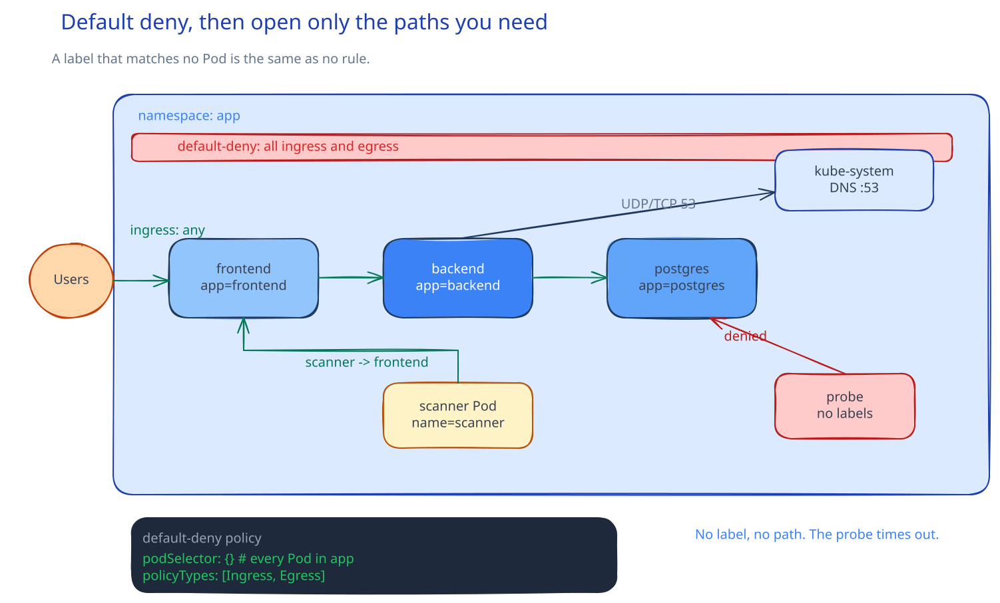

# CSC-22: Fix and Harden

**Act 4, Cybersecurity Engineer** · Focus: Security Engineer (defensive) · About 14 to 16 minutes

Last episode you broke it. This episode fixes it, then makes sure a compromised Pod cannot just walk over to the database. The fix is small. The wall behind it limits the next bug you have not found yet.

| | |
|---|---|
| You need | Episode 21 complete. A second, free Minikube profile for the policy check later in this episode. |
| You build | A fixed search query, a rebuilt backend Deployment, and `kubernetes/app/07-networkpolicy.yaml` with default deny plus explicit allow rules |
| Done when | Both exploit payloads return an empty list, `sqlmap` reports not injectable, and a Pod without an allow rule cannot reach the database |

## What you will be able to do

- Fix a SQL injection with a parameterized query and explain why the value is no longer SQL.
- Isolate tiers with default-deny NetworkPolicies and explicit allow rules.
- Verify that a Pod without an allow rule cannot reach the database.

## Before you start

- Episode 21 complete, with the pentest notes row for search.
- A second, free Minikube profile available for the policy check at the end.

## Fix the query

The fix is one change. Pass `q` as a parameter, the same way every other endpoint already does.

The vulnerable handler reads the `q` parameter into `term`. It opens a database connection. It builds the query with an f-string and drops `term` into the SQL text. It selects `id`, `title`, and `done` from `tasks` with a `WHERE` clause on `LIKE` and `ORDER BY id DESC`. That handler must change in one place only.

Replace the f-string with a `%s` placeholder and a separate parameter tuple. The query text now holds a fixed `SELECT` with `LIKE` and a placeholder. The value, the wrapped search term, travels as data in the tuple. The driver sends query text and value separately. The database never treats the value as part of the SQL. User input can now only match titles. It cannot add conditions, close strings, or add `SELECT` statements.

Remove the comment that says the endpoint is intentionally vulnerable. The comment is no longer true. Leaving it would tell the next reader the opposite of what the code does. Small fix, two lines of code, but the shape changes from text building to data passing.

| Term | Meaning |
|---|---|
| Parameterized query | Query text and value travel separately |
| Default deny | Block all ingress and egress, then add needs |
| Frontend allow | Ingress from anywhere, for the browser |
| Backend allow | Ingress only from frontend labels |
| Database allow | Ingress only from backend labels |

## Verify the fix

Rebuild, reload, and restart before you verify. This warning matters. The running Pod uses the baked image. Changing the file on disk changes nothing until the image is rebuilt, loaded into Minikube, and the Deployment is restarted. Wait for the rollout to finish. Only then re-run the old payloads.

Warning: do not run `sqlmap` from a laptop container against the port-forward. The port-forward listens on `127.0.0.1` only. A laptop container using `host.docker.internal` cannot reach it. Run the scan as a Pod. Use the same Pod command as Episode 21, with the same scanner label and the same Service URL.

The boolean payload now returns an empty list. Nothing matches, because the whole payload is now just a search string. The UNION payload also returns an empty list. No extra row is added. The `sqlmap` scan reports the parameter as not injectable. Three checks now agree. The hand tests and the tool test all show the same result. The fix is real, and it is also measured.

## Default deny, then allow

Right now, every Pod in `app` can reach every other Pod. A compromised frontend could talk to the database directly. A compromised backend could talk to anything else in the namespace. Nothing in the cluster stops it.

Default-deny first, then add only the paths the app needs. One policy blocks all ingress and all egress in `app`. Then three allow rules open the three paths the app needs. Frontend accepts ingress from anywhere on port 80. Backend accepts ingress from Pods labeled `app.kubernetes.io/name: frontend`. Database accepts ingress from Pods labeled `app.kubernetes.io/name: backend`. Each tier gets only the access it needs. That is [[cloud/principle-of-least-privilege|least privilege]] applied to the network.

Use the labels in the manifests. A label such as `app: frontend` matches no Pod. The Deployments use `app.kubernetes.io/name` values of `frontend`, `backend`, and `postgres`. A wrong label name fails silently. The rule looks correct but allows nothing. The app breaks in a way that looks like a code bug. It is a label bug.

Add the DNS egress rule. Default deny also blocks `kube-dns`. Without an allow rule for UDP and TCP port 53 to `kube-system`, name lookups fail everywhere. The app then breaks even where the labels are right. Keep DNS open. It is the one exception every Pod needs.

Add egress rules on the source as well as ingress rules on the destination. Default deny blocks egress too. A rule on the destination alone is not enough. Each source Pod needs its own egress allow to the next tier port. Ingress without egress still blocks the traffic.

## Verify the deny

Prove the default-deny rule with a Pod that has no allow rule. Use a throwaway cluster. Do not disturb the cluster you record on.

Warning: on an 8 GB laptop, stop the main profile first. Start the second profile. Run the check. Delete the second profile. Start the main profile again. All three commands come in order. Reversing them leaves two clusters fighting for memory.

The second profile needs the same CPU and memory shape as the first. The earlier act guide version started the second profile with Calico networking. The probe Pod starts with a busybox image and tries to reach the database on port 5432. The probe times out. A Pod with no explicit allow rule cannot reach the database. The timeout is the proof. No timeout would mean the deny failed.

Delete the check profile after the probe. A leftover profile holds CPU, memory, and a stale copy of the app. The main cluster stays the only one you run. The proof stays in the pentest notes and the policy file, not in a second cluster.

## Common mistakes

- **Forgetting the DNS egress rule.** Default deny blocks `kube-dns` too. Lookups fail everywhere. Allow UDP and TCP port 53 to `kube-system`.
- **Testing the deny on the recording cluster.** Use a second profile and delete it after.
- **Forgetting to rebuild and restart.** The Pod runs the baked image. A file change alone changes nothing. Rebuild, load, and restart before you verify.
- **Using the wrong Pod labels.** Labels such as `app: frontend` match no Pod. Use `app.kubernetes.io/name` values from the manifests.
- **Adding ingress rules only.** Default deny also blocks egress. Add egress rules on the source Pods.
- **Running `sqlmap` from a laptop container.** The port-forward listens on `127.0.0.1` only. Run the scan as a Pod.

## Check your work

- [ ] The search handler uses a placeholder and a separate parameter, not an f-string.
- [ ] The vulnerable comment is removed from the search handler.
- [ ] The backend image is rebuilt and loaded and the rollout is finished.
- [ ] Both old payloads return an empty list.
- [ ] The `sqlmap` scan reports not injectable.
- [ ] The frontend still answers in the browser and DNS lookups inside Pods still work.
- [ ] The probe Pod with no allow rule times out against the database port.
- [ ] The second profile is deleted after the check.

## What this unlocks on your CV

| Skill | Episode | CV section | Example bullet |
|---|---|---|---|
| Secure coding (parameterized queries) | 22 | Programming & Scripting | Fixed a SQL injection with parameterized queries and verified the fix |
| Network segmentation (NetworkPolicies) | 22 | Networking & Security | Isolated tiers with default-deny NetworkPolicies and explicit allow rules |

## Career note

Defense in depth: the parameterized query closes this bug. Network segmentation limits the next one you have not found yet. Least privilege is not paranoia. It is the default assumption that something, eventually, gets compromised.

## Next

Episode 23 proves the fix with tools instead of by hand. Semgrep, Trivy, and ZAP each check a different layer.

## Apply

The verified steps for this episode are in [Act 4, Episode 22](../act4-cybersecurity-engineer.md#fix-and-harden-episode-22). Follow the tasks in order.

<!-- APPLY -->

### What you should see

| After | You should see |
|---|---|
| You fix and rebuild | The rollout finishes after rebuild, load, and restart. |
| You re-run the payloads | Both the boolean and UNION payloads return an empty list. |
| You re-run `sqlmap` | The parameter reported as not injectable. |
| You apply the policies | The frontend still answers in the browser and DNS lookups inside Pods still work. |
| You run the probe | The probe times out. A Pod with no allow rule cannot reach the database. |

An end-to-end run of this episode passed: after rebuild, load, and restart, both payloads returned an empty list, `sqlmap` reported not injectable, and the default-deny probe timed out.
