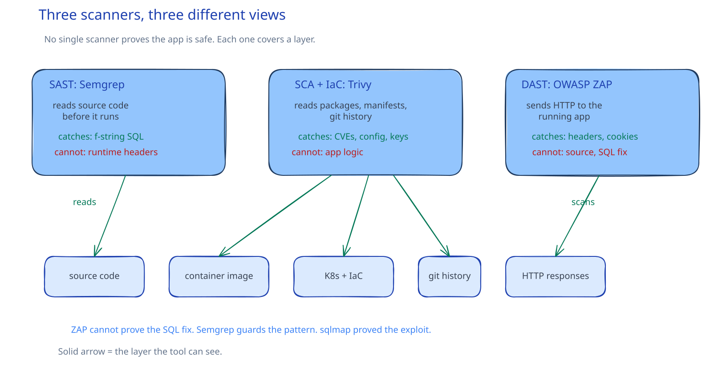

# CSC-23: Scan and verify

**Act 4, Cybersecurity Engineer** · Focus: Security Engineer (AppSec) · About 20 minutes

You fixed the bug by reading the code. Today, three tools check that it stays fixed, automatically, on every future commit. One tool per layer: source code, supply chain, running app.

| | |
|---|---|
| You need | Episode 22 complete. The fixed search query and the NetworkPolicies are live. |
| You build | A Semgrep rule, Trivy scan reports, a ZAP baseline scan of the frontend, and a pull request workflow |
| Done when | Semgrep is clean on the fixed code, every Trivy finding is recorded, the ZAP header warnings are fixed, and the workflow fails on a pull request that reintroduces the bug |

## What you will be able to do

- Catch an injection pattern in source code with Semgrep.
- Scan images, Dockerfiles, Kubernetes YAML, and Terraform with Trivy.
- Check the running app's HTTP response headers with OWASP ZAP.
- Wire SAST and SCA into a pull request workflow.

## Before you start

- Episode 22 complete. The search query uses a parameterized query.
- The Minikube cluster is running with the app deployed from Episode 22.
- Docker Desktop is running, so the scanner images can run locally.

## One scanner cannot see everything

No single scanner catches everything. SAST reads code that never ran. DAST tests what actually runs. SCA watches the supply chain that neither of those look at. Different layers need different views. Three tools in this episode cover three layers, one per layer.

| Term | What it reads | Tool in this episode |
|---|---|---|
| SAST, Semgrep | Source code, without running it. It matches a pattern you describe against every file. | Reads the backend source and flags the f-string injection pattern. |
| SCA, [[cloud/infrastructure-as-code|IaC]], and secrets, Trivy | Container images, Dockerfiles, Kubernetes YAML, Terraform, and credentials committed to the repository. | Reports base image vulnerabilities, misconfigurations, and any committed secret. |
| DAST, OWASP ZAP | The running app over HTTP, the same way a user or an attacker sees it, with no view of the source code. | Checks the response headers and cookies the browser receives. |
| Workflow | The checks, running on every pull request. | Runs the Semgrep and Trivy scans before code can merge. |

An AppSec Engineer's job is wiring these together so a fix stays fixed. Without the wiring, the same bug returns on the next commit and someone finds it by hand again. The three scans also have different limits, and knowing the limit of each one matters more than the number of tools. A clean result from one tool proves nothing about another layer.

## SAST: Semgrep

SAST reads source code without running it. Semgrep matches a pattern you describe against every file in the repository. The pattern in this episode flags an f-string passed to the database `execute` call, the exact shape of the bug from Episode 21. You write the rule once, in your own rule file under `tools/semgrep/`, and the scan runs it against the backend.

On the fixed code, the scan reports no findings. Temporarily put the f-string back and run it again, and Semgrep flags the exact line. Revert the change. That round trip is the proof the rule works: silent on good code, loud on the bad pattern. Use your own rule file, not only Semgrep's registry rules. The registry rules may not catch this exact f-string pattern, so the workflow must run your rule as well.

## SCA, IaC, and secrets: Trivy

Trivy checks three different things with one tool. It looks for known vulnerabilities in the packages inside your images (SCA). It looks for misconfigurations in Dockerfiles, Kubernetes YAML, and Terraform (IaC). And it looks for credentials accidentally committed to the repository (secrets). The scanner service mounts your Docker socket, so it can inspect a local image by name without pushing anything to a registry.

Run all three kinds of scan. The image scan reports the vulnerabilities in the backend base image. The config scan reports the state of the Kubernetes manifests. The secret scan is clean, since this course never commits credentials. Not every finding needs a fix today. Record every finding you do not fix, and say why. An unrecorded finding is invisible to the next person and to the next scan.

## DAST: OWASP ZAP

DAST tests the running app over HTTP, the same way an attacker or a user would, with no view of the source code. The baseline scan is passive by default: it crawls the app and checks headers and cookies, not full active attacks. That makes it safe to run against your own app repeatedly. It also sets its limit. The baseline scan sends no injection payloads, so it cannot prove the SQL injection fix. `sqlmap` proved that in Episode 21, and Semgrep now guards the pattern in source. ZAP covers the HTTP layer around it: the headers every browser receives.

Target the frontend, not the backend. The backend has no page at the root path, and its responses carry Flask headers. The headers in this episode live in `frontend/nginx.conf`, so the scan must go through Nginx. Run the scanner as a Pod inside the cluster, the same reasoning as `sqlmap`: it reaches the app by Service name, and nothing is exposed beyond the cluster. The Pod carries the scanner label, which is how the NetworkPolicy lets it reach the frontend. Without that label, the default-deny egress rule blocks the scan and the Pod fails with a connection timeout.

A few details decide whether the scan succeeds. The `-I` flag keeps the Pod successful when the only result is warnings. Without it, the baseline script exits with code 2 and the wait command never sees `Succeeded`, even though the report is complete. Read the findings from the Pod log. Do not copy a report out of the exited container: its process is gone, so the copy command cannot run inside it. The working directory volume is required even without a report option, because the scanner script refuses to start with file-based options unless that directory is a mount. The starter rules file silences two informational findings only (cacheable content and modern web application). Every header finding still reports.

Before the header fix, the log lists the missing anti-clickjacking header, the missing `X-Content-Type-Options` header, the missing Content Security Policy, the missing Permissions Policy, and the Nginx version leak. It reports no injection, because this scan sends no injection payloads.

## Nginx security headers

These headers close the rest of the report. Each one does one job. One stops the browser guessing a file's type. One stops the page being framed by another site. One limits where the page may load code from. One switches off browser APIs this app does not use. And the version banner comes off the server header and the error pages.

| Header | What it does |
|---|---|
| `server_tokens off` | Removes the Nginx version from the `Server` header and error pages. |
| `X-Content-Type-Options: nosniff` | Stops the browser sniffing a file's type instead of trusting its declared type. |
| `X-Frame-Options: DENY` | Stops the page from being framed by another site (clickjacking). |
| `Content-Security-Policy` | Limits where the page may load code from. |
| `Permissions-Policy` | Switches off browser APIs this app does not use, such as geolocation, camera, and microphone. |

The Content Security Policy needs its fallback directives as well. Without them, ZAP raises the CSP rule about a directive with no fallback. After the headers are added and the frontend is rebuilt, re-run the same scan Pod. The anti-clickjacking, `X-Content-Type-Options`, CSP, Permissions Policy, and version leak findings disappear. One Low finding remains, about Cross-Origin policies. Record it and leave it: those policies need every cross-origin resource to cooperate, and this app loads none.

## Wire the checks into pull requests

Semgrep and Trivy need no running app, so they run on every pull request. ZAP needs the app running, which a GitHub Actions runner does not have by default in this course, so ZAP stays a manual, documented step. Add a security workflow that runs the Semgrep scan with your rule file and the Trivy scans on every pull request to main as well. A pull request that reintroduces the f-string fails the workflow before it can be merged. A clean ZAP report is never proof of safety. It is a passive baseline scan, not a full penetration test.

## Common mistakes

- **Scanning the backend API and expecting Nginx header findings.** The headers live in Nginx. Scan the frontend.
- **Waiting for `Succeeded` without `-I`.** Warnings make the baseline script exit 2, so the Pod ends failed even though the report is complete.
- **Treating a clean ZAP report as proof of safety.** It is a passive baseline scan, not a full penetration test.
- **Treating a ZAP report as proof of the SQL injection fix.** A passive scan sends no payloads. `sqlmap` and Semgrep cover that.
- **Wiring ZAP into the pull request workflow.** It needs a running app. Keep it manual and documented.
- **Leaving a Trivy finding unrecorded.** Note every finding you do not fix, and say why.

## Check your work

- [ ] Semgrep reports no findings on the fixed code.
- [ ] Semgrep flags the exact line when the f-string is temporarily reintroduced, and the change is reverted.
- [ ] The Trivy image scan, config scan, and secret scan each ran, and every unfixed finding is recorded with a reason.
- [ ] The ZAP scan targeted the frontend through Nginx, not the backend.
- [ ] The ZAP Pod reached `Succeeded` with warnings allowed.
- [ ] After the headers are added, the five header findings disappear.
- [ ] The security workflow runs the Semgrep and Trivy scans on pull requests.
- [ ] ZAP stays a manual, documented step.

## What this unlocks on your CV

| Skill | Episode | CV section | Example bullet |
|---|---|---|---|
| SAST (Semgrep) | 23 | Networking and security | Found a SQL injection pattern in source code with Semgrep |
| SCA, IaC, and secret scanning (Trivy) | 23 | Networking and security | Scanned images, Dockerfiles, Kubernetes YAML, and Terraform with Trivy |
| DAST (OWASP ZAP) | 23 | Networking and security | Hardened the Nginx response headers and verified them with an OWASP ZAP baseline scan |

## Career note

No single scanner catches everything. SAST reads code that never ran. DAST tests what actually runs. Trivy watches the supply chain neither one looks at. An AppSec Engineer's job is wiring these together so a fix stays fixed, not re-finding the same bug by hand every time.

## Next

Episode 24 finds a second real vulnerability: broken access control. Two users, one missing ownership check.

## Apply

The verified steps for this episode are in [Act 4, Episode 23](../act4-cybersecurity-engineer.md#scan-and-verify-episode-23). Follow the tasks in order.

<!-- APPLY -->

### What you should see

| After | You should see |
|---|---|
| You run Semgrep on the fixed code | No findings. |
| You temporarily reintroduce the f-string | One finding on the exact line. Revert the change. |
| You run the Trivy scans | A vulnerability report for the base image, a misconfiguration report for the manifests, and a clean secret scan. |
| You run ZAP before the headers | Warnings listing the missing anti-clickjacking and `X-Content-Type-Options` headers, the missing Content Security Policy, the missing Permissions Policy, and the Nginx version leak. No injection findings. |
| You add the headers and re-run ZAP | The five header findings disappear. One Low finding remains, `Cross-Origin-*-Policy Header Missing or Invalid` (90004). Record it and leave it. |
| You add the workflow | A pull request that reintroduces the f-string fails the workflow before it can be merged. |

An end-to-end run of this episode passed: Semgrep reported 0 findings on the fixed code and 1 on the vulnerable code, the Trivy image, config, and secret scans ran, and ZAP reported 5 warnings before the headers and 0 after.
