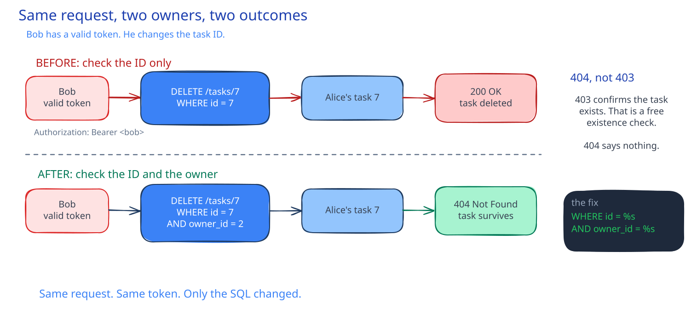

# CSC-24: Broken access control

**Act 4, Cybersecurity Engineer** · Focus: Security Engineer (defensive) · About 30 minutes

The SQL injection was a classic beginner bug. This one is more common, and far easier to miss: the app has no concept of mine versus yours. Today you add real users, then watch one user delete another user's task using nothing but their own valid login.

| | |
|---|---|
| You need | Episode 23 complete. `docker compose up --build` works from Episode 3. |
| You build | Real users with bcrypt and JWT, task ownership, and an IDOR fix with a regression test |
| Done when | One user can no longer modify another's task, and the check is locked in by a test |

## What you will be able to do

- Explain OWASP A01, Broken Access Control, and IDOR (Insecure Direct Object Reference) as one named pattern.
- Add real users: registration with bcrypt-hashed passwords, login with a signed JWT.
- Explain why "the request was authenticated" and "the request was authorized" are different questions.
- Reproduce an IDOR step by step, then close it with an ownership check.
- Choose 404 over 403 so a fix does not leak which objects exist.

## Before you start

- Episode 23 complete.
- `docker compose up --build` works from Episode 3.
- You can reset the local database volume. Warning: resetting deletes all data in your local database.

## Authentication is not authorization

Authentication answers "who are you?" Authorization answers "are you allowed to do this?" An app can get the first one right and still fail the second. OWASP ranks Broken Access Control (A01) as the number one web application risk, ahead of injection. Today's specific bug has a name: IDOR, Insecure Direct Object Reference. The app takes an ID straight from the request and acts on it, without checking that the caller owns the thing that ID points to.

| Term | Meaning |
|---|---|
| Authentication | Who are you. Login with bcrypt and a JWT. |
| Authorization | Are you allowed. Per-object ownership. |
| OWASP A01, Broken Access Control | Ranked number one. Permissions the app does not check. |
| IDOR | An ID from the request is used without an owner check. |
| 404 over 403 | Not yours looks the same as does not exist. |

"Authenticated" and "authorized" are two different questions. A token proves who made the request. It says nothing about whether that person may touch the object named in the request. The app in this episode gets the first question right and the second one wrong, and that gap is the whole vulnerability.

## Add real users

The app has never had users. Add a users table with a username and a password hash. Add a registration endpoint that stores the password as a salted hash, never as the password itself. Even reading the database cannot recover the original password from a salted hash. Add a login endpoint that checks the password and returns a signed token.

A JWT is a signed claim, not a secret the server stores per session. Anyone with the signing key can verify that a token is genuine, and nobody without the key can forge one. The signing key is a new environment variable, read the same way the database password is: required, never defaulted, and never committed. Every task route now requires a bearer token in the `Authorization` header. The health, readiness, metrics, and demo endpoints stay public on purpose: probes and the load generator have no login.

## Scope tasks to their owner

Every task now belongs to a user, through an owner column. List, create, and search filter by the caller instead of reading the whole table. Two different users see two different, non-overlapping task lists. That part is correct on purpose. It makes the bug harder to spot, because the correct part sits next to the broken part. The list endpoint starts from the question "what is mine?" The direct-access endpoints start from the question "what is this ID?" List endpoints are easy to get right for that reason. Direct-access endpoints are easy to get wrong for the same reason.

## Reproduce the IDOR, step by step

The list is scoped correctly. The bug is somewhere else: the endpoints that take a task ID directly. Find it the same way a real attacker would, with two real accounts. Start the stack, register two users, log in as both, and save each token. One user creates a task and saves its ID from the response. Then confirm the second user's own list is empty. That empty list matters: it proves the list endpoint is correctly scoped, so the bug is not there. Then the second user deletes the first user's task by ID, using only their own valid token. The request succeeds, even though the second user never saw that task in their own list.

Task IDs are sequential integers, starting at 1. The attacker did not need to guess the ID. They could enumerate every ID from 1 upward and delete or modify whatever existed. That is what makes this an IDOR, not a one-off mistake: the object reference itself is the attack surface. The same attack is available as one page in the security console at `/pentest`, served by the same frontend. It calls the same API over the same origin, nothing simulated. Open it through the Compose stack, never through a static file previewer, which has no API proxy and rejects the register and login requests.

## Fix: check ownership, not just existence

The update and delete queries filter by the task ID and the owner at the same time. A task that exists but belongs to someone else, and a task that does not exist at all, now look identical to the caller: both return 404. Returning 403 instead would confirm "this task exists, you just cannot touch it," which hands an attacker a free existence check across every ID. Choosing 404 gives away nothing about which objects exist. That is the secure error design this fix depends on: the fix must not turn into an oracle.

Rebuild the backend and run the exact same attack again. Create a new task as the first user. Delete it as the second user. Now the request returns 404 and the task survives. Then delete it as the owner: that still works. The fix removes one specific permission, not the feature. The same page in the security console gives the opposite verdict after the fix: safe, with the task untouched. That is the proof the fix works, not a new test written to match the fix.

## Write the regression test

Add the test imports, a token helper that signs a token for a user ID, and an auth header helper. Then add a test that calls delete for a task ID with a token for a different user, and asserts that the response is 404, that the executed SQL contains the owner filter, and that the parameters carry both the task ID and the caller ID. The assertion checks the SQL and its parameters, not only the response. A test that only checks the [[status-code|status code]] would keep passing even if the ownership filter were quietly removed again, as long as some database state happened to return the right status. Update the two earlier delete-endpoint tests so they send the auth header.

## Common mistakes

- **Scoping the list endpoint and assuming every other endpoint is now safe by association.** Check each endpoint that takes an ID on its own.
- **Returning 403 for an object the caller does not own.** It confirms the object exists. Prefer 404.
- **Testing only "did the request succeed," never which row the query actually touched.** Assert the SQL and its parameters.
- **Storing a password instead of a hash, or hashing without a per-password salt.** The hashing library's salt function handles this. Never write your own.
- **Opening `/pentest` with a static file previewer instead of the Compose stack.** A static server has no API proxy, so register and login fail inside the previewer, not inside the app.

## Check your work

- [ ] Registration returns an ID and a username, never a password.
- [ ] Two logged-in users see two non-overlapping task lists.
- [ ] Before the fix, deleting another user's task returns status 200.
- [ ] After the fix, the same delete returns status 404 and the task survives.
- [ ] The owner can still delete their own task.
- [ ] The regression test asserts the owner filter and both parameters in the SQL.
- [ ] The full test suite passes.

## What this unlocks on your CV

| Skill | Episode | CV section | Example bullet |
|---|---|---|---|
| OWASP A01, Broken Access Control, IDOR | 24 | Networking and security | Identified and reproduced an Insecure Direct Object Reference end to end |
| Authentication (bcrypt, JWT) | 24 | Programming and scripting | Implemented registration and login with bcrypt-hashed passwords and signed JWT bearer tokens |
| Authorization (ownership checks) | 24 | Programming and scripting | Added per-object ownership checks that stopped one authenticated user from modifying another's data |
| Secure error design (404 vs. 403) | 24 | Networking and security | Chose a response code that fixed an access control bug without creating an object-existence oracle |

## Career note

This bug shipped because building the feature and securing the feature felt like the same task, so the second half got skipped. Every endpoint that accepts an ID from the caller needs the same question asked of it: does this caller own this object? List endpoints start from "what is mine." Direct-access endpoints start from "what is this ID." The second question is where the bugs live.

## Next

Episode 25 encrypts secrets for Git. The app gets a second real secret, its JWT signing key, and a safe way to commit it, encrypted.

## Apply

The verified steps for this episode are in [Act 4, Episode 24](../act4-cybersecurity-engineer.md#broken-access-control-episode-24). Follow the tasks in order.

<!-- APPLY -->

### What you should see

| After | You should see |
|---|---|
| You register the two users | `{"id":1,"username":"alice"}` and `{"id":2,"username":"bob"}`. |
| You list the second user's tasks before the fix | An empty list, `[]`. |
| You delete the first user's task as the second user before the fix | `status=200`. |
| You re-run the same delete after the fix | `status=404`. The task survives. |
| You delete your own task as the owner | Success. The fix removes one permission, not the feature. |
| You run the unit tests | 11 tests pass. |

An end-to-end run of this episode passed: the IDOR returned `status=200` before the fix and `status=404` after, 11 unit tests passed, and `/pentest` returned 200 after the Nginx fix.
