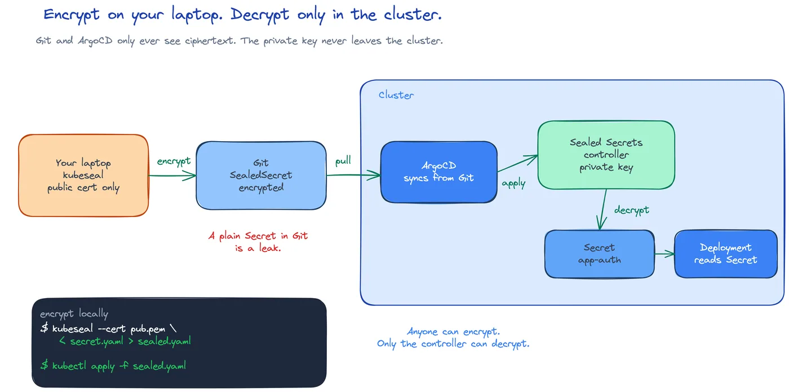

# CSC-25: Encrypt secrets for Git

**Act 4, Cybersecurity Engineer** · Focus: DevOps Engineer · About 30 to 35 minutes

Since Episode 13, every Secret in this app has been created by hand, on the command line, and never committed. That kept the values out of Git, but it also kept ArgoCD from ever managing them. Today that changes. The Secret stays secret, and the file goes in Git.

| | |
|---|---|
| You need | Episode 24 complete. A Minikube cluster with the app deployed from Act 3. |
| You build | The Sealed Secrets controller in `kube-system`, sealed `app-db` and `app-auth` in `kubernetes/app/08-sealed-secrets.yaml`, with `JWT_SECRET` wired into the backend Deployment |
| Done when | The controller decrypts both SealedSecrets into ordinary Secrets, the backend runs with the sealed values, and the sealed file is safe to commit for ArgoCD |

## What you will be able to do

- Explain why plain Kubernetes Secrets cannot go in Git, and why that kept Secrets outside GitOps since Episode 17.
- Install the Sealed Secrets controller and fetch its public certificate.
- Encrypt a Secret with `kubeseal`, offline, using only the public certificate.
- Explain why `kubeseal` can encrypt but never decrypt.
- Let ArgoCD manage a Secret for the first time.

## Before you start

- Episode 24 complete, with `app-auth` and the JWT flow from the authenticated endpoints.
- A Minikube cluster with the `app` Application deployed from Act 3.
- The `tools/compose.yaml` file with the `kubeseal` service, so sealing runs as a container.

## Why plain Secrets cannot go in Git

A Kubernetes Secret only base64-encodes its value. Base64 is encoding, not encryption. Anyone who can read the file can decode it and read the Secret. You saw this in Episode 13. A Secret in YAML looks like this in plain form:

```yaml
apiVersion: v1
kind: Secret
metadata:
  name: app-db
  namespace: app
data:
  password: <base64 of the real password>
```

The `data` field is readable by anyone with access to the repository. A base64 string in Git is the same as plaintext in Git. GitOps wants everything in Git, including Secrets, so that the cluster matches Git and every change is a commit that can be reviewed and rolled back. Committing base64 breaks that promise. The value is in Git history forever, even if you delete the file later.

That is why `app-db` has always been the exception. In Act 3 you created it once, by hand, and kept it out of the repo. ArgoCD never managed your database password. In Episode 24 you added a second Secret for `JWT_SECRET`. It has the exact same problem. A second hand-made Secret makes the exception harder to remember and easier to forget after rebuilding a cluster.

A DevOps engineer needs a way to put a Secret in Git without putting the plaintext in Git. Sealed Secrets closes that gap.

## Public, private, sealed

Sealed Secrets works with a keypair. A controller runs inside the cluster. It generates a private key and never shares it. It publishes the matching public key. You encrypt with the public key. Only the controller, with the private key, can decrypt.

| Term | Meaning |
|---|---|
| Base64 | Encoding only. Anyone with the file can read it. Not encryption. |
| Controller | Holds the private key. Never shares it. Decrypts SealedSecrets in the cluster. |
| Public certificate | Safe to commit. Anyone can encrypt with it. |
| kubeseal | Encrypts only. No decrypt flag, on purpose. |
| SealedSecret | Ciphertext in Git, ordinary Secret in the cluster. |

The flow has three steps:

1. Your laptop holds only the public certificate. It pipes a plaintext Secret straight to `kubeseal`.
2. Git and ArgoCD carry the `SealedSecret`. The `SealedSecret` syncs like any other manifest.
3. The cluster holds the private key. The controller decrypts the `SealedSecret` into an ordinary Secret that your Deployments already read from, exactly as before.



The ciphertext in Git is useless on its own. Without the one cluster that generated the keypair, nobody can unseal it. Committing it does not leak the value. Removing the hand-made exception also removes a gap: the cluster can match Git, with no Secrets created by hand.

You fetch the public certificate exactly once per cluster. After that, sealing works completely offline. That is different from the cloud credentials in Episode 10, which needed a live connection to GCP every time you used them. Here, `kubeseal` needs the cluster once, to fetch the certificate, and then runs for you with no connection at all. State that before you run the command, so the offline step is clear.

## Install the controller and fetch the certificate

The controller lives in `kube-system`, alongside Minikube's own components, not in `app`. Install it from the vendored manifest in the starter repository:

```shell
minikube kubectl -- apply -f kubernetes/sealed-secrets/controller.yaml
minikube kubectl -- -n kube-system rollout status deploy/sealed-secrets-controller
```

You should see the rollout finish. Do not move the controller into `app`. It is a cluster-wide component, and the keypair it holds must stay outside the application namespace.

Fetch the public certificate from the controller's key Secret:

```shell
minikube kubectl -- get secret -n kube-system \
  -l sealedsecrets.bitnami.com/sealed-secrets-key \
  -o jsonpath='{.items[0].data.tls\.crt}' | base64 -d > kubernetes/sealed-secrets/pub-cert.pem
```

This file is the public half of the keypair. Committing it is fine. It can only encrypt, never decrypt. Before you install the controller, delete any hand-made Secrets it would need to replace. The controller does not overwrite a Secret that it does not manage. If `app-db` or `app-auth` still exists from a hand-made create, the `SealedSecret` will report that it already exists and is not managed by SealedSecret. Delete first, then apply.

```shell
minikube kubectl -- delete secret app-db app-auth -n app --ignore-not-found
```

Expect the backend Pods to fail until you apply the SealedSecrets. That is normal. The Deployments read from Secrets, and you have removed the only copies. Apply the sealed versions in the next step.

## Seal the secrets offline

Sealing has three parts: build the plaintext manifest without sending it to the cluster, pipe it to `kubeseal`, and write only the sealed output to a file.

Build the plaintext manifest with a client-side dry run:

```shell
minikube kubectl -- create secret generic app-db -n app \
  --from-literal=username=tutorial --from-literal=password="$(openssl rand -hex 16)" \
  --dry-run=client -o yaml \
  | docker compose -f tools/compose.yaml run --rm -T kubeseal \
      --cert kubernetes/sealed-secrets/pub-cert.pem --format yaml \
  > kubernetes/app/08-sealed-secrets.yaml
```

The `--dry-run=client -o yaml` builds the plaintext manifest on your laptop. It does not send the Secret to the cluster. The pipe sends it to `kubeseal` inside the container. The file on disk is never written on its own, so plaintext never touches the filesystem. The `-T` flag on `docker compose run` turns off the pseudo-terminal. Piped input then reaches the container's stdin. Without `-T`, the pipe breaks and `kubeseal` receives nothing.

Use the same database username as Episode 13. This example uses `tutorial`. A different name creates a role that PostgreSQL does not have, and the database will refuse the login.

Seal the JWT signing key the same way, appending a second document to the same file:

```shell
minikube kubectl -- create secret generic app-auth -n app \
  --from-literal=jwt-secret="$(openssl rand -hex 32)" \
  --dry-run=client -o yaml \
  | docker compose -f tools/compose.yaml run --rm -T kubeseal \
      --cert kubernetes/sealed-secrets/pub-cert.pem --format yaml \
  >> kubernetes/app/08-sealed-secrets.yaml
```

Wire the JWT value into the backend Deployment, the same way `DB_PASSWORD` already reads from `app-db`. Add this to the backend container env in `kubernetes/app/04-deployments.yaml`:

```yaml
- name: JWT_SECRET
  valueFrom:
    secretKeyRef:
      name: app-auth
      key: jwt-secret
```

`kubeseal` can encrypt but never decrypt. That is on purpose. There is no decrypt flag. The only way back to plaintext is applying the `SealedSecret` to the cluster that holds the matching private key. If you seal with the public certificate, you cannot unseal on your laptop, read the compiler output, or undo a seal without the cluster. Anyone can encrypt. Only the controller can decrypt.

## Apply and let ArgoCD manage them

Apply the sealed file. The controller decrypts both `SealedSecret` objects into ordinary Secrets in `app`:

```shell
minikube kubectl -- apply -f kubernetes/app/08-sealed-secrets.yaml
minikube kubectl -- get secrets -n app
```

You should see `app-db` and `app-auth` as ordinary Secrets, created by the controller, not by you directly. The file `kubernetes/app/08-sealed-secrets.yaml` is safe to commit. Only the cluster that generated the keypair can unseal it.

The sealed `app-db` uses a new random password. The existing PostgreSQL volume still has the old password. Running Pods also keep old environment values. Reset both, so the app reads the sealed values:

```shell
minikube kubectl -- scale statefulset postgres -n app --replicas=0
minikube kubectl -- delete pvc postgres-data-postgres-0 -n app
minikube kubectl -- scale statefulset postgres -n app --replicas=1
minikube kubectl -- rollout restart deployment/backend -n app
minikube kubectl -- rollout status deployment/backend -n app
```

Deleting the PVC deletes the database data. That warning matters. Postgres initializes only on an empty data directory, with the new password from the sealed Secret.

`kubernetes/argocd/applications/app.yaml` already points at the whole `kubernetes/app` folder. The sealed file is just another file in it now. ArgoCD syncs the `SealedSecret` like any other manifest:

```shell
git add kubernetes/app/08-sealed-secrets.yaml kubernetes/app/04-deployments.yaml kubernetes/sealed-secrets
git commit -m "Seal app-db and app-auth, manage them with ArgoCD"
git push
```

For the first time, a Secret's lifecycle lives in Git, not only on your command-line history. A fresh cluster can fetch the same public certificate, reseal, and match Git again. The cluster matches Git, with no hand-made exceptions.

## Common mistakes

- **Running `kubeseal` without `--cert`.** It then tries to reach the cluster directly, which defeats offline sealing and needs credentials you should not hand the tool. Always pass `--cert kubernetes/sealed-secrets/pub-cert.pem`.
- **Forgetting `-T` on `docker compose run`.** The piped plaintext Secret never reaches `kubeseal`'s stdin. Keep `-T`.
- **Committing the plaintext by mistake.** The `--dry-run=client -o yaml` output has a `data` field. The sealed output has `encryptedData`. Check for `encryptedData`, not `data`, before `git add`.
- **Reusing old sealed files on a new cluster.** Each cluster has its own keypair. Fetch a fresh `pub-cert.pem` and reseal for the new cluster. Old ciphertext will not decrypt.
- **Applying over a hand-made Secret.** Delete `app-db` and `app-auth` first, or the `SealedSecret` reports it already exists and is not managed.
- **Sealing a new database password without resetting the volume.** Postgres keeps the old password, so the backend cannot connect. Delete the PVC and restart Postgres.
- **Forgetting to restart the backend.** Running Pods keep old environment values until they restart. Restart the Deployment after sealing.
- **Using a different database username.** `tutorial` matches the role Postgres created. Another name creates a login failure.

## Check your work

- [ ] `kubernetes/sealed-secrets/pub-cert.pem` exists and was fetched from the controller.
- [ ] `kubernetes/app/08-sealed-secrets.yaml` contains two documents with `encryptedData`, not `data`.
- [ ] `minikube kubectl -- get secrets -n app` shows `app-db` and `app-auth` created by the controller.
- [ ] The old hand-made Secrets are gone.
- [ ] Postgres runs with the new sealed password after the PVC reset.
- [ ] The backend Deployment has `JWT_SECRET` from `app-auth` and rolls out ready.
- [ ] The sealed file is committed, and ArgoCD manages it from Git.

## What this unlocks on your CV

| Skill | Episode | CV section | Example bullet |
|---|---|---|---|
| Secrets encryption for GitOps (Sealed Secrets) | 25 | Networking & Security | Encrypted Kubernetes Secrets with Sealed Secrets so they could be committed to Git and managed by ArgoCD |
| Asymmetric encryption, applied | 25 | Networking & Security | Explained and used a public/private keypair where only the cluster could decrypt |

## Next

Episode 26 is the finale. You combine every skills ledger row into one CV and build it as a PDF.

## Apply

The verified steps for this episode are in [Act 4, Episode 25](../act4-cybersecurity-engineer.md#encrypt-secrets-for-git-episode-25). Follow the tasks in order.

<!-- APPLY -->

### What you should see

| After | You should see |
|---|---|
| You install the controller | `rollout status deploy/sealed-secrets-controller` finishes in `kube-system`. |
| You fetch the certificate | `kubernetes/sealed-secrets/pub-cert.pem` holds the public certificate. |
| You seal `app-db` | `08-sealed-secrets.yaml` has a `SealedSecret` with `encryptedData` and unreadable ciphertext. |
| You seal `app-auth` | The same file holds two documents separated by `---`: `app-db` and `app-auth`. |
| You apply the file | `get secrets -n app` shows `app-db` and `app-auth` as ordinary Secrets created by the controller. |
| You reset the volume and restart | Postgres runs with the new password and the backend reaches ready. |

An end-to-end run of this episode passed after fixes: the controller decrypted both SealedSecrets once the hand-made Secrets were deleted, the PVC reset let Postgres start with the sealed password, the backend reached ready, and the IDOR returned 404 on Kubernetes.
